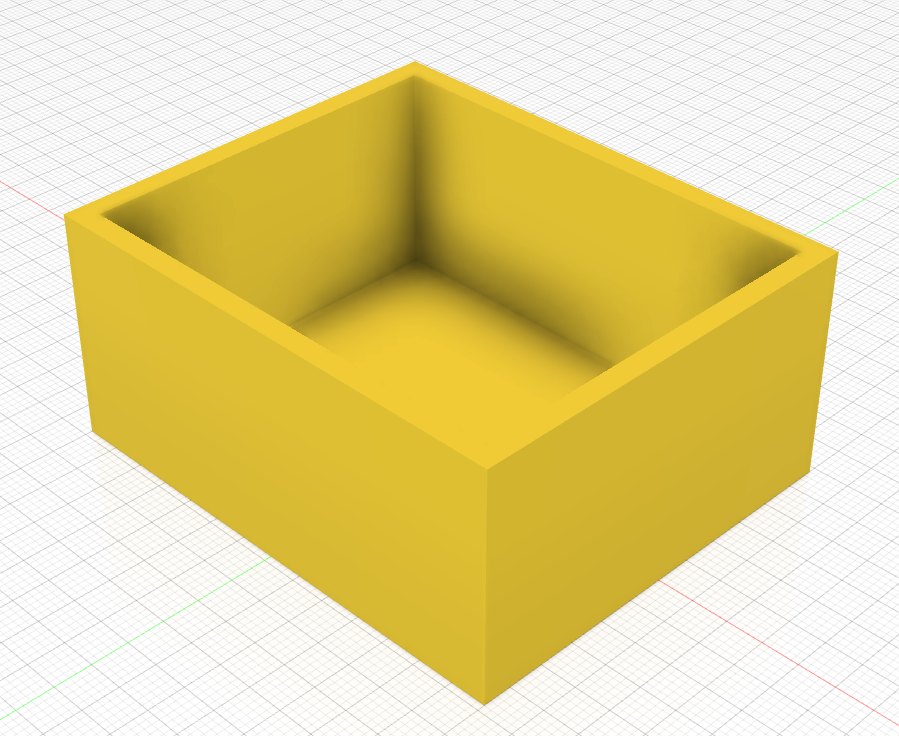

{:class="cover"}

---

Next a shell is applied to the extruded base cube, making it more into the familiar shape, if not a little blocky.

* Shell thickness = 3mm

{:class="img-fluid w-75 m-3"}

---
