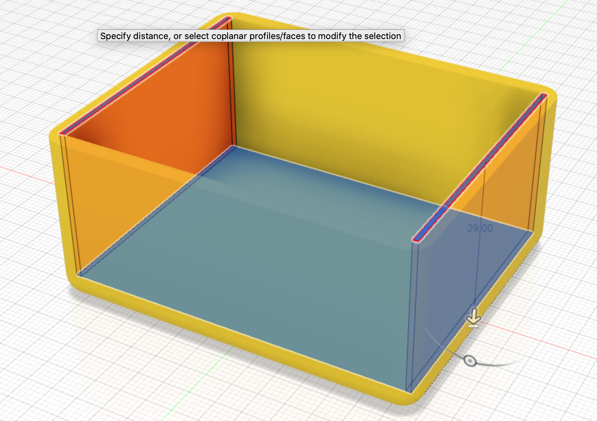

The Front and Back sides are currently the case thickness from the shell we applied earlier. This needs to be trimmed down so that they are only 2mm thick.

{:class="img-fluid w-75 m-3"}

## Check your understanding


? What does the **Shell** tool do to the extruded base?
- [ ] Rounds off the corners
- [x] Hollows it out, leaving walls of a set thickness
- [ ] Copies it to the other side
> Shell removes the inside of a solid and leaves walls 3mm thick, giving us the open box shape of the chassis.

? How big is the chassis base sketch?
- [x] 70mm long and 58mm wide
- [ ] 58mm long and 32mm wide
- [ ] 100mm long and 70mm wide
> The base is 70mm by 58mm, then extruded 32mm high.

? Why do we add a 4mm fillet to the bottom edges and corners?
- [ ] To make the walls thinner
- [ ] So the Arduino fits
- [x] To round the edges so the chassis looks and feels better
> Fillets round sharp edges. On a 3D print they also make corners stronger and nicer to handle.

