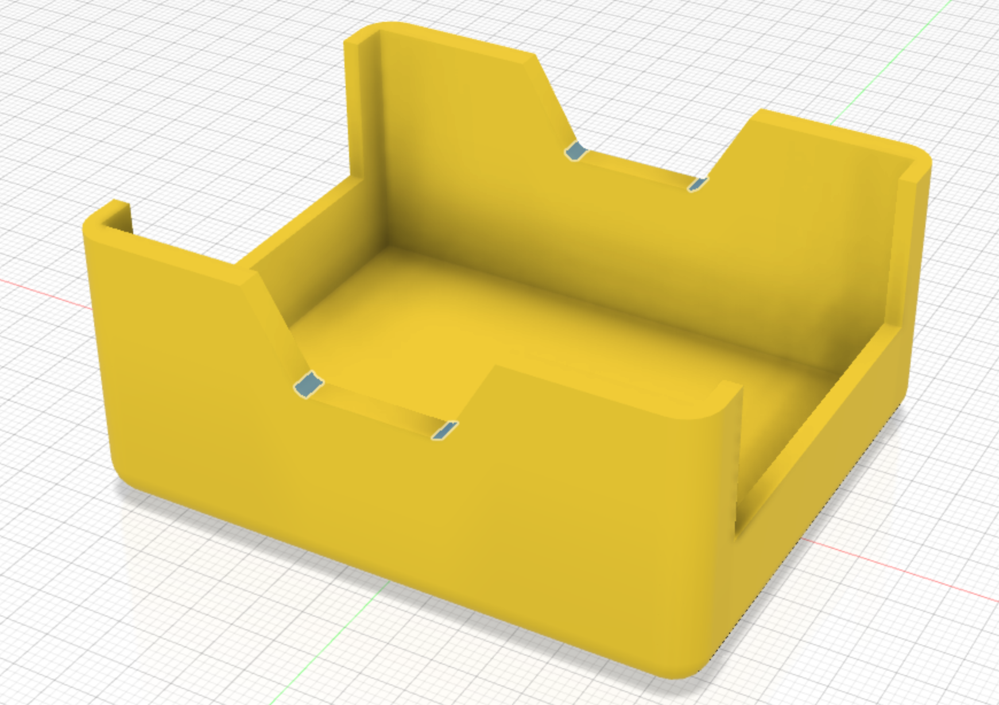

{:class="cover"}

---

By the end of this lesson you will be able to choose the right fillet size for a small edge, and explain why it is smaller than the earlier fillet.

---

After the side cut, the chassis has some new, sharp inside edges around the notch. They look rough next to the smooth 4mm curves we added earlier, and they can be snag points. A fillet fixes both.

## A smaller fillet

A small fillet of 1.5mm is applied to round the inner edges of the [cutout](09_sidecut.html) that has just been applied.

{:class="img-fluid w-75 m-3"}

This is the same Fillet tool as in lesson 4 but with a much smaller radius, 1.5mm. A big fillet on a small edge simply would not fit. The notch walls are only 3mm thick, so a gentle 1.5mm curve softens the edge without eating into the wall.

## Choosing a fillet size

A good rule of thumb is that the fillet should be clearly smaller than the wall or edge it sits on. Compare:

| Where | Fillet | Why |
| --- | --- | --- |
| Bottom edges and corners | 4mm | Large, visible curves on a large body |
| Side cut-out edges | 1.5mm | Small curves on a thin, 3mm wall |
{:class="table table-single"}

## What to check

Zoom in on the notch. The edges you selected should be smooth, and the notch shape should still look like a trapezium. If it has gone lumpy or has gaps, the radius may be too big for the geometry.

## Common Issues

- **Problem**: The fillet fails with an error.
- **Solution**: Check you typed 1.5mm, not 15mm, and that the selected edges are the inner edges of the notch.
- **Why**: A fillet cannot be bigger than the geometry beside it, and a stray decimal point makes it ten times too large.

- **Problem**: I cannot select the inner edges.
- **Solution**: Orbit and zoom closer so the edges highlight, or use the timeline to check the cut came first.
- **Why**: You can only fillet edges that already exist, so the cut has to be done before the fillet.

## Try it Yourself

1. Edit the fillet and try 1mm and 2mm. Can you tell the difference by eye?
2. Compare the 4mm and 1.5mm curves by zooming in on each.
3. Challenge: what is the biggest fillet you think this wall could take before it fails? Try it and see.

## Check your understanding


? What size is the fillet on the side cut-outs?
- [ ] 4mm
- [x] 1.5mm
- [ ] 3mm
> The side cut-out edges get a 1.5mm fillet. The 4mm one is for the base edges and corners.

? Why is this fillet smaller than the first one?
- [x] It is on a small, thin edge, so a large fillet would not fit
- [ ] Fusion limits all fillets to 1.5mm
- [ ] Smaller fillets print faster
> A fillet has to be smaller than the geometry it sits on.

? Why must the cut come before this fillet?
- [ ] Fusion does not allow fillets first
- [x] The edges to be rounded do not exist until the cut has been made
- [ ] Fillets only work on cuts
> A fillet needs existing edges, and the cut creates them.

