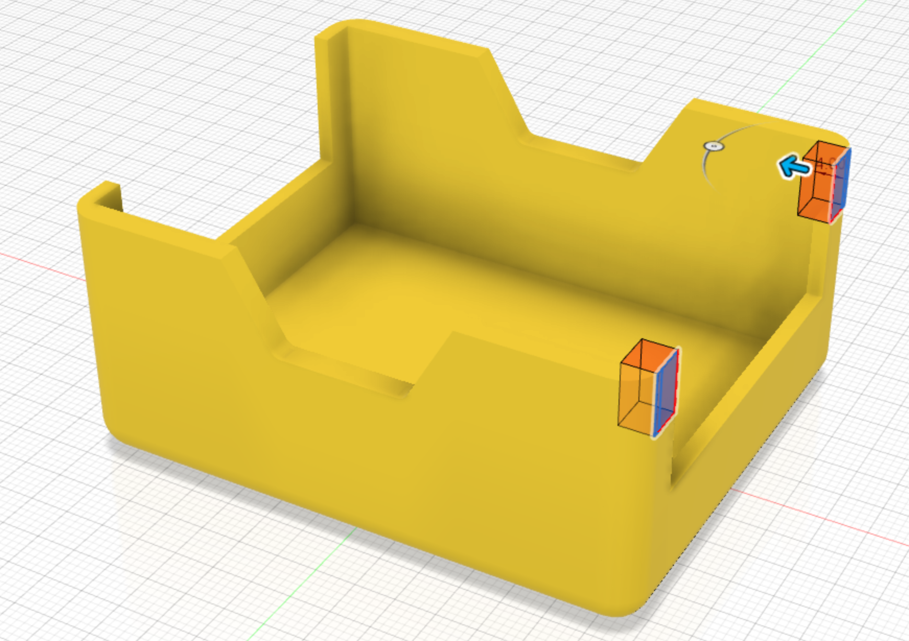

The [profile created above](11_back.html) is used to extrude a cut through the back side of the body. This is where the Arduino will slide in. The slots will come shortly.

{:class="img-fluid w-75 m-3"}

## Check your understanding


? How do you cut a shape out of a solid body in Fusion 360?
- [ ] Draw the shape and press Delete
- [x] Sketch a profile, then Extrude it with the operation set to **Cut**
- [ ] Use the Shell tool on the profile
> An extrude can join, cut or create a new body. Setting it to Cut removes material wherever the profile passes through.

? What shape is the side cutout profile?
- [ ] A circle
- [ ] A rectangle
- [x] An inverted trapezium
> The 28mm top, 16mm bottom trapezium gives SMARS its classic tank-like side shape.

