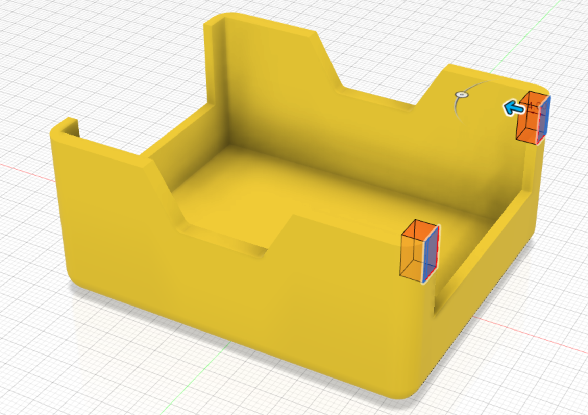

{:class="cover"}

---

By the end of this lesson you will be able to cut an opening through one wall of a body and check that the cut went the right distance.

---

This lesson uses the profile from the last one. By the end of it, the back of the chassis has the doorway that the Arduino slides into.

## Cutting the back

The [profile created above](11_back.html) is used to extrude a cut through the back side of the body. This is where the Arduino will slide in. The slots will come shortly.

{:class="img-fluid w-75 m-3"}

It is the same recipe as the front and side cuts: Extrude, with the operation set to **Cut**. The difference this time is that the opening belongs to the back wall, so keep an eye on the distance and the direction, and check the result against the picture. The picture shows the result you are aiming for.

## Why the slots come after

You may wonder why we cut the opening first and the slots later. The opening makes a doorway in the wall. The slots, which we add in the last two lessons, are small grooves along the inside that grip the edges of the board so it stays put. We cut the big shape first, then add the fine detail, which is how most CAD designs are built.

## What to check

Look at the back of the chassis. The opening should be a clean rectangle, with the wall still intact at each side and above it. Look inside: there should be no extra material cut away from the front wall.

> **Teachers**: this is a good point to ask learners to save a numbered version of their file. If the later steps go wrong, they can open the earlier version rather than starting again.

## Common Issues

- **Problem**: The cut also removed part of the front wall.
- **Solution**: Edit the cut and reduce its extent so it only affects the back wall.
- **Why**: A cut that goes all the way through removes everything in its path.

- **Problem**: Nothing seems to have been cut.
- **Solution**: Check the operation is Cut and that the direction points into the body.
- **Why**: If the direction points away from the body, there is no material to cut.

## Try it Yourself

1. Save your design, then try changing the cut distance in the timeline to see what it does.
2. Look at the opening from inside the chassis. Which way would a board slide in?
3. Challenge: sketch on paper how the Arduino board would sit in this opening, and where the slots would hold it.

## Check your understanding


? What is the back opening for?
- [x] It is where the Arduino slides in
- [ ] It holds the motors
- [ ] It is for the wheels
> The back cut is where the Arduino will slide in.

? How do you cut a shape out of a solid body in Fusion?
- [ ] Draw the shape and press Delete
- [x] Sketch a profile, then Extrude it with the operation set to Cut
- [ ] Use the Shell tool on the profile
> An extrude can join, cut or create a new body. Cut removes material wherever the profile passes through.

? Why are the slots cut after the main opening?
- [ ] Fusion forces this order
- [x] The big shape comes first and the fine detail is added afterwards
- [ ] The slots need a fillet first
> The opening gives the doorway, and the slots are small details added to it.

