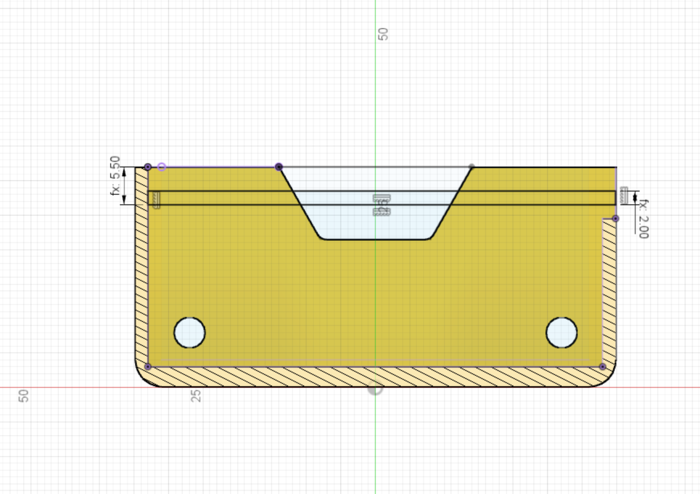

{:class="cover"}

---

By the end of this lesson you will be able to sketch a narrow slot profile using a height and an offset from a reference edge.

---

The back opening lets the Arduino in, but nothing yet holds it. The slots are narrow grooves along the inside walls that the edges of the board slide into, like a drawer on runners. This lesson draws the slot profile.

## The slot profile

The slots for the Arduino are sketched next. They go all the way from the back edge to the inner front edge. The dimensions of the Arduino slots are:

* Slot height = 2mm
* Body top to slot bottom edge = 5.5mm

{:class="img-fluid w-75 m-3"}

## Reading the numbers

The slot is a thin rectangle, 2mm high. Its bottom edge is 5.5mm down from the top of the body, so the slot sits in the band from 3.5mm to 5.5mm below the top.

The 2mm height is chosen with the board in mind: it has to be a little thicker than the board edge so that it slides without sticking, but not so thick that the board wobbles. Check your own board against these numbers before you print.

## Why a slot, not a screw

SMARS stands for Screwless Modular Assemblable Robotic System, and this is the screwless part. The board is held by the shape of the chassis alone, so there is nothing to lose or strip.

## What to check

The slot sketch should run the whole way from the back edge to the inner front edge, as the lesson says, and be 2mm high, 5.5mm below the top of the body.

## Common Issues

- **Problem**: My slot is measured from the wrong edge.
- **Solution**: Dimension from the top of the body to the bottom edge of the slot, as the picture shows.
- **Why**: The same 2mm slot in the wrong place would leave the board too high or too low.

- **Problem**: The slot profile will not stay put.
- **Solution**: Check both the 2mm height and the 5.5mm distance are dimensioned.
- **Why**: Both are needed to fix a rectangle's position and size.

## Try it Yourself

1. Check where the top of the slot is: bottom edge distance minus the slot height.
2. Measure the thickness of your Arduino board with callipers, if you have them, and compare with the 2mm slot.
3. Challenge: sketch a slot with a different height and think about how it would change the fit.

## Check your understanding


? How high is the Arduino slot?
- [x] 2mm
- [ ] 5.5mm
- [ ] 0.5mm
> The slot height is 2mm. The 5.5mm is the distance from the body top to the slot bottom edge.

? What does the 5.5mm dimension measure?
- [ ] The depth of the cut
- [x] From the body top to the bottom edge of the slot
- [ ] The width of the chassis
> The slot's bottom edge is 5.5mm below the top of the body.

? How does the Arduino stay in the chassis?
- [ ] With screws
- [x] The edges of the board slide into the slots
- [ ] With glue
> SMARS is screwless, so the slots hold the board.

