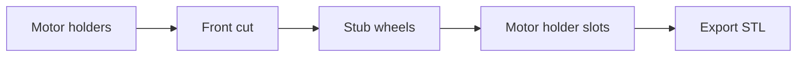

{:class="cover"}

---

## Watch the video first

This course goes with the video below. Part 2 picks up from where the chassis has its wheel holes and Arduino slots, so skip ahead in the video to the motor holders.



---

## Overview

In [Part 1](/learn/smars_fusion360/) you built the outer shell of the SMARS chassis. In Part 2 you'll add the parts inside and underneath that make it a working robot: holders that grip the two N20 motors, the stub wheels that carry the unpowered wheels, and the slots for the motor clips. At the end you'll have a finished chassis ready to export and 3D print.

> **A note on names**: Fusion 360 is now called Autodesk Fusion. The lessons use the screenshots and wording from the original video, so some menus and buttons may have moved or been renamed since. The tools themselves (Sketch, Extrude, Revolve, Chamfer, Mirror and Pattern) work the same way, so if something is not where the lesson says, look for it by name.

Here is the journey:

## Course Content

- Sketch and extrude the motor holders, nubs and chamfers
- Make the final cut in the front of the chassis
- Build the snap-fit stub wheels with a **Revolve**
- Cut the motor holder slots and export your design

## Key Results

By the end of Part 2 you will be able to:

- Use a **circular pattern** to repeat a sketch or feature around a centre point
- Create a round part by **revolving** a profile around an axis
- Add a **chamfer** to soften edges
- Design a snap-fit (pressure-fit) feature for a 3D print
- Export a finished body as an STL file for printing

## What you'll need

- [Autodesk Fusion](https://www.autodesk.com/products/fusion-360/personal) (formerly Fusion 360)
- Your chassis design from [Part 1](/learn/smars_fusion360/)
- A mouse with a scroll wheel, which makes orbiting and zooming easier
- A 3D printer and slicer, only if you want to print the result

## How the course works

Each lesson is one step: what to make and why, the dimensions to use, a drawing of the result, what to check afterwards and what commonly goes wrong. Every dimension is listed exactly as it appears in the original lessons, so type them in as given and compare your model with each drawing. Use the video if you need to see a step being done. Each lesson ends with a short quiz, and the lessons are best done in order because every feature builds on the one before.

> **Teachers**: This course suits students aged about 11 and up who have finished Part 1, working alone or in pairs. Allow roughly 15 to 25 minutes per lesson, or two or three lessons per session. Each learner needs a computer with Autodesk Fusion and a free account, so check that your school allows installation and sign-in. A 3D printer is only needed for the final lesson, and the whole course can be completed without one. Learners on shared machines should save their work to their own account or a USB stick.

## Prerequisites

- [Design a SMARS Robot in Fusion 360, Part 1](/learn/smars_fusion360/)
