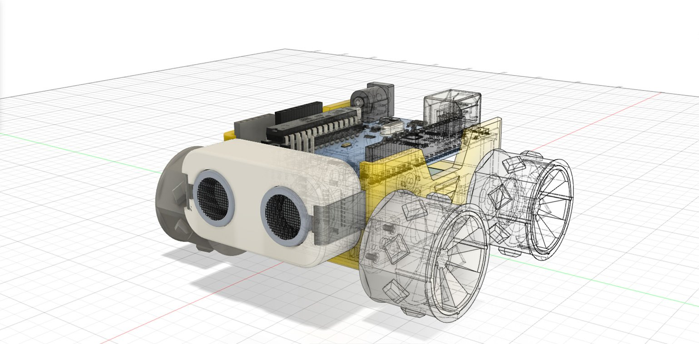

{:class="cover"}

## Watch the video first

This course goes with the video below. Part 2 picks up from where the chassis has its wheel holes and Arduino slots, so skip ahead in the video to the motor holders.



---

## Overview

In [Part 1](/learn/smars_fusion360/) you built the outer shell of the SMARS chassis. In Part 2 you'll add the parts inside and underneath that make it a working robot: holders that grip the two N20 motors, the stub wheels that carry the unpowered wheels, and the slots for the motor clips. At the end you'll have a finished chassis ready to export and 3D print.

## Course Content

- Sketch and extrude the motor holders, nubs and chamfers
- Make the final cut in the front of the chassis
- Build the snap-fit stub wheels with a **Revolve**
- Cut the motor holder slots and export your design

## Key Results

By the end of Part 2 you will be able to:

- Use a **circular pattern** to repeat a sketch or feature around a centre point
- Create a round part by **revolving** a profile around an axis
- Add a **chamfer** to soften edges
- Design a snap-fit (pressure-fit) feature for a 3D print
- Export a finished body as an STL file for printing

## What you'll need

- [Autodesk Fusion 360](https://www.autodesk.com/products/fusion-360/personal)
- Your chassis design from [Part 1](/learn/smars_fusion360/)

## How the course works

Each lesson is one step: a short explanation, the dimensions, and a drawing of the result. Use the video if you need to see a step being done, and try the quiz at the end of each section.

## Prerequisites

- [Design a SMARS Robot in Fusion 360, Part 1](/learn/smars_fusion360/)
