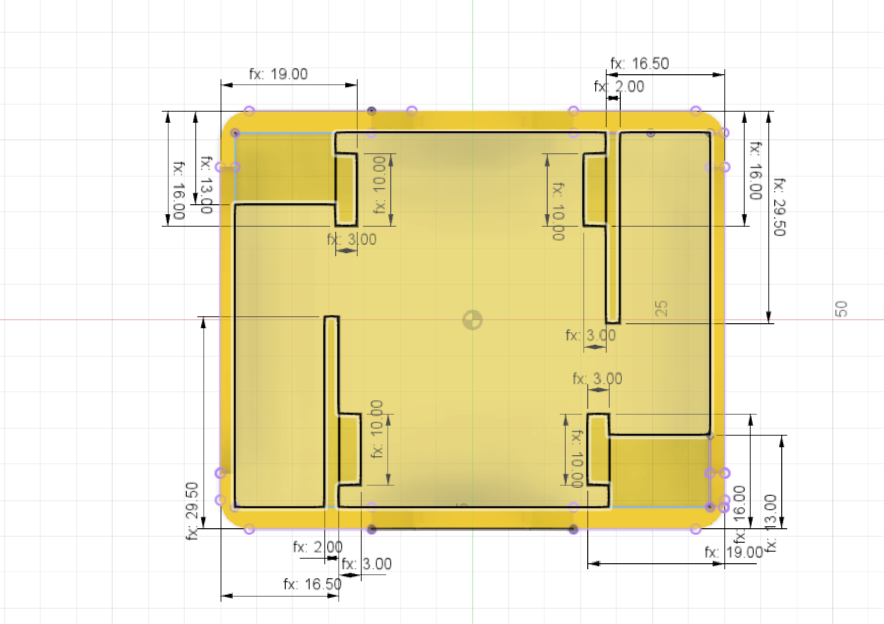
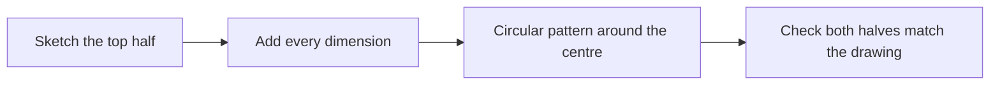

{:class="cover"}

---

By the end of this lesson you will be able to sketch the motor holder profile and use a circular pattern to copy half of it to the opposite side of the chassis.

## What are we making?

A SMARS robot gets its drive from two small motors, one on each side. Those motors need somewhere to sit that holds them still, otherwise they rattle about and the wheels wander. The motor holders are thin walls inside the chassis, and the sketch you draw now is the footprint of all of them.

Let's build it. These are the dimensions in the sketch:

* motor holder side wall thickness = 2mm
* motor holder side wall edge from body edge = 16.5mm
* motor holder wall height = 29.50mm
* unpowered wheel block from case edge = 13mm
* unpowered wheel block and battery nub from edge = 19mm
* battery nub height = 10mm
* battery nub thickness = 3mm

{:class="img-fluid w-75 m-3"}

## Draw half, then pattern it

You do not need to draw every line twice. The top half of the sketch can be created and then a circular pattern used to rotate this around the centre to create an asymmetric mirror for the bottom half of the sketch.

Why a pattern instead of a mirror? A mirror flips a shape, so the two halves would be reflections of each other. Here you want a copy that is turned around the centre instead, which is what "asymmetric mirror" means in the original instructions. Drawing once and patterning also means that if you fix a dimension on the top half, the bottom half follows.

**Check after this step:** compare your sketch with the drawing. Both halves should look the same, turned around the centre, and every dimension in the list above should appear on one half or the other. If a line is still blue, it is not fully constrained yet, so add the missing dimension.

## Try it Yourself

1. Match each dimension in the list above to a line in your sketch. Can you find all seven?
2. Temporarily change the 2mm wall thickness, watch which other lines move with it, then undo.
3. Challenge: explain in your own words why a circular pattern was chosen here instead of a mirror.

## Common Issues

- **Problem**: The bottom half of the sketch looks flipped instead of turned.
- **Solution**: Undo and use a circular pattern around the centre point, not a mirror.
- **Why**: A mirror reflects the shape across a line, while the pattern rotates it around the middle.

- **Problem**: Lines stay blue and the sketch will not fully lock.
- **Solution**: Dimension each line from the list above until the sketch turns black.
- **Why**: Fusion shows blue for geometry that can still move, and unconstrained lines can shift later when you edit something nearby.

## Check your understanding


? Why use a circular pattern rather than a mirror for the bottom half of this sketch?
- [ ] Mirrors are not available in sketches
- [x] The pattern rotates the shape around the centre, giving an asymmetric copy rather than a reflection
- [ ] A pattern makes the walls thicker
> The lesson describes the pattern as rotating the top half around the centre to make an asymmetric mirror.

? What is the motor holder side wall thickness in this sketch?
- [ ] 1mm
- [x] 2mm
- [ ] 3mm
> The first dimension in the list is a 2mm side wall.

? What does the finished sketch describe, in plain terms?
- [ ] The wheels
- [x] The footprint of the motor holders and nearby blocks inside the chassis
- [ ] The lid
> This profile is extruded in the next lesson to make the walls.

