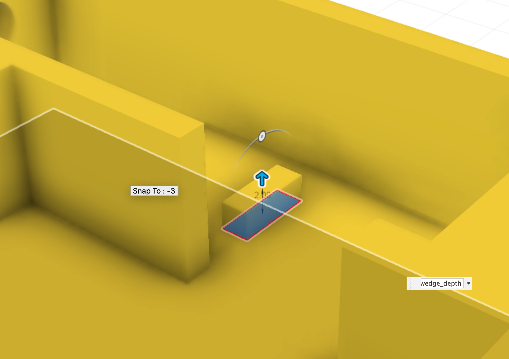

{:class="cover"}

---

By the end of this lesson you will be able to extrude the nub profile so the motor has a solid stop.

## Making the stop solid

Using the [Motor nub profile](03_nub.html) created earlier, we extrude the motor nub up by:

* Motor nub extrude height = 2mm

{:class="img-fluid w-75 m-3"}

## Why a small step is enough

A stop does not need to be big. It only has to meet the end of the motor. This is a good design-for-printing habit: add only as much plastic as the job needs, because small features print cleanly and big unneeded ones cost time and material.

As in the previous extrude, make sure the nub joins the existing body so you end up with a single solid chassis. If you accidentally create a second body, it will print as a loose piece.

**Check after this step:**

- The nub sits at the top of the motor holder sides.
- It belongs to the same body as the rest of the chassis.
- Rotate the view and look along the walls: the nub should appear as a small step.

## Try it Yourself

1. Open the timeline and find both extrudes. Which has the larger value?
2. Use the Measure tool on the nub to confirm its height.
3. Challenge: imagine a motor that sat further back. Which single value would you change, and in which feature?

## Common Issues

- **Problem**: The nub extrudes downward into the wall instead of up.
- **Solution**: Flip the direction in the Extrude dialog and check the preview before confirming.
- **Why**: A nub that goes the wrong way is hidden inside the wall and does nothing.

- **Problem**: A second body appears.
- **Solution**: Undo and extrude again with the operation set to join.
- **Why**: A separate body will print as a loose piece.

## Check your understanding


? How far is the nub extruded?
- [ ] 1mm
- [x] 2mm
- [ ] 5.5mm
> The extrude height is given as 2mm.

? What should you check after extruding?
- [x] That the nub is part of the same body as the chassis
- [ ] That it has its own colour
- [ ] That it is round
> A joined nub is one solid; a separate body would print loose.

? What is the design-for-printing idea in this lesson?
- [ ] Always make stops as tall as possible
- [x] Add only as much plastic as the job needs
- [ ] Print the nub separately
> Small features print cleanly and save time and material.

