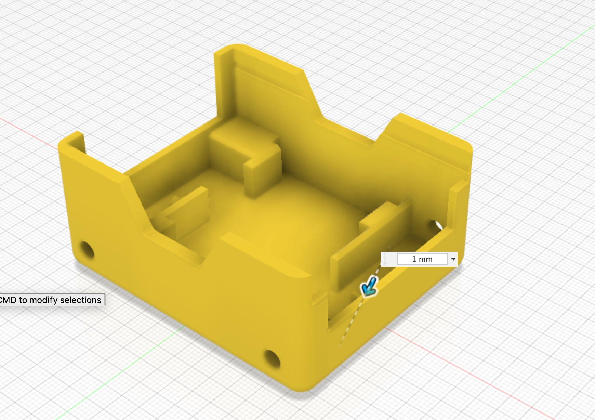

A small chamfer is applied to the tops of the extruded [motor holder profiles](01_motor.html) and [motor nubs](04_extrude.html).

The dimension of the chamfer is:

- motor holder chamfer = 1mm

{:class="img-fluid w-75 m-3"}

## Check your understanding


? What are the small motor nubs for?
- [ ] To hold the battery
- [x] To stop the motors sliding backwards into the chassis
- [ ] To clip the lid on
> The 2mm nubs sit behind each motor and hold it in place.

? What does a **Chamfer** do to an edge?
- [x] Cuts it at an angle
- [ ] Rounds it into a curve
- [ ] Makes it thicker
> A chamfer bevels an edge at an angle. A fillet rounds it instead.

