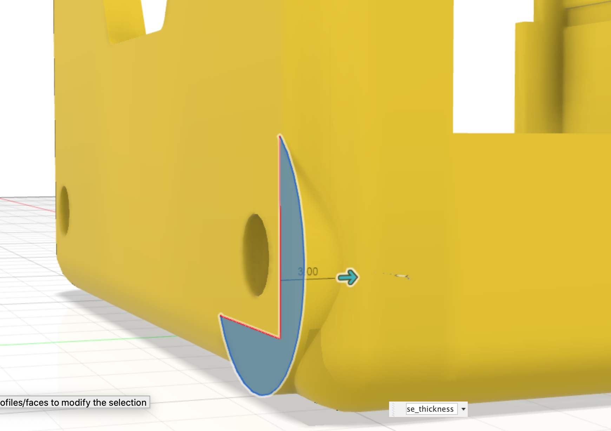

{:class="cover"}

---

By the end of this lesson you will be able to extrude the stub base and copy it to the other side of the chassis with a circular pattern.

## Building the base

The [Stub extrude profile](09_cut.html) is extruded into the chassis body. The dimension is:

* stub extrude 3mm

This feature is replicated to the other side of the case using a circular pattern.

{:class="img-fluid w-75 m-3"}

## Why a pattern again?

You used a circular pattern in the motor holder sketch, and here it is used on a whole feature. Rather than repeating the sketch and extrude on the far side, the pattern copies the finished feature to the other side. The copy stays linked to the original: if you edit the 3mm later, both sides update, so the robot stays symmetrical.

**Check after this step:** look at both sides of the chassis. Each should have an identical base around its wheel hole, and the browser should still show one body.

## Try it Yourself

1. Extrude the circle and orbit to check it joins the chassis.
2. Apply the pattern and look at the other side.
3. Challenge: in the timeline, edit the 3mm value, watch both sides change, then undo.

## Common Issues

- **Problem**: The pattern shows nothing on the other side.
- **Solution**: Choose the feature to pattern from the timeline or browser, and check the centre axis is set.
- **Why**: A pattern needs both a feature to copy and a centre to rotate around.

- **Problem**: The base pokes out the wrong way.
- **Solution**: Check the extrude direction in the preview before confirming.
- **Why**: The base must join the chassis wall as shown in the drawing.

## Check your understanding


? How far is the stub base extruded?
- [ ] 2mm
- [x] 3mm
- [ ] 15mm
> The stub extrude is 3mm.

? Why use a pattern for the other side?
- [ ] It is the only way to extrude
- [x] The copy stays linked, so edits apply to both sides
- [ ] It makes the part lighter
> A patterned feature updates with the original.

? What should you check after the pattern?
- [x] Both sides look identical and it is still one body
- [ ] The colour changed
- [ ] The nub is gone
> Symmetry and a single body are the checks.

