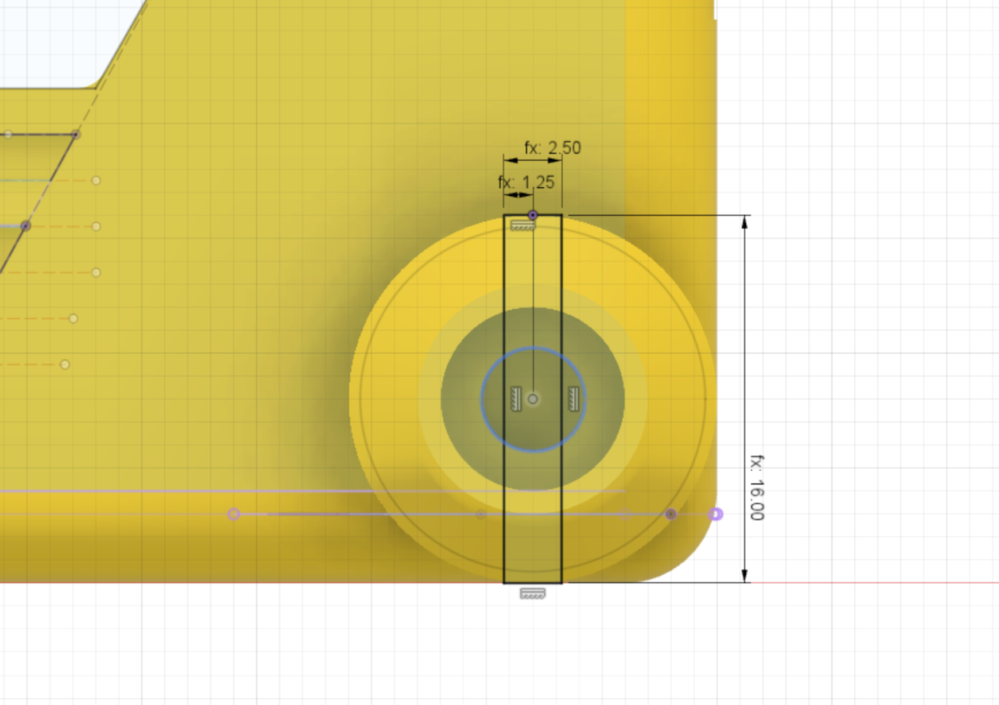

{:class="cover"}

---

By the end of this lesson you will be able to sketch the slot profile that lets the stub wheel flex like a spring.

## Why cut a slot in a solid part?

The stub wheel needs a cut out section to allow the two halves of the stub wheel to squeeze together when pushing on an unpowered wheel. This is a snap fit: the halves flex inward as the wheel is pushed on, then spring back out so the wheel stays put without a screw.

The dimensions are:

* cutout width = 2.5mm
* cutout height = 16mm (the wheel diameter)

{:class="img-fluid w-75 m-3"}

## Design for printing

Snap fits are a 3D printing favourite because they need no screws, but plastic is stiff. A thin part bent too far can crack, especially along the layer lines. The slot gives the halves room to move a little without needing much force.

The height of 16mm matches the wheel diameter, so the slot runs right across the stub.

**Check after this step:** the profile is 2.5mm wide and 16mm long and sits centred across the stub, as in the drawing.

> **Teachers**: Snap-fit parts depend on your printer's accuracy, so print one stub as a test before printing a class set. Different printers and filaments give slightly different fits, so allow time to adjust and reprint.

## Try it Yourself

1. Sketch the profile and add both dimensions.
2. Check it is centred over the stub.
3. Challenge: predict what would happen to the spring if the slot were much narrower, and if it were much wider.

## Common Issues

- **Problem**: The profile is not centred across the stub.
- **Solution**: Add a midpoint or symmetry constraint to the stub centre.
- **Why**: An off-centre slot makes one half thicker than the other, so the flex is uneven.

- **Problem**: The sketch is on the wrong plane.
- **Solution**: Restart on the plane or face shown in the drawing.
- **Why**: The slot must pass through the stub to split it into two halves.

## Check your understanding


? Why does the stub wheel have a slot?
- [ ] To save plastic
- [x] So the two halves can squeeze together when a wheel is pushed on
- [ ] To let wires through
> The cut out allows the halves to squeeze together.

? What is the cutout width?
- [x] 2.5mm
- [ ] 16mm
- [ ] 1mm
> The width is 2.5mm; the height is 16mm.

? What kind of fit is this?
- [ ] A screw fit
- [x] A snap fit
- [ ] A glue fit
> The halves flex, then spring back to hold the wheel.

