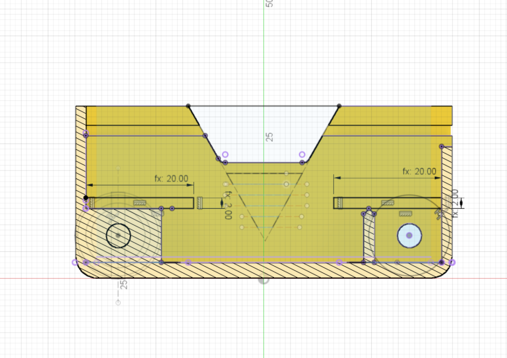

{:class="cover"}

---

By the end of this lesson you will be able to sketch the slot profiles that let a separate motor holder part snap into the chassis.

## A part that clips in

Two slot profiles need to be sketched above each of the areas where the motors live. This will enable a motor holder part to be snapped into place later once the motors are installed. The parts are pressure fit, so this part will only need to be a few mm deep.

Dimensions:

* length = 20mm
* depth = 2mm

{:class="img-fluid w-75 m-3"}

## Why a separate part?

The motors go in first, and a separate holder part is then pressed into slots to keep them in. "Pressure fit" means the part is held by a snug fit, not screws or glue.

A shallow slot is enough, because friction does the holding. A deep slot would also remove more of the chassis wall.

A note on numbers: this lesson gives a slot depth of 2mm in the sketch, and the next lesson gives an extrude cut depth of 1.5mm. Both are shown exactly as in the original lessons, so follow each as written and compare with the drawings.

**Check after this step:** there is a slot profile above each motor area, each 20mm long, matching the drawing.

## Try it Yourself

1. Sketch one slot with the length and depth above.
2. Create the second slot above the other motor area.
3. Challenge: why is it a good idea for the two slots to be the same size?

## Common Issues

- **Problem**: One slot is drawn above the wrong area.
- **Solution**: Compare the position with the drawing and move the sketch into place.
- **Why**: Each slot must sit above its motor so the holder lines up.

- **Problem**: The two slots are slightly different.
- **Solution**: Use an equal constraint or copy the first slot.
- **Why**: A holder part will not fit both sides if the slots differ.

## Check your understanding


? How long is each slot?
- [ ] 2mm
- [x] 20mm
- [ ] 1.5mm
> The length is 20mm.

? What does pressure fit mean?
- [x] The part is held by a snug fit, not screws
- [ ] The part is glued
- [ ] The part is printed hot
> The parts are pressure fit.

? Why only a shallow slot?
- [ ] Fusion cannot go deeper
- [x] A pressure fit only needs a few mm
- [ ] To use more plastic
> The lesson says it only needs to be a few mm deep.

