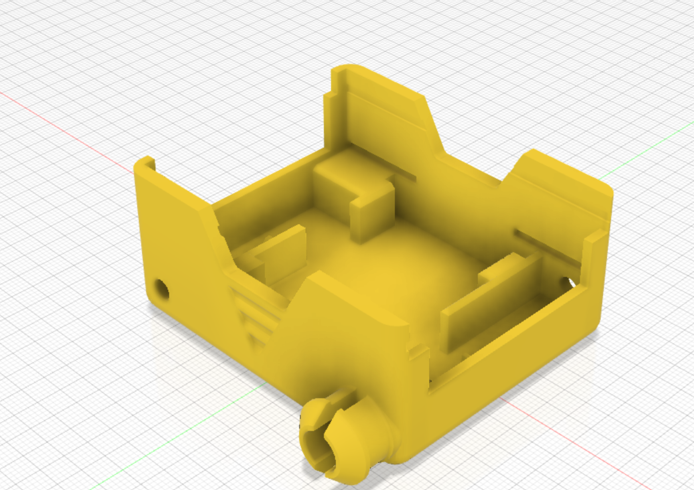

You should now have a finished Chassis design, ready for saving out to an STL file and printing.

(Note this design has a few extra flourishes)

{:class="img-fluid w-75 m-3"}

## Export it for printing

1. In the browser on the left, right-click the chassis body.
2. Choose **Save As Mesh**, pick **STL** and set the refinement to **High**.
3. Open the STL in your slicer. Print it with the base flat on the bed; PLA at 0.2mm layer height works well.

## Check your understanding


? Why are the motor holder slots only 1.5mm deep?
- [ ] To save printing time
- [x] The motor holder parts are a pressure fit, so they only need a shallow slot
- [ ] Fusion 360 can't cut deeper slots
> A pressure fit relies on a snug fit rather than screws, so a short, tight slot is enough.

? Which file format do you export to 3D print your chassis?
- [ ] PNG
- [x] STL
- [ ] PDF
> STL describes the surface of the part as triangles, which is what slicers like Cura and PrusaSlicer read.


## Try it yourself

1. Add your initials to the side of the chassis with the **Text** tool and an extrude-cut.
2. Challenge: design a lid that clips onto the top of the chassis.

## What's next

- Build and code your robot with [Build a SMARS robot](/learn/smars/) and [SMARS programming](/learn/smars_code/)
- Prefer free and open source software? Design SMARS in [FreeCAD](/learn/freecad_smars/)
