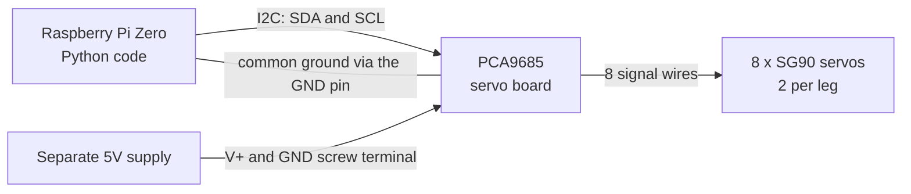

{:class="cover"}

---

By the end of this lesson you will know what the SMARS Quad is, what you need to build one, and how the course is laid out.

## Watch the videos

Printing the parts:



Assembling and wiring it up:



---

## Overview

Ahoy there makers! The SMARS Quad swaps the tracks of the original SMARS for four legs. Each leg has two servos, one to swing the leg and one to lift the foot, so it can walk, wave and dance. A PCA9685 board drives all eight servos, and a Raspberry Pi Zero runs the Python code.

Here is how the pieces talk to each other. The Pi never drives a servo directly: it sends short I2C messages to the PCA9685, and the PCA9685 makes the servo pulses.

## Course Content

- Printing the frame, servo holders, arms and feet
- Fitting the servos and assembling the legs
- Wiring the servos and PCA9685 board to the Raspberry Pi
- Downloading the SMARSLab code, finding which limb is on which channel, and making the quad move
- How a four-legged walking cycle keeps the robot balanced, worked through with real numbers

## Key Results

After completing this course, you will:

- Print and assemble a four-legged SMARS Quad with eight servos
- Wire a PCA9685 to a Raspberry Pi and power the servos safely from their own supply
- Identify which PCA9685 channel drives which limb
- Explain a creeping gait and why three feet stay on the ground
- Run SMARSLab and your own Python script to move the legs

## What you'll need

Item              | Description            | Qty |  Price
------------------|------------------------|:---:|------:
Raspberry Pi Zero | Raspberry Pi Zero 2 WH |  1  | £15.00
Servos            | SG90 Servos            |  8  |  £2.00
PCA9685           | PCA9685 Servo board    |  1  |  £3.00
{:class="table table-striped"}

You'll also need a 3D printer, a small screwdriver, jumper wires, a micro SD card with Raspberry Pi OS, and a separate 5V supply or battery pack for the servos. Prices are a guide from when the course was written.

## How the course works

Each build step has an instruction drawing from the build guide. Follow them in order, and use the videos if you want to see a step done. Every lesson starts with what you will be able to do by the end, then has a few exercises and a short quiz.

The code runs on the Raspberry Pi in normal Python 3 (CPython) using the Adafruit PCA9685 library, not MicroPython. You save a file on the Pi and run it from the terminal, so the Run buttons on this site are not used in this course.

> **Teachers**: This course suits ages 11 and up working in pairs, with a teacher who is comfortable with a Raspberry Pi terminal. Plan about 20 to 40 minutes per build lesson and one hour each for the wiring and walking lessons. Print times depend on your printer and settings, so check your slicer's estimate and print ahead of the lesson. Each pair needs one full set of kit (a Pi, a PCA9685, eight servos, a servo supply). With no hardware you can still do the build reading, the channel table, and the gait arithmetic in the last lesson. Servo power is the main hazard: never run the servos from a Pi pin.

## Prerequisites

None, but it helps to have built the [original SMARS](/learn/smars/) first. [Building a Robot Arm with Raspberry Pi and PCA9685](/learn/pca9685/) goes deeper into how the servo board works, and is the best course to take if you have never used a PCA9685 or an I2C device before.
