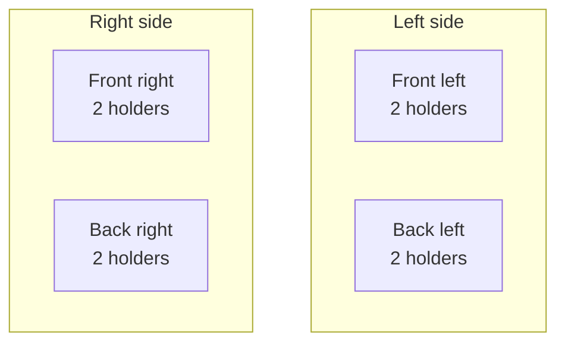

{:class="cover"}

---

By the end of this lesson you will be able to explain why the quad needs both normal and mirrored servo holders, and print the right number of each.

## Print the servo holders

Print 4x Servo holder and 4x Servo holder M (M is a mirror image of the servo holder).

{:class="img-fluid w-50"}

## Why mirrored parts?

Look at your own hands. Your left hand is a mirror image of your right hand, and a glove for one will not fit the other. The holders are the same. A holder clamps a servo with the wire channel pointing a certain way, and on the opposite side of the robot the same holder would face the wrong way. A mirrored copy fixes that without any change to the servo.

Here is the sum for the whole robot:

- 4 legs, each with 2 servos, makes 8 servos
- 8 servos need 8 holders
- 4 normal plus 4 mirrored makes 8

Each corner of the robot gets 2 holders, so 4 corners x 2 holders = 8. Lesson 4 and lesson 8 show where each one goes.

**Common mistake:** printing 8 identical holders. Four of them will not fit the other side of the frame properly, so always print 4 and 4.

## Try it Yourself

1. Lay your printed holders out in two rows, normal and M. Hold one from each row side by side and spot the difference.
2. Count how many holders you have printed. Does it match 8?
3. Challenge: hold a normal holder up to a mirror. Which one does it look like?

## Common Issues

- **Problem**: I printed 8 normal holders
- **Solution**: Print 4 of the mirrored M version and keep 4 of the normal ones
- **Why**: The wire channel and lugs face different ways on the two sides of the robot

- **Problem**: I can't tell the normal and M holders apart after printing
- **Solution**: Mark them with a pen or print them in two different colours
- **Why**: They look almost the same, and mixing them up costs a rebuild later

## Check your understanding


? How many servo holders do the four legs need in total?
- [ ] 4
- [x] 8
- [ ] 16
> Each leg has two servos and each servo has its own holder, so 4 x 2 = 8.

? What is the "M" holder?
- [x] A mirror image of the normal holder
- [ ] A bigger holder
- [ ] A holder for a motor
> M parts are mirror copies for the opposite side of the robot.

? Why not print 8 normal holders?
- [ ] They would be too heavy
- [x] They would not fit the opposite side of the robot
- [ ] The M holder is stronger
> The holders are left and right handed, like gloves.

