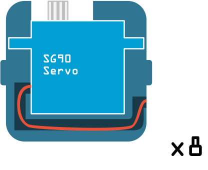

{:class="cover"}

---

By the end of this lesson you will be able to fit an SG90 servo into its holder and route its wire neatly.

## Fit the servo into the servo holder

The SG90 size servos will fit snugly into the servo holder. You can push the servo wire into the channel within the holder to neatly guide the wire. If the type of servo you have has a wire that comes directly out of the bottom, you can easily clip away some of the channel wall so that the wire fits in.

{:class="img-fluid w-25"}

## Step by step

1. Take one holder and one servo.
2. Slide the servo in so that the output shaft (the part that turns) sticks out where the drawing shows it.
3. Lay the wire in the channel so it is not trapped between the servo and the plastic.
4. Wiggle the servo gently. It should not rock, but you should not need to force it either.

**Why this matters:** every wire runs to the PCA9685 later. A wire that is trapped can be pulled out of its plug when the leg moves, and a loose wire can catch in a leg and stop it.

> **Teachers**: Clipping channel walls needs side cutters or a craft knife. Pupils should do this with supervision, cutting away from their fingers, and wear eye protection when clipping plastic.

## Try it Yourself

1. Fit one servo and check the wire is not pinched. Tug the plug end gently to prove it.
2. Pick up the holder with the servo and shake it lightly. Does the servo stay put?
3. Challenge: if your servo wire came out of the bottom, which part of the channel wall would you clip, and why?

## Common Issues

- **Problem**: The servo will not push all the way in
- **Solution**: Check the servo is the right way round, then check no wire is in the way. If it is still tight, lightly clean up the holder's edges with a file
- **Why**: A little blobbing on the inside corners from printing makes the fit tighter than designed

- **Problem**: The servo wire is pinched
- **Solution**: Take the servo out and lay the wire in the channel before pushing the servo back in
- **Why**: A pinched wire can fray or come loose when the leg moves

## Check your understanding


? What is the channel in the holder for?
- [ ] Holding the screw
- [x] Guiding the servo wire neatly
- [ ] Cooling the servo
> The lesson says to push the wire into the channel to guide it.

? What can you do if your servo wire comes out of the bottom?
- [x] Clip away some of the channel wall so the wire fits
- [ ] Cut the wire shorter
- [ ] Use a bigger holder
> The channel wall can be trimmed so the wire has somewhere to go.

? How snugly should an SG90 servo fit?
- [x] Snugly, without rocking and without forcing
- [ ] Loosely, held by glue
- [ ] It does not matter
> The holder is designed to grip the servo snugly.

