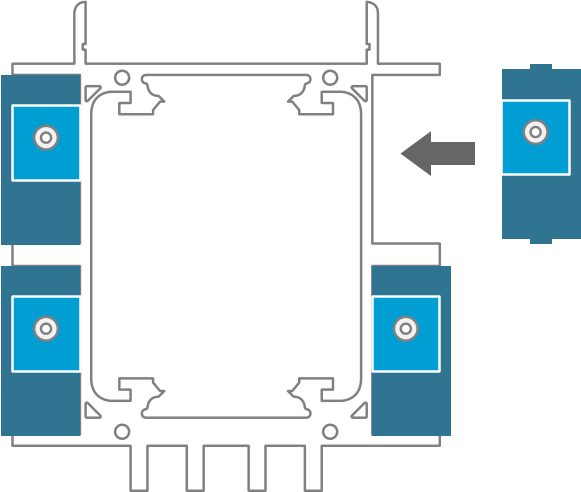
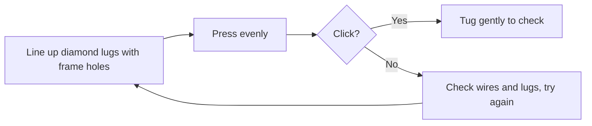

{:class="cover"}

---

By the end of this lesson you will be able to click a servo holder into the frame and check that it is locked in place.

## Fit the servo holders into the frame

The servo holder can be pushed into the frame so that the wires and the servo are locked into place. The small diamond shaped lugs on the servo holders will locate into the holes in the frame and click into place when pushed in.

{:class="img-fluid w-25"}

## How the click works

The lugs and holes work like a snap fastener, with no screws needed. Line the diamond lugs up with the holes, then press with firm, even pressure until you feel and hear the click.

**Why this matters:** the frame carries the weight of the whole robot. If a holder is only half clicked in, it will flex when the leg takes weight and the walk will wobble.

## Try it Yourself

1. Fit one holder, then try to wiggle it. How firmly does it stay in?
2. Pull the holder out and put it back again. Does it click the same way a second time?
3. Challenge: look at the frame and work out which corner each holder will go in. We fit the rest in lesson 8.

## Common Issues

- **Problem**: The holder will not click in
- **Solution**: Check that the wire is lying in its channel and that a printing blob is not sitting on a lug. Trim blobs with a craft knife
- **Why**: The lugs need to sit square in the holes, and a stray blob or wire props the holder up

- **Problem**: A lug snapped off
- **Solution**: Reprint the holder, and press more slowly and squarely next time
- **Why**: Printed plastic is brittle if it is forced in at an angle

## Check your understanding


? What locks the servo holder into the frame?
- [ ] Glue
- [x] Small diamond shaped lugs that click into holes
- [ ] Long bolts
> The lugs locate into holes in the frame and click when pushed in.

? What should you do if the holder will not click in?
- [x] Check the wire and lugs for anything in the way
- [ ] Press as hard as you can
- [ ] Skip it
> A trapped wire or a printing blob stops the lugs seating.

? Why does a half-clicked holder matter?
- [ ] It looks untidy only
- [ ] It uses more power
- [x] It will flex when the leg takes weight and spoil the walk
> The frame carries the robot's weight.

