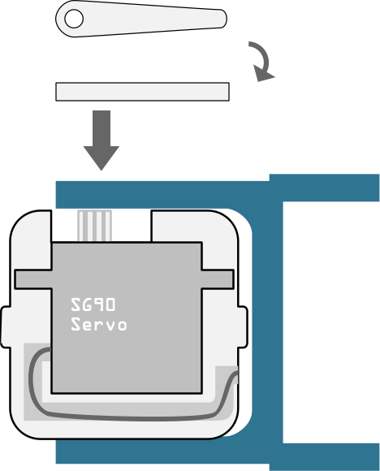

{:class="cover"}

---

By the end of this lesson you will be able to fit a servo horn to the servo and fix it to the printed servo arm.

## Mount the servo holder in the servo arm

Push the servo horn onto the servo, then screw it securely to the servo arm.

{:class="img-fluid w-25"}

## Take it slowly

A servo horn pushes onto splines (little ridges) on the servo's output shaft. The angle at which you push the horn on decides where the leg points when the servo is at its middle. That is why the next lesson is a check, and why you should treat the horn's final fixing as the last step.

Use the small screws that come in the servo bag where the drawing shows them. Tighten until snug, then stop. Plastic parts split if they are over-tightened.

**Why this matters:** the arm and the horn have to turn as one. If the screws are loose the servo will turn but the leg will slip, and the robot will lose its position.

## Try it Yourself

1. Push a horn on and take it off again. Do you feel the splines?
2. Hold the servo and turn the arm gently to its two end stops. Stop before you force it.
3. Challenge: push the horn on one spline step round and compare where the arm points.

## Common Issues

- **Problem**: The arm slips on the servo
- **Solution**: Check the horn is pushed fully onto the shaft and the screws are snug
- **Why**: A horn that is not seated on its splines can spin on the shaft

- **Problem**: The arm plastic cracked near a screw
- **Solution**: Reprint the arm and tighten only until snug
- **Why**: Printed plastic splits when a screw is over-tightened

## Check your understanding


? What do you push onto the servo's shaft first?
- [ ] The foot
- [x] The servo horn
- [ ] The frame
> The horn goes on the servo, then it is screwed to the arm.

? Why is there a check in the next lesson?
- [x] The angle the horn is fitted at sets where the leg points
- [ ] To test the battery
- [ ] To clean the parts
> A horn pushed on at the wrong angle runs out of movement on one side.

? What can happen if you over-tighten a screw in a printed arm?
- [ ] Nothing
- [x] The plastic can crack
- [ ] The servo goes faster
> Printed plastic splits if it is overtightened.

