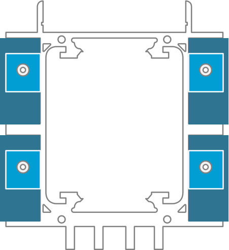

{:class="cover"}

---

## 8 Attach the other servo holders to the frame

Fit the remaining servo holders into the frame in the same way, so there is one at each corner.

{:class="img-fluid w-25"}

---
