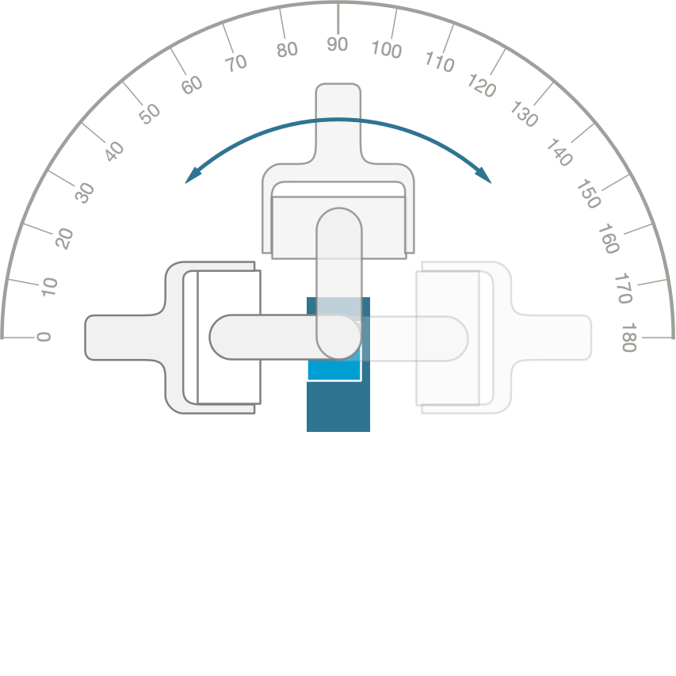
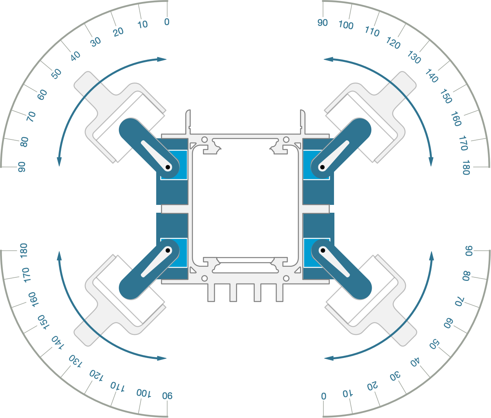

## 11 Check the servo rotation

You can check the precise angle of these later using the `test.py` program. The foot should be able to rotate between 50 & 150 degrees.

{:class="img-fluid w-25"}
{:class="img-fluid  w-25"}

{:class="img-fluid  w-25"}

---

## Check your understanding


? Why check the servo can move equally in both directions before screwing on the horn?
- [x] So the leg can swing the same amount forwards and backwards
- [ ] To test the battery
- [ ] Servos only work in one direction
> If the horn goes on off-centre, the leg will run out of movement on one side.

? Between which angles should each foot be able to rotate?
- [ ] 0 and 30 degrees
- [x] 50 and 150 degrees
- [ ] 0 and 360 degrees

