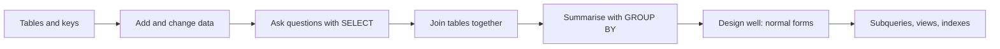

{:class="cover"}

---

Ahoy there makers! Every robot you build produces data. Which sensors did you fit? How long does the battery last? What did those distance readings say at 10:02? Sooner or later a spreadsheet stops being enough, and that is where **SQL** comes in.

SQL (Structured Query Language) is the language you use to ask questions of a database. In this course we'll build one real database, the **Robot Workshop**, and grow it lesson by lesson: robots, the sensors fitted to them, the readings they take, and the parts and people that built them.

## Overview

You'll learn SQL on **SQLite**, a database that lives in a single file and needs no server. It is free, it is already installed on many computers, and it runs happily on a Raspberry Pi. The core ideas (tables, `SELECT`, `JOIN`, `GROUP BY`) work the same in MySQL, PostgreSQL and friends, and we'll point out the places where they differ.

## Course Content

- **SQL Basics**: what a relational database is, setting up SQLite, the four everyday commands, creating tables, inserting and changing data, `SELECT`, filtering and joins
- **Intermediate Concepts**: grouping and counting, normalisation and Boyce-Codd normal form, subqueries, views and indexes, and SQL functions
- **Conclusion**: a final project, a small online shop for robot parts, that uses everything

## Key Results

By the end of this course you will be able to:

- Explain what tables, rows, primary keys and foreign keys are, and why data is split across tables
- Create a SQLite database and tables with sensible data types and constraints
- Insert, update and delete rows safely, using transactions to undo mistakes
- Filter, sort and combine data with `SELECT`, `WHERE`, `CASE` and `JOIN`
- Summarise data with `GROUP BY` and aggregate functions
- Design tables that avoid repeated data, and speed queries up with views and indexes

## What you'll need

- A computer running Windows, macOS or Linux (a Raspberry Pi works too)
- The `sqlite3` command-line tool, or Python 3, which has SQLite built in (lesson 2 shows both routes)
- A plain text editor to keep your SQL in a `.sql` file
- No electronics. This is a software course, and every example uses made-up robot data

You don't need to know any programming. If you have used a terminal before, great. If not, [Introduction to the Linux Command Line](/learn/linux_intro/) is a friendly warm-up, and [Python for beginners](/learn/python/) pairs nicely with this course.

## How the course works

**One database, growing.** Lesson 2 creates `workshop.db`, and every lesson from then on adds to it. If you skip a lesson, the first page of each lesson says what the database should look like, so you can catch up.

**Run every statement.** Each SQL block is meant to be typed and run. The output shown under it is what SQLite really printed when we ran it. Your rows may come back in a different order unless the query has an `ORDER BY`.

**Checked on SQLite.** Everything was run on SQLite 3.53. A few features need a newer version than older systems ship, and the lessons say when. Where MySQL or PostgreSQL does something differently, you'll see a note.

**Quizzes.** Each lesson ends with a short quiz. Your score is kept in your browser and shown in the sidebar.

**Mistakes are normal.** Each lesson has a Common Issues list. Error messages are a feature: they tell you what the database refuses to let you do.

> **Teachers**: this course suits students aged about 13 and up, with no programming background. Allow 30 to 45 minutes per lesson; lessons 8 to 13 are the heaviest, so give them a full session each. It needs no hardware, no accounts and no network once SQLite is installed, so it works well on locked-down school computers if `sqlite3` or Python is available (the Python route in lesson 2 needs no extra install). Each learner should have their own `workshop.db` file, as shared files cause locking errors. All sample data is fictional, so there is no personal-data concern, but remind students not to put real names or emails into their own tables.

Ready? Let's find out what a relational database actually is.
