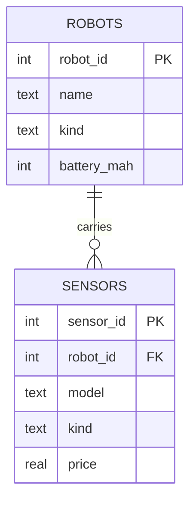

{:class="cover"}

---

By the end of this lesson you will be able to explain what a table, a row, a primary key and a foreign key are, and say why a database keeps robots and sensors in separate tables.

---

## Why not just use a spreadsheet?

Imagine you have built a few robots, and you keep a spreadsheet of them. One row per robot, with a column for each sensor. It works until Smars needs a third sensor and you have to add a column for every robot, or until you want to ask "which robots have an ultrasonic sensor?" across fifty rows.

A **database** keeps data in an organised, checkable form, and **SQL** (Structured Query Language, often said "sequel" or "S-Q-L") is the language you use to talk to it. You describe *what* you want, and the database works out *how* to get it.

## Tables, rows and columns

A **relational database** stores everything in **tables**. A table is like one sheet of a spreadsheet, but stricter:

- A **column** is one kind of fact, such as `name` or `battery_mah`. Every row has the same columns.
- A **row** is one thing, such as one robot.
- A **table** holds one kind of thing: robots in one table, sensors in another.

Here is the `robots` table we'll build in this course:

| robot_id | name        | kind   | battery_mah |
|----------|-------------|--------|-------------|
| 1        | Smars       | rover  | 2000        |
| 2        | Pico Walker | walker | 1500        |
| 3        | Arm Buddy   | arm    | (empty)     |
{:class="table table-single"}

## Keys link tables together

Each robot can carry several sensors, so sensors get their own table. How does a sensor say which robot it belongs to?

- A **primary key** is a column whose value is different for every row, like `robot_id`. It is how you point at exactly one row.
- A **foreign key** is a column in one table that holds the primary key of a row in another. A sensor's `robot_id` says "I am fitted to robot number 1".



Read the line between the boxes as "one robot carries zero or more sensors". The sensor table does not repeat the robot's name, only its number. If you rename Smars, you change it in one place and every sensor still points at the right robot.

## What SQL can do

SQL has a small set of verbs, and we'll meet them all:

| You want to... | SQL words |
|----------------|-----------|
| Build a new table | `CREATE TABLE` |
| Add rows | `INSERT` |
| Look at rows | `SELECT` |
| Change rows | `UPDATE` |
| Remove rows | `DELETE` |
| Combine tables | `JOIN` |
| Count, add up, average | `GROUP BY`, `COUNT`, `SUM`, `AVG` |
{:class="table table-single"}

Here is a taste. This asks the sensors table for every distance sensor, cheapest first:

```sql
SELECT model, price
FROM sensors
WHERE kind = 'distance'
ORDER BY price;
```

{: .no-snakie }

Read it almost like English: select the model and price from sensors, where the kind is distance, ordered by price. You can't run it yet, because there is no database. In the next lesson we'll make one.

## Which database?

SQL is a standard, and many systems speak it: SQLite, MySQL, PostgreSQL, Microsoft SQL Server and Oracle. Each adds its own extras and has small differences. We use **SQLite** because it is a single file with no server to install, and the basics you learn carry straight over to the others.

## Try it Yourself

1. On paper, draw a table for your own robots or projects with at least four columns. Which column could be the primary key?
2. Sketch a second table for the motors or sensors on those robots. Which column would be the foreign key?
3. Challenge: a robot can have many sensors, and one sensor model (such as an HC-SR04) can be fitted to many robots. Can you work out why that needs a third table in between? (We'll meet it in lesson 10.)

## Common Issues

- **Problem**: I put the sensor names into the robots table as a comma-separated list, and now I can't search it properly.
- **Solution**: Give sensors their own table, one row per sensor, with a foreign key back to the robot.
- **Why**: A column should hold one fact. A list inside one cell can't be counted, sorted or checked by the database.

- **Problem**: Two robots have the same name, so I used the name as the key and got confused.
- **Solution**: Use a number column like `robot_id` as the primary key.
- **Why**: Names change and repeat. A key must never change or repeat.

## Check your understanding


? What does a foreign key do?
- [ ] It makes a column impossible to change
- [x] It holds the primary key of a row in another table, linking the two
- [ ] It encrypts the data in a column
> A sensor's `robot_id` is a foreign key: it stores the primary key of the robot the sensor is fitted to.

? In a relational database, what is a row?
- [ ] One kind of fact, such as `name`
- [ ] A whole collection of related tables
- [x] One record, such as one robot
> Columns are the kinds of fact, a row is one thing described by those facts, and a table is a collection of rows.

? Why do sensors get their own table instead of extra columns on robots?
- [x] A robot can have any number of sensors, and renaming a robot then only needs changing in one place
- [ ] SQL cannot store more than five columns in one table
- [ ] Tables with fewer columns are always faster
> One table per kind of thing keeps each fact in a single place, so there is nothing to keep in step.

? Which of these is the SQL word for looking at rows?
- [ ] `INSERT`
- [x] `SELECT`
- [ ] `JOIN`
> `SELECT` reads rows. `INSERT` adds them, and `JOIN` combines tables.


Next, let's set up SQLite and make our first database.
