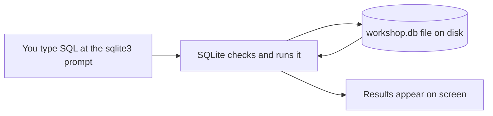

{:class="cover"}

---

By the end of this lesson you will be able to start SQLite, create a database file called `workshop.db`, and create, fill and read a first table.

---

Let's get our hands on a real database. We'll use **SQLite**, which keeps a whole database in one ordinary file. There is no server to start, no password and no account.



## Route A: the sqlite3 command

1. Open a terminal (Command Prompt or PowerShell on Windows).
2. Type `sqlite3 --version` and press Enter. If you see a version number, you're done.
3. If not, install it:
   - **Windows**: download the `sqlite-tools` zip for Windows from [sqlite.org/download.html](https://www.sqlite.org/download.html), unzip it to a folder such as `C:\sqlite`, and add that folder to your PATH so `sqlite3` works from any window.
   - **macOS**: `sqlite3` is normally already there. If not, `brew install sqlite` works if you use Homebrew.
   - **Linux and Raspberry Pi OS**: `sudo apt install sqlite3`.

Now create the database. Move to a folder where you want to keep your work, then run:

```bash
sqlite3 workshop.db
```

{: .no-snakie }

SQLite creates `workshop.db` the first time you save something to it, and shows a `sqlite>` prompt. Switch on tidier output with two **dot commands**. These start with a full stop, belong to the `sqlite3` tool rather than SQL, and need no semicolon:

```text
.headers on
.mode column
```

## Route B: Python, no install needed

Python ships with SQLite. If you can run Python 3 but have no `sqlite3` command, save this as `sql_shell.py` and run it with `python3 sql_shell.py`. It gives you a simple `sql>` prompt that works on `workshop.db`:

```python
import sqlite3

# A tiny SQL prompt for when the sqlite3 command is not installed.
# isolation_level=None means every statement runs exactly as you type it.
db = sqlite3.connect("workshop.db", isolation_level=None)
print("Type SQL ending with a semicolon. Type quit on its own line to leave.")

buffer = ""
while True:
    line = input("sql> " if buffer == "" else "...> ")
    if buffer == "" and line.strip().lower() in ("quit", "exit"):
        break
    buffer += line + "\n"
    if sqlite3.complete_statement(buffer):
        try:
            cursor = db.execute(buffer)
            if cursor.description:
                print([column[0] for column in cursor.description])
                for row in cursor.fetchall():
                    print(row)
        except sqlite3.Error as error:
            print("Error:", error)
        buffer = ""

db.close()
```

On this route, results print as Python tuples, such as `(1, 'Smars')`, instead of neat columns, and the dot commands don't exist. Use the SQL equivalents the lessons mention instead.

## Create, fill and read a table

Type each statement and press Enter. SQL statements end with a semicolon, and may run over several lines.

```sql
CREATE TABLE robots (
    robot_id INTEGER PRIMARY KEY,
    name TEXT NOT NULL
);
```

Nothing is printed. In SQLite, silence means success. Now add three robots and read them back:

```sql
INSERT INTO robots (name) VALUES ('Smars');
INSERT INTO robots (name) VALUES ('Pico Walker'), ('Arm Buddy');
SELECT * FROM robots;
```

You should see:

```text
robot_id  name
--------  -----------
1         Smars
2         Pico Walker
3         Arm Buddy
```

We never gave a `robot_id`. A column declared `INTEGER PRIMARY KEY` fills itself in with the next free number, which is why Smars got 1.

Two more dot commands let you look around:

```text
.tables
.schema
```

`.tables` lists the tables (here just `robots`) and `.schema` shows the `CREATE TABLE` text each was made with. To leave, type `.quit`. Everything is already saved in `workshop.db`. Start again later with `sqlite3 workshop.db` and `SELECT * FROM robots;` to see your robots waiting for you.

If you use Route B, `SELECT name FROM sqlite_master WHERE type = 'table';` lists your tables.

> **Teachers**: a locked-down school machine may not allow installing `sqlite3`, but Python usually works, so Route B avoids needing admin rights. Give each learner their own folder and database file. Two people opening the same `.db` file on a network drive causes "database is locked" errors. If students use a browser-based SQLite tool instead, check that your school allows it and that nothing personal is typed in.

## Try it Yourself

1. Add a fourth robot called `Line Chaser`, then run `SELECT * FROM robots;` again. What `robot_id` does it get?
2. Quit SQLite, start it again with `sqlite3 workshop.db`, and check your robots survived.
3. Challenge: run `SELECT * FROM robots` without the semicolon and press Enter. What does the prompt change to, and how do you finish the statement?

## Common Issues

- **Problem**: The prompt changes to `...>` and nothing happens.
- **Solution**: SQLite is waiting for the end of your statement. Type `;` and press Enter.
- **Why**: A statement only runs when SQLite sees the semicolon. Without it, it assumes you're still typing.

- **Problem**: `Error: no such table: robots`.
- **Solution**: You probably started `sqlite3` without the file name, which opens a temporary empty database. Quit and run `sqlite3 workshop.db`.
- **Why**: A database is just a file. Opening a different file, or none, means opening a different database.

- **Problem**: `Error: table robots already exists`.
- **Solution**: You've already created it. Carry on to the `INSERT`, or run `DROP TABLE robots;` to start over.
- **Why**: Table names must be unique in a database, so SQLite refuses to create a second one.

## Check your understanding


? Where does SQLite keep your data?
- [ ] On a server that must be started first
- [x] In a single file, such as `workshop.db`
- [ ] In the terminal window until you close it
> SQLite is serverless: the whole database is one file, which is why it needs no installation of a database server.

? Why did Smars get `robot_id` 1 without us typing it?
- [x] The column is `INTEGER PRIMARY KEY`, so SQLite fills in the next free number
- [ ] SQL always numbers rows from 1 in the first column
- [ ] The `name` column is `NOT NULL`
> An `INTEGER PRIMARY KEY` column automatically takes the next unused number when you leave it out.

? What does `.tables` do?
- [ ] It creates a new table
- [x] It lists the tables in the database (a `sqlite3` tool command, not SQL)
- [ ] It deletes empty tables
> Dot commands belong to the `sqlite3` program. They need no semicolon.


Now that we have a table, let's look properly at the four commands you'll use every day.
