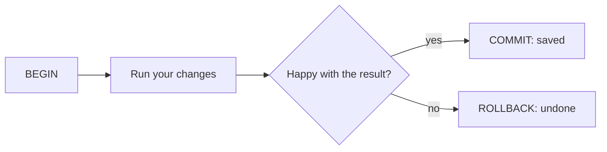

{:class="cover"}

---

By the end of this lesson you will be able to insert many rows at once, update and delete rows with confidence, and use a transaction to undo a mistake before it is saved.

---

This lesson loads the data we'll use for the rest of the course. You need the `robots` and `sensors` tables from lesson 4 (both empty). If you skipped ahead, here is the whole setup in one go:

```sql
CREATE TABLE robots (
    robot_id    INTEGER PRIMARY KEY,
    name        TEXT NOT NULL UNIQUE,
    kind        TEXT NOT NULL DEFAULT 'rover',
    battery_mah INTEGER,
    built_on    TEXT
);
CREATE TABLE sensors (
    sensor_id INTEGER PRIMARY KEY,
    robot_id  INTEGER REFERENCES robots (robot_id),
    model     TEXT NOT NULL,
    kind      TEXT NOT NULL,
    price     REAL
);
```

## Inserting many rows at once

One `INSERT` can carry many rows, separated by commas. It is faster and tidier than one statement per row:

```sql
INSERT INTO robots (name, kind, battery_mah, built_on) VALUES
    ('Smars',       'rover',  2000, '2024-03-10'),
    ('Pico Walker', 'walker', 1500, '2024-06-21'),
    ('Arm Buddy',   'arm',    NULL, '2024-09-02'),
    ('Line Chaser', 'rover',  1200, '2025-01-15'),
    ('Mystery Bot', 'rover',  NULL, NULL);
```

Two things to notice. `NULL` (no quotes) means "we don't know", so Arm Buddy has no battery figure yet. And the dates are text in `YYYY-MM-DD` form.

Now the sensors. The first number is the `robot_id` each one is fitted to:

```sql
INSERT INTO sensors (robot_id, model, kind, price) VALUES
    (1, 'HC-SR04',  'distance', 2.50),
    (1, 'TCRT5000', 'line',     1.20),
    (2, 'HC-SR04',  'distance', 2.50),
    (2, 'MPU6050',  'motion',   3.80),
    (4, 'TCRT5000', 'line',     1.20),
    (4, 'TCRT5000', 'line',     1.20),
    (NULL, 'VL53L0X', 'distance', 6.00);
```

The prices are made-up sample figures, not real shop prices. The last sensor has `NULL` for `robot_id`: it is sitting in the parts drawer, not fitted to anything. Check your work:

```sql
SELECT * FROM robots;
```

```text
robot_id  name         kind    battery_mah  built_on
--------  -----------  ------  -----------  ----------
1         Smars        rover   2000         2024-03-10
2         Pico Walker  walker  1500         2024-06-21
3         Arm Buddy    arm                  2024-09-02
4         Line Chaser  rover   1200         2025-01-15
5         Mystery Bot  rover
```

If you inserted rows twice by accident, delete the table contents with `DELETE FROM sensors;` and `DELETE FROM robots;`, then insert again.

## When a row already exists

Inserting `Smars` again fails, because `name` is `UNIQUE`:

```sql
INSERT INTO robots (name) VALUES ('Smars');
```

```text
UNIQUE constraint failed: robots.name
```

If you'd rather skip duplicates quietly, say so:

```sql
INSERT OR IGNORE INTO robots (name) VALUES ('Smars');
```

No error, and no new row. `INSERT OR IGNORE` is SQLite's wording. MySQL uses `INSERT IGNORE`.

## Updating rows

Fit the spare VL53L0X to Arm Buddy (robot 3):

```sql
UPDATE sensors SET robot_id = 3 WHERE model = 'VL53L0X';
```

You can also set a column back to `NULL` to say "not fitted to anything":

```sql
UPDATE sensors SET robot_id = NULL WHERE model = 'VL53L0X';
```

An `UPDATE` can use the old value too. This raises every `line` sensor price by 10 percent:

```sql
UPDATE sensors SET price = price * 1.1 WHERE kind = 'line';
```

Check it, then put it back so your numbers match the rest of the course:

```sql
SELECT sensor_id, model, price FROM sensors WHERE kind = 'line';
UPDATE sensors SET price = 1.20 WHERE kind = 'line';
```

## Deleting rows

Add a throwaway sensor, then remove it using its unique ID:

```sql
INSERT INTO sensors (robot_id, model, kind, price) VALUES (NULL, 'Test', 'test', 0);
SELECT sensor_id FROM sensors WHERE model = 'Test';
DELETE FROM sensors WHERE sensor_id = 8;
```

Use the `sensor_id` the `SELECT` shows you. It should be 8 if you've followed along.

## Transactions: an undo button

What if you make a mistake with no `WHERE`? A **transaction** groups statements so they are saved together, or not at all. `BEGIN` starts one, `COMMIT` keeps the changes and `ROLLBACK` throws them away.



Try a disaster safely:

```sql
BEGIN;
UPDATE robots SET battery_mah = 0;
SELECT name, battery_mah FROM robots;
```

```text
name         battery_mah
-----------  -----------
Smars        0
Pico Walker  0
Arm Buddy    0
Line Chaser  0
Mystery Bot  0
```

Every battery is zero. Whoops. Undo it:

```sql
ROLLBACK;
SELECT name, battery_mah FROM robots;
```

```text
name         battery_mah
-----------  -----------
Smars        2000
Pico Walker  1500
Arm Buddy
Line Chaser  1200
Mystery Bot
```

Everything is back. Get in the habit of typing `BEGIN;` before any risky change, and `COMMIT;` only once the `SELECT` looks right.

> **Teachers**: let students practise destructive commands freely, but first have each one copy their database (`cp workshop.db workshop_backup.db`, or copy the file in a file manager). A broken table then costs a minute, not the lesson. Remind them that `DELETE` without `WHERE` does not ask for confirmation.

## Try it Yourself

1. Insert two more robots in a single statement, then remove one with a `DELETE` that uses its `robot_id`.
2. Use `UPDATE` to give `Arm Buddy` a battery of 2500, check it with a `SELECT`, then set it back to `NULL`.
3. Challenge: in a transaction, delete all sensors with `price < 2`, look at what is left, then `ROLLBACK` and confirm they came back.

## Common Issues

- **Problem**: `table sensors has 5 columns but 4 values were supplied`.
- **Solution**: List the columns you're filling in after the table name, and give exactly one value for each.
- **Why**: Without a column list, SQL expects a value for every column, including the auto-numbered ID.

- **Problem**: `FOREIGN KEY constraint failed` on a sensor insert.
- **Solution**: Check that the `robot_id` really exists in `robots`, or use `NULL`.
- **Why**: Foreign keys only accept an existing parent row (when `PRAGMA foreign_keys = ON;` is set).

- **Problem**: I ran `ROLLBACK` but my changes stayed.
- **Solution**: Check that you typed `BEGIN;` first. Without it, each statement is saved the moment it runs.
- **Why**: Outside a transaction, SQLite saves every statement automatically.

## Check your understanding


? What does `NULL` mean in a column?
- [ ] The number zero
- [ ] An empty piece of text
- [x] There is no value, because it is unknown or not filled in
> `NULL` is different from `0` and from `''`. Arm Buddy's missing battery is `NULL` until we know the figure.

? Which command undoes the changes made since `BEGIN`?
- [x] `ROLLBACK`
- [ ] `COMMIT`
- [ ] `UNDO`
> `COMMIT` saves the changes, `ROLLBACK` discards them. There is no `UNDO` in SQL.

? How can one `INSERT` add several rows?
- [ ] You can't. Each row needs its own statement
- [x] List several sets of values in parentheses, separated by commas
- [ ] Use `INSERT ALL`
> `VALUES (...), (...), (...)` adds all the rows in one statement.


With data in place, we can finally start asking it questions.
