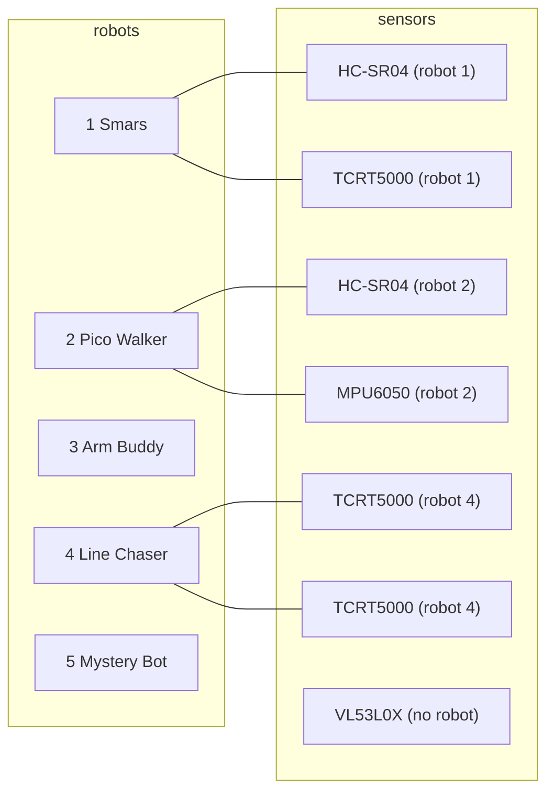

{:class="cover"}

---

By the end of this lesson you will be able to combine two tables with `JOIN`, choose between `INNER` and `LEFT` joins, and find rows that have no match.

---

Our data lives in separate tables on purpose: robots in one, sensors in another, linked by `robot_id`. A **join** puts them back together for a query, matching rows where the keys agree.



Look at the picture. Arm Buddy and Mystery Bot have no lines, and the VL53L0X has none either. How each join treats those loose ends is the whole story.

## INNER JOIN: only the matches

```sql
SELECT r.name, s.model
FROM robots AS r
INNER JOIN sensors AS s ON s.robot_id = r.robot_id
ORDER BY r.robot_id, s.sensor_id;
```

```text
name         model
-----------  --------
Smars        HC-SR04
Smars        TCRT5000
Pico Walker  HC-SR04
Pico Walker  MPU6050
Line Chaser  TCRT5000
Line Chaser  TCRT5000
```

Three pieces make a join work:

- `AS r` and `AS s` give each table a short **alias**, so you can write `r.name` instead of `robots.name`.
- `ON s.robot_id = r.robot_id` says which columns must match.
- Rows with no partner (Arm Buddy, Mystery Bot, the spare VL53L0X) vanish. Plain `JOIN` means `INNER JOIN`.

## LEFT JOIN: keep everything from the left table

Say you want every robot, whether or not it has sensors:

```sql
SELECT r.name, s.model
FROM robots AS r
LEFT JOIN sensors AS s ON s.robot_id = r.robot_id
ORDER BY r.robot_id, s.sensor_id;
```

```text
name         model
-----------  --------
Smars        HC-SR04
Smars        TCRT5000
Pico Walker  HC-SR04
Pico Walker  MPU6050
Arm Buddy
Line Chaser  TCRT5000
Line Chaser  TCRT5000
Mystery Bot
```

Arm Buddy and Mystery Bot are back, with blank (`NULL`) sensor columns. That gives us a neat trick for finding **orphans**: robots with no sensors at all.

```sql
SELECT r.name
FROM robots AS r
LEFT JOIN sensors AS s ON s.robot_id = r.robot_id
WHERE s.sensor_id IS NULL;
```

```text
name
-----------
Arm Buddy
Mystery Bot
```

Flip the tables round to find sensors sitting in the drawer:

```sql
SELECT s.model, s.kind
FROM sensors AS s
LEFT JOIN robots AS r ON r.robot_id = s.robot_id
WHERE r.robot_id IS NULL;
```

```text
model    kind
-------  --------
VL53L0X  distance
```

## RIGHT and FULL joins

`RIGHT JOIN` keeps everything from the second table instead, and `FULL JOIN` keeps unmatched rows from both. SQLite only supports them from version 3.39, so on an older system, swap the table order and use `LEFT JOIN`. For a full join on the robots and sensors, this shows all three kinds of rows:

```sql
SELECT r.name, s.model
FROM robots AS r
FULL JOIN sensors AS s ON s.robot_id = r.robot_id
ORDER BY r.robot_id, s.sensor_id;
```

```text
name         model
-----------  --------
             VL53L0X
Smars        HC-SR04
Smars        TCRT5000
Pico Walker  HC-SR04
Pico Walker  MPU6050
Arm Buddy
Line Chaser  TCRT5000
Line Chaser  TCRT5000
Mystery Bot
```

The spare VL53L0X comes first because its `robot_id` is `NULL`, and `NULL` sorts first. MySQL has no `FULL JOIN`, so there it takes a `UNION` of a left and a right join.

## Filtering joined data

A `WHERE` on the sensor table works as you'd hope with an inner join:

```sql
SELECT r.name, s.model
FROM robots AS r
JOIN sensors AS s ON s.robot_id = r.robot_id
WHERE s.kind = 'distance';
```

That gives Smars and Pico Walker, each with an HC-SR04. But beware: put the same `WHERE s.kind = 'distance'` on a **left** join and Arm Buddy and the others disappear again, because their `s.kind` is `NULL`, which fails the test. To keep every robot, move the condition into the `ON`:

```sql
SELECT r.name, s.model
FROM robots AS r
LEFT JOIN sensors AS s ON s.robot_id = r.robot_id AND s.kind = 'distance'
ORDER BY r.robot_id, s.sensor_id;
```

```text
name         model
-----------  -------
Smars        HC-SR04
Pico Walker  HC-SR04
Arm Buddy
Line Chaser
Mystery Bot
```

## The accidental cross join

If you forget the `ON`, the database pairs **every** robot with **every** sensor:

```sql
SELECT COUNT(*) FROM robots, sensors;
```

```text
COUNT(*)
--------
35
```

5 robots times 7 sensors is 35 rows, nearly all nonsense. With big tables, that can be millions of rows. If a join returns far more rows than expected, check your `ON`.

## Try it Yourself

1. List every sensor with the name of the robot it is fitted to, ordered by sensor model. Keep the spare sensor in the list.
2. Find robots that have a `line` sensor fitted.
3. Challenge: list each robot and its sensor models, but only for robots built before `2025-01-01`. Decide whether you need an `INNER` or `LEFT` join, and why.

## Common Issues

- **Problem**: `ambiguous column name: robot_id`.
- **Solution**: Put the table alias in front of the column, as in `r.robot_id`.
- **Why**: Both tables have a `robot_id` column, so the database can't guess which you mean.

- **Problem**: My `LEFT JOIN` has dropped the unmatched rows.
- **Solution**: Check for a `WHERE` on the right-hand table. Move the test into the `ON` clause, or add `OR s.sensor_id IS NULL`.
- **Why**: A `WHERE` runs after the join, and `NULL` fails most tests.

- **Problem**: `RIGHT and FULL OUTER JOINs are not currently supported`.
- **Solution**: Swap the table order and use `LEFT JOIN`, or update SQLite to 3.39 or newer.
- **Why**: Older SQLite versions only knew `INNER` and `LEFT` joins.

## Check your understanding


? Which join keeps robots that have no sensors?
- [ ] `INNER JOIN` from robots to sensors
- [x] `LEFT JOIN` from robots to sensors
- [ ] Neither. Joins only keep matching rows
> `LEFT JOIN` keeps every row from the left table, filling the right side with `NULL` when there is no match.

? What does `ON s.robot_id = r.robot_id` do?
- [ ] Filters the output to one robot
- [x] Says which rows from the two tables belong together
- [ ] Creates a foreign key
> The `ON` clause is the matching rule for the join.

? What would `SELECT * FROM robots, sensors` (no `ON` or `WHERE`) return for 5 robots and 7 sensors?
- [ ] 7 rows
- [ ] 12 rows
- [x] 35 rows
> Every robot is paired with every sensor, so 5 times 7 rows.


Joins let us combine data. Next we'll summarise it.
