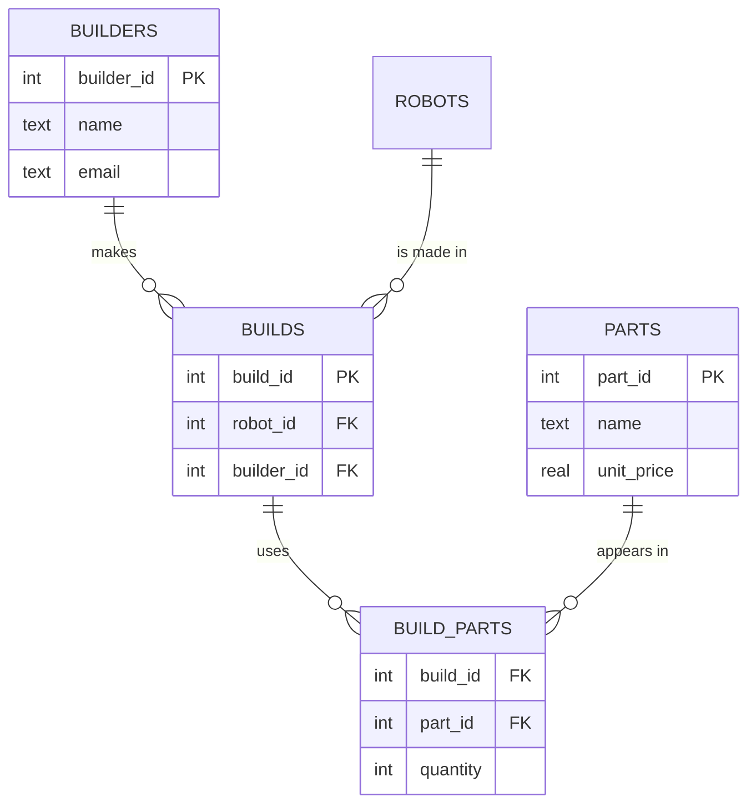

{:class="cover"}

---

By the end of this lesson you will be able to spot repeated and tangled data in a table, and split it into tables that satisfy first, second and third normal form.

---

So far we've been handed sensible tables. Now let's see what happens when you design them badly. **Normalisation** is the habit of organising tables so each fact is stored **once**. It saves space, but the real prize is that your data can't contradict itself.

## A messy build log

Imagine you keep a log of which parts went into each robot, and who built it, all in one table:

```sql
CREATE TABLE build_log_messy (
    log_id        INTEGER PRIMARY KEY,
    robot_name    TEXT,
    builder_name  TEXT,
    builder_email TEXT,
    parts         TEXT
);

INSERT INTO build_log_messy (robot_name, builder_name, builder_email, parts) VALUES
    ('Smars',       'Kev', 'kev@example.com', 'motor, wheel, battery'),
    ('Pico Walker', 'Kev', 'kev@example.com', 'servo, battery'),
    ('Line Chaser', 'Sam', 'sam@example.com', 'motor, wheel');
```

```text
log_id  robot_name   builder_name  builder_email    parts
------  -----------  ------------  ---------------  ---------------------
1       Smars        Kev           kev@example.com  motor, wheel, battery
2       Pico Walker  Kev           kev@example.com  servo, battery
3       Line Chaser  Sam           sam@example.com  motor, wheel
```

It looks fine, until you try to use it. Kev's email is written twice, and "which robots used a wheel?" means searching inside a text list with `LIKE '%wheel%'`, which also matches `wheelbase` and can't be counted properly.

## First normal form (1NF): one value per cell

**Rule**: every cell holds a single value, with no lists and no repeating columns like `part1`, `part2`.

The fix is one row per part. The key is now the pair (`log_id`, `part_name`), because neither alone is unique:

```sql
CREATE TABLE build_parts_1nf (
    log_id        INTEGER,
    part_name     TEXT,
    robot_name    TEXT,
    builder_name  TEXT,
    builder_email TEXT,
    part_price    REAL,
    PRIMARY KEY (log_id, part_name)
);

INSERT INTO build_parts_1nf VALUES
    (1, 'motor',   'Smars',       'Kev', 'kev@example.com', 3.50),
    (1, 'wheel',   'Smars',       'Kev', 'kev@example.com', 0.80),
    (1, 'battery', 'Smars',       'Kev', 'kev@example.com', 8.00),
    (2, 'servo',   'Pico Walker', 'Kev', 'kev@example.com', 2.20),
    (2, 'battery', 'Pico Walker', 'Kev', 'kev@example.com', 8.00),
    (3, 'motor',   'Line Chaser', 'Sam', 'sam@example.com', 3.50),
    (3, 'wheel',   'Line Chaser', 'Sam', 'sam@example.com', 0.80);
```

Now we can count and search, but there is a lot of repetition. Watch what happens when the battery price changes in just one row:

```sql
UPDATE build_parts_1nf SET part_price = 9.00
WHERE log_id = 1 AND part_name = 'battery';

SELECT part_name, part_price FROM build_parts_1nf WHERE part_name = 'battery';
```

```text
part_name  part_price
---------  ----------
battery    9.0
battery    8.0
```

The database now says a battery costs 9.00 **and** 8.00. This is an **update anomaly**, and normalisation exists to prevent it.

## Second normal form (2NF): depend on the whole key

**Rule**: be in 1NF, and every non-key column depends on the **whole** key, not just part of it.

Our key is (`log_id`, `part_name`). But `part_price` depends only on `part_name`, and `robot_name`, `builder_name` and `builder_email` depend only on `log_id`. Those are partial dependencies. The fix is to give each idea its own table: one for parts (with their price), and one for builds.

## Third normal form (3NF): no hopping through other columns

**Rule**: be in 2NF, and no non-key column depends on another non-key column.

Look at the builds. `builder_email` is really a fact about the **builder**, not about the build. It depends on `builder_name`, which in turn depends on the build, a chain called a **transitive dependency**. The fix is a `builders` table. The rule of thumb: every column should depend on "the key, the whole key, and nothing but the key".

## The tidy design



`build_parts` is a **link table**. A build uses many parts and a part goes into many builds, so a table in the middle holds one row per pair, plus the quantity. Create the tables, reusing the `robots` table we already have:

```sql
CREATE TABLE builders (
    builder_id INTEGER PRIMARY KEY,
    name       TEXT NOT NULL,
    email      TEXT NOT NULL UNIQUE
);
CREATE TABLE parts (
    part_id    INTEGER PRIMARY KEY,
    name       TEXT NOT NULL UNIQUE,
    unit_price REAL NOT NULL
);
CREATE TABLE builds (
    build_id   INTEGER PRIMARY KEY,
    robot_id   INTEGER NOT NULL REFERENCES robots (robot_id),
    builder_id INTEGER NOT NULL REFERENCES builders (builder_id)
);
CREATE TABLE build_parts (
    build_id INTEGER NOT NULL REFERENCES builds (build_id),
    part_id  INTEGER NOT NULL REFERENCES parts (part_id),
    quantity INTEGER NOT NULL DEFAULT 1,
    PRIMARY KEY (build_id, part_id)
);

INSERT INTO builders (name, email) VALUES
    ('Kev', 'kev@example.com'),
    ('Sam', 'sam@example.com');
INSERT INTO parts (name, unit_price) VALUES
    ('motor', 3.50), ('wheel', 0.80), ('battery', 8.00), ('servo', 2.20);
INSERT INTO builds (robot_id, builder_id) VALUES (1, 1), (2, 1), (4, 2), (3, 2);
INSERT INTO build_parts (build_id, part_id, quantity) VALUES
    (1, 1, 2), (1, 2, 4), (1, 3, 1),
    (2, 4, 6), (2, 3, 1),
    (3, 1, 2), (3, 2, 2),
    (4, 4, 4), (4, 3, 1);
```

A four-table join puts the full picture back together:

```sql
SELECT r.name AS robot, b.name AS builder, p.name AS part, bp.quantity
FROM builds AS bd
JOIN robots AS r ON r.robot_id = bd.robot_id
JOIN builders AS b ON b.builder_id = bd.builder_id
JOIN build_parts AS bp ON bp.build_id = bd.build_id
JOIN parts AS p ON p.part_id = bp.part_id
ORDER BY bd.build_id, p.part_id;
```

```text
robot        builder  part     quantity
-----------  -------  -------  --------
Smars        Kev      motor    2
Smars        Kev      wheel    4
Smars        Kev      battery  1
Pico Walker  Kev      battery  1
Pico Walker  Kev      servo    6
Line Chaser  Sam      motor    2
Line Chaser  Sam      wheel    2
Arm Buddy    Sam      battery  1
Arm Buddy    Sam      servo    4
```

Now a battery's price lives in one row, so changing it once changes it everywhere. Finally, tidy up the practice tables:

```sql
DROP TABLE build_log_messy;
DROP TABLE build_parts_1nf;
```

## Try it Yourself

1. Add a new part, `ultrasonic sensor`, to `parts`, then record that build 3 (Line Chaser) used one.
2. Change Sam's email in one `UPDATE`, then run the four-table join to see it change for every row.
3. Challenge: write a query that gives the total parts cost per robot (quantity times unit price, summed). Lesson 9 and the join above are all you need.

## Common Issues

- **Problem**: `FOREIGN KEY constraint failed` when I insert into `builds` or `build_parts`.
- **Solution**: Insert the parent rows first (builders, parts, robots), then the rows that point at them, and set `PRAGMA foreign_keys = ON;`.
- **Why**: A foreign key must point at a row that already exists.

- **Problem**: I normalised everything and now every query needs five joins.
- **Solution**: That's normal. Wrap the common joins in a view (lesson 13) and add indexes.
- **Why**: Normalisation trades a few extra joins for data that can't contradict itself, and views hide the joins.

- **Problem**: Should I store `quantity * unit_price` in a column as well?
- **Solution**: No, calculate it in the query.
- **Why**: A stored total is a copy that can drift out of step when the inputs change.

## Check your understanding


? Which of these breaks first normal form?
- [ ] A `robot_id` column
- [x] A `parts` column holding the text `motor, wheel, battery`
- [ ] A column that allows `NULL`
> 1NF wants one value per cell. A comma-separated list should be one row per item.

? A table has the key (`log_id`, `part_name`), and `part_price` depends only on `part_name`. Which form is broken?
- [ ] First normal form
- [x] Second normal form
- [ ] Third normal form
> `part_price` depends on only part of the key, which is a partial dependency and breaks 2NF.

? What is the job of the `build_parts` table?
- [ ] It stores the name of each part
- [x] It links builds to parts, since each can have many of the other
- [ ] It replaces the primary key of `builds`
> A link table holds one row per (build, part) pair, with the quantity.


There is one more normal form worth knowing, a stricter version of the third. Let's meet Boyce-Codd.
