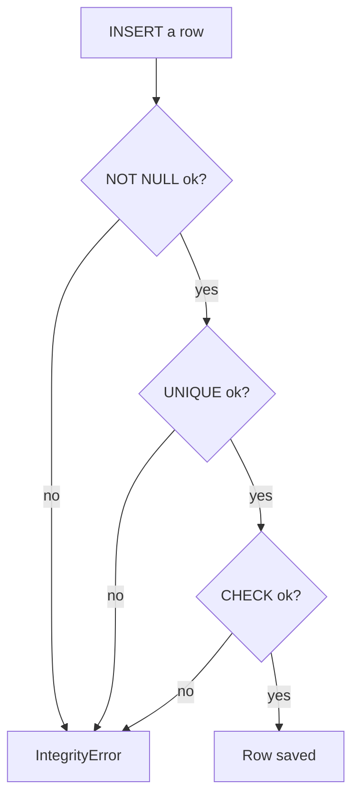

{:class="cover"}

---

By the end of this lesson you will be able to create tables with primary keys and constraints, and change a table later with `ALTER TABLE`.

Module 3 focuses on creating tables in SQLite databases and understanding the principles of schema design. We will explore how to define table structure, data types, constraints, and primary keys.

### Understanding Table Structure

Tables are the foundation of a relational database. They organize and store data in a structured manner. In this section, we will explore the components of table structure.

#### Rows (Records) and Columns

A table consists of rows, also known as records or tuples, and columns, also known as fields or attributes.

- **Rows**: Each row represents a distinct record or entry in the table. For example, in a "Books" table, each row might represent a specific book with information like the title, author, and publication year.
- **Columns**: Columns define the specific types of data that can be stored in a table. Each column corresponds to a specific attribute or piece of information about the records. For instance, in the "Books" table, columns might include "Title," "Author," and "Publication Year."

### Creating Tables

To create tables in a SQLite database, we use the SQL `CREATE TABLE` statement. This statement specifies the table name, column names, data types, and constraints.

```python
# Create a table
connection.execute('''
    CREATE TABLE IF NOT EXISTS books (
        id INTEGER PRIMARY KEY,
        title TEXT,
        author TEXT,
        year INTEGER
    )
''')
```

In this example, we create a table named "books" with four columns: "id," "title," "author," and "year." The `INTEGER` data type is used for the "id" and "year" columns, while `TEXT` is used for the "title" and "author" columns. The "id" column is defined as the primary key.

### Defining Primary Keys

A primary key uniquely identifies each record in a table. It ensures data integrity and serves as a reference point for establishing relationships between tables. In SQLite, primary keys can be defined using the `PRIMARY KEY` constraint.

```python
# Create a table with a primary key
connection.execute('''
    CREATE TABLE IF NOT EXISTS students (
        id INTEGER PRIMARY KEY,
        name TEXT,
        age INTEGER,
        grade TEXT
    )
''')
```

In this example, we create a "students" table with an "id" column as the primary key. Each record in the table will have a unique "id" value. An `INTEGER PRIMARY KEY` column fills itself in: if you don't give a value, SQLite picks the next number.

### Adding constraints

When you insert a row, SQLite checks every rule before it saves anything:



Constraints make the database reject bad data for you:

```python
connection.execute('''
    CREATE TABLE IF NOT EXISTS robots (
        id INTEGER PRIMARY KEY,
        name TEXT NOT NULL UNIQUE,
        wheels INTEGER DEFAULT 2 CHECK (wheels >= 0)
    )
''')
```

- `NOT NULL` means every robot must have a name
- `UNIQUE` means no two robots can share a name
- `DEFAULT 2` fills in `wheels` if you leave it out
- `CHECK (wheels >= 0)` rejects negative numbers

Inserting a row that breaks a constraint raises `sqlite3.IntegrityError`.

### Modifying Tables

Sometimes, we need to modify the structure of existing tables. SQLite provides the `ALTER TABLE` statement to rename a table, and to add, rename or drop columns. It can't change a column's type: for that you create a new table and copy the data across.

```python
# Add a new column to a table
connection.execute("ALTER TABLE students ADD COLUMN email TEXT")
```

In this example, we add a new "email" column to the "students" table. This new column will store email addresses for each student. Rows that were already there get `NULL` (shown as `None` in Python) in the new column, unless you give it a `DEFAULT`.

### Schema Design Considerations

When designing a database schema, it's important to consider several factors to ensure efficient data storage and retrieval. Some key considerations include:

- **Normalization**: Organize data into tables and reduce redundancy.
- **Data Types**: Choose appropriate data types for columns to optimize storage and enforce data integrity.
- **Constraints**: Define constraints (e.g., `NOT NULL`, `UNIQUE`) to maintain data integrity and consistency.
- **Relationships**: Establish relationships between tables using foreign keys to represent connections between entities.
- **Indexing**: Use indexes to improve query performance on frequently searched columns.

By understanding these considerations, we can design efficient and well-structured databases.

## Try it Yourself

1. Create the `robots` table from this lesson. Insert a robot called `Smars` using only the `name`, and print the row. What is `wheels`?
2. Break each rule on purpose: insert `Smars` again, insert a robot with `wheels` of `-1`, and insert a robot with no name. Read each error message.
3. Add an `email TEXT` column to `students`, then print an old row. What value does it have?
4. Challenge: design a `parts` table for your robot box with a sensible primary key, a `NOT NULL` name, and a `CHECK` that quantity is never negative.

## Common Issues

- **Problem**: `sqlite3.OperationalError: table robots already exists`.
- **Solution**: Write `CREATE TABLE IF NOT EXISTS`.
- **Why**: Without it, running the script a second time tries to create the table again.

- **Problem**: `sqlite3.OperationalError: duplicate column name: email`.
- **Solution**: Only run `ALTER TABLE ... ADD COLUMN` once, or remove the line after the first run.
- **Why**: `ALTER TABLE` has no `IF NOT EXISTS` for columns, so a second run tries to add the same column twice.

- **Problem**: `sqlite3.IntegrityError: UNIQUE constraint failed: robots.name`.
- **Solution**: That's the constraint doing its job. Choose a different name, or update the existing row instead.
- **Why**: The `UNIQUE` rule rejects a second robot with the same name.

---

## Check your understanding


? Which constraint stops two rows having the same value in a column?
- [ ] `NOT NULL`
- [x] `UNIQUE`
- [ ] `DEFAULT`
> `UNIQUE` rejects duplicates. `NOT NULL` only rejects empty values.

? What happens if you insert a row without an `id` into a table with `id INTEGER PRIMARY KEY`?
- [ ] An error
- [x] SQLite picks the next number automatically
- [ ] The id is set to 0
> An `INTEGER PRIMARY KEY` column numbers rows for you.

? You add a column with `ALTER TABLE students ADD COLUMN email TEXT`. What do the existing rows hold in `email`?
- [ ] An empty string
- [x] `NULL` (shown as `None` in Python)
> Existing rows get no value for a new column unless you give it a `DEFAULT`.

? Which constraint stops `wheels` from being negative?
- [ ] `UNIQUE`
- [ ] `NOT NULL`
- [x] `CHECK (wheels >= 0)`
> `CHECK` tests any condition you write before the row is saved.


---
