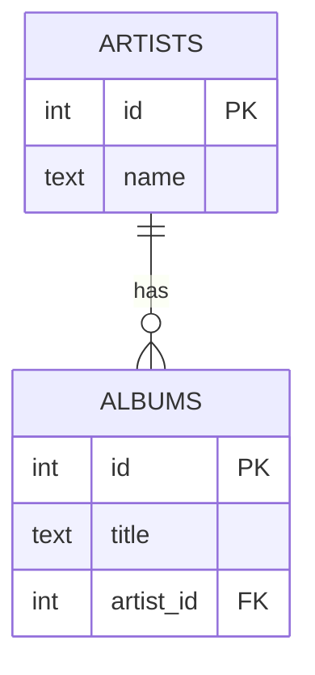

{:class="cover"}

---

By the end of this lesson you will be able to change and remove rows safely with `UPDATE` and `DELETE`, and use foreign keys with `ON DELETE CASCADE`.

Module 5 focuses on modifying data in SQLite tables. You will learn how to update existing records and delete data from tables using SQL statements.

### Updating Data

To modify existing data in a SQLite table, we use the SQL `UPDATE` statement. This statement allows us to specify the table name, the columns to update, and the new values.

```python
# Update a record in the table
with connection:
    connection.execute("UPDATE books SET title = ? WHERE id = ?", ("New Title", 1))
```

In this example, we update the title of a book with an ID of 1 in the "books" table. The cursor that `execute()` returns has a `rowcount`, which tells you how many rows were changed, so `cursor.rowcount` of `0` means your `WHERE` matched nothing.

### Deleting Data

To remove data from a SQLite table, we use the SQL `DELETE` statement. This statement allows us to specify the table name and the conditions for deleting records.

```python
# Delete records from the table
with connection:
    connection.execute("DELETE FROM books WHERE author = ?", ("F. Scott Fitzgerald",))
```

In this example, we delete records from the "books" table where the author is "F. Scott Fitzgerald."

> ## Don't forget the WHERE
>
> `UPDATE` or `DELETE` without a `WHERE` clause changes **every** row in the table. Run the same `WHERE` with a `SELECT` first to check which rows will be affected.

### Batch Updates and Deletes

SQLite allows us to perform batch updates and deletes using the `executemany()` method. This method allows us to execute the same SQL statement multiple times with different parameter values.

```python
# Batch update
data = [("New Title 1", 1), ("New Title 2", 2), ("New Title 3", 3)]
with connection:
    connection.executemany("UPDATE books SET title = ? WHERE id = ?", data)
```

In this example, we perform a batch update on the "books" table, updating the titles of multiple books based on their IDs.

### Handling Cascading Deletes and Referential Integrity

SQLite supports referential integrity, which means that you can define relationships between tables using foreign keys. When a record in a parent table is deleted, you can specify the desired behavior for associated records in child tables.



SQLite only enforces foreign keys when you switch them on, once per connection:

```python
connection.execute("PRAGMA foreign_keys = ON")
```

```python
# Create tables with foreign key relationship
connection.execute('''
    CREATE TABLE IF NOT EXISTS artists (
        id INTEGER PRIMARY KEY,
        name TEXT
    )
''')

connection.execute('''
    CREATE TABLE IF NOT EXISTS albums (
        id INTEGER PRIMARY KEY,
        title TEXT,
        artist_id INTEGER,
        FOREIGN KEY (artist_id) REFERENCES artists(id) ON DELETE CASCADE
    )
''')
```

In this example, we create two tables: "artists" and "albums." The "albums" table has a foreign key relationship with the "artists" table. The `ON DELETE CASCADE` clause ensures that when an artist is deleted, all associated albums are also deleted. With foreign keys switched on, SQLite also refuses to add an album for an artist that doesn't exist.

By understanding how to update and delete data, as well as handle cascading deletes and referential integrity, you will have the tools to effectively modify and manage data in SQLite tables.

## Try it Yourself

1. Update the year of one book and use `rowcount` to confirm that exactly one row changed.
2. Before running a `DELETE`, run the same `WHERE` as a `SELECT` and read the rows it would remove. Then delete them.
3. Create the `artists` and `albums` tables, switch on `PRAGMA foreign_keys = ON`, add an artist with two albums, delete the artist and count the albums.
4. Challenge: comment out the `PRAGMA` line and repeat. What changes, and why?

## Common Issues

- **Problem**: Every row in the table has changed or vanished.
- **Solution**: You left off the `WHERE`. Restore from a backup (see lesson 10) and always test the `WHERE` with a `SELECT` first.
- **Why**: Without `WHERE`, `UPDATE` and `DELETE` apply to the whole table.

- **Problem**: The albums are still there after you delete their artist.
- **Solution**: Run `PRAGMA foreign_keys = ON` on every new connection, before you create or delete anything.
- **Why**: Foreign keys are off by default in SQLite and the setting isn't saved in the file.

- **Problem**: `sqlite3.IntegrityError: FOREIGN KEY constraint failed` when adding an album.
- **Solution**: Add the artist first, or use the right `artist_id`.
- **Why**: With foreign keys on, an album must point at an artist that exists.

> **Teachers**: `DELETE` and `UPDATE` without a `WHERE` on a shared database file removes everyone's work at once. Have each learner work on their own copy of the `.db` file, and show them the backup method from lesson 10 before this lesson's exercises.

---

## Check your understanding


? What does `DELETE FROM books` (with no WHERE) do?
- [ ] Deletes the first book
- [x] Deletes every row in the table
- [ ] Deletes the table itself
> Without `WHERE`, the statement applies to every row. `DROP TABLE` is what removes the table.

? Why might `ON DELETE CASCADE` seem to do nothing in SQLite?
- [x] Foreign keys are off until you run `PRAGMA foreign_keys = ON`
- [ ] SQLite doesn't support foreign keys
- [ ] It only works on tables with fewer than 100 rows
> SQLite checks foreign keys only when they're switched on for the connection.

? How can you check how many rows an `UPDATE` changed?
- [ ] `connection.count()`
- [x] Read `cursor.rowcount` from the cursor that `execute()` returned
- [ ] Call `fetchall()` on the update
> A `rowcount` of 0 usually means the `WHERE` matched nothing.


---
