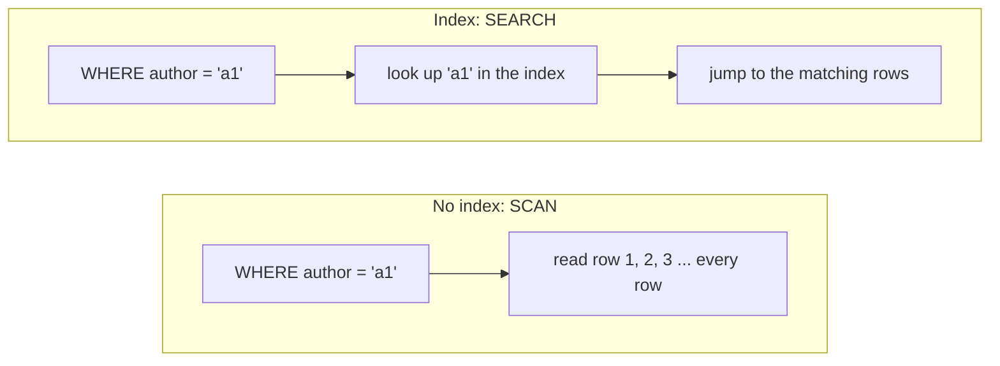

{:class="cover"}

---

By the end of this lesson you will be able to read a query plan with `EXPLAIN QUERY PLAN` and speed up a slow search with an index.

Module 9 focuses on optimizing the performance of SQLite databases by utilizing indexes and employing various techniques to improve query execution speed.

### Understanding Indexes

Indexes are data structures that improve the speed of data retrieval operations in a database. They provide a way to quickly locate and access specific data within a table.

#### Primary Key Index

Every SQLite table is stored in order of its row id, and an `INTEGER PRIMARY KEY` column *is* the row id. So looking a row up by its primary key is already fast, without any extra index. For other kinds of primary key, and for `UNIQUE` columns, SQLite creates an index automatically.

#### Creating Additional Indexes

To improve the performance of queries that involve filtering, sorting, or joining, we can create additional indexes on specific columns.

```python
# Create an index on a column
connection.execute("CREATE INDEX IF NOT EXISTS idx_books_author ON books(author)")
```

In this example, we create an index named "idx_books_author" on the "author" column of the "books" table. This index enhances query performance when filtering or sorting based on the "author" column.



### Analyzing Query Performance

SQLite provides the `EXPLAIN QUERY PLAN` command, which helps analyze the execution plan of a query and identify areas for optimization.

```python
# Analyze query performance
query = "SELECT * FROM books WHERE author = ?"
result = connection.execute("EXPLAIN QUERY PLAN " + query, ("F. Scott Fitzgerald",))
data = result.fetchall()
```

By examining the output of the `EXPLAIN QUERY PLAN` command, we can identify potential performance bottlenecks and make informed decisions on index creation or query optimization.

Print `data` and look at the last item of each row:

- `SCAN books` means SQLite reads every row to find the matches. Fine for small tables, slow for big ones
- `SEARCH books USING INDEX idx_books_author (author=?)` means it jumps straight to the matching rows using the index

Try it before and after creating the index to see the difference.

### Optimizing Query Execution

There are various techniques to optimize query execution and improve overall database performance.

#### Filtering Rows

To improve query performance, it's important to limit the number of rows returned by a query. Use the `WHERE` clause to filter rows based on specific conditions and retrieve only the necessary data.

#### Limiting Result Sets

If you only need a subset of records, use the `LIMIT` clause to restrict the number of rows returned by a query. This helps reduce the data transferred and improves query response time.

#### Using Joins Efficiently

Joins can impact query performance, especially when dealing with large tables. Be selective when joining tables and use appropriate indexes on join columns.

#### Avoiding Unnecessary Data Retrieval

Retrieve only the columns that are required for a particular query. Avoid selecting unnecessary columns to reduce the amount of data transferred and improve query performance.

### Monitoring and Tuning

Regular monitoring and tuning of your SQLite database can help identify performance issues and optimize query execution.

#### Monitoring Tools

Running `ANALYZE` makes SQLite gather statistics about your tables and indexes (stored in the `sqlite_stat1` table), which helps it choose the best plan for each query. The `sqlite3_analyzer` command-line utility from the SQLite website reports how space is used in a database file.

#### Query Optimization Techniques

Optimizing queries involves techniques such as using appropriate indexes, rewriting complex queries, and denormalizing data in certain cases.

### Performance Testing and Benchmarking

To measure the performance improvements achieved through optimizations, it's important to conduct performance testing and benchmarking on representative workloads.

### Continuous Improvement

Database performance is an ongoing concern. Regularly monitor performance, analyze query execution plans, and fine-tune indexes and queries to ensure optimal performance over time.

By understanding indexes and employing performance optimization techniques, you can significantly enhance the speed and efficiency of your SQLite databases.

---

> ## Indexes aren't free
>
> Each index takes up space and has to be updated on every insert, update and delete. Add indexes for columns you search, sort or join on often, not for every column.

## Try it Yourself

Save this as a complete program and run it. It fills a table with 20,000 rows, times 200 searches, adds an index and times them again:

```python
import sqlite3
import time

connection = sqlite3.connect(":memory:")
connection.execute("CREATE TABLE books (id INTEGER PRIMARY KEY, title TEXT, author TEXT, year INTEGER)")
rows = [(f"title {i}", f"author {i % 500}", 2000) for i in range(20000)]
with connection:
    connection.executemany("INSERT INTO books (title, author, year) VALUES (?, ?, ?)", rows)

query = "SELECT * FROM books WHERE author = ?"


def time_searches():
    start = time.perf_counter()
    for i in range(200):
        connection.execute(query, (f"author {i}",)).fetchall()
    return time.perf_counter() - start


print(connection.execute("EXPLAIN QUERY PLAN " + query, ("author 1",)).fetchall()[0][-1])
print(f"Without an index: {time_searches():.3f} seconds")

connection.execute("CREATE INDEX idx_books_author ON books(author)")
print(connection.execute("EXPLAIN QUERY PLAN " + query, ("author 1",)).fetchall()[0][-1])
print(f"With an index: {time_searches():.3f} seconds")
```

On our test machine the plan changed from `SCAN books` to `SEARCH books USING INDEX idx_books_author (author=?)`, and the 200 searches went from about 0.16 seconds to about 0.006. Your times will differ, but the second should be much faster.

1. Change `20000` to `2000`. How much does the index help now?
2. Drop the index with `DROP INDEX idx_books_author` and check the plan goes back to `SCAN`.
3. Create an index and then search with `WHERE lower(author) = ?`. Does the plan still say `SEARCH`?
4. Challenge: time 20,000 inserts into a table with no index, and again with three indexes. What does that tell you about the cost of indexes?

## Common Issues

- **Problem**: You created an index but the plan still says `SCAN`.
- **Solution**: Search on the plain column, such as `author = ?`, rather than wrapping it in a function like `lower(author)`.
- **Why**: An index is sorted by the column's actual values. SQLite can't use it when the query changes the value first. The same goes for `LIKE '%text'` with a leading wildcard.

- **Problem**: Inserts got slower after adding several indexes.
- **Solution**: Keep only the indexes your slow queries really use, and drop the others with `DROP INDEX`.
- **Why**: Every index has to be updated on each insert, update and delete.

> **Teachers**: Timings change from machine to machine, and a busy classroom of laptops or Raspberry Pis will not agree. Compare the plan (`SCAN` against `SEARCH`) and the ratio between the two times, not the exact seconds.

---

## Check your understanding


? `EXPLAIN QUERY PLAN` shows `SCAN books`. What does that mean?
- [x] SQLite is reading every row of the table
- [ ] The query is using an index
- [ ] The table is corrupt
> A scan checks every row. `SEARCH ... USING INDEX` is what you want for big tables.

? Why not put an index on every column?
- [ ] SQLite only allows one index per table
- [x] Indexes use space and slow down inserts, updates and deletes
- [ ] Indexes make SELECT queries slower
> Each index must be kept up to date whenever the data changes.

? Your plan says `SEARCH books USING INDEX idx_books_author (author=?)`. What does that tell you?
- [x] SQLite jumped to the matching rows using the index
- [ ] The table was read one row at a time
- [ ] The index is being rebuilt
> `SCAN` is the one that reads every row.

? Why does `WHERE lower(author) = ?` ignore an index on `author`?
- [ ] `lower()` isn't allowed in SQLite
- [x] The index holds the original values, so SQLite can't use it once the query changes the value
- [ ] Indexes only work on numbers
> Search on the plain column to let the index help.


---
