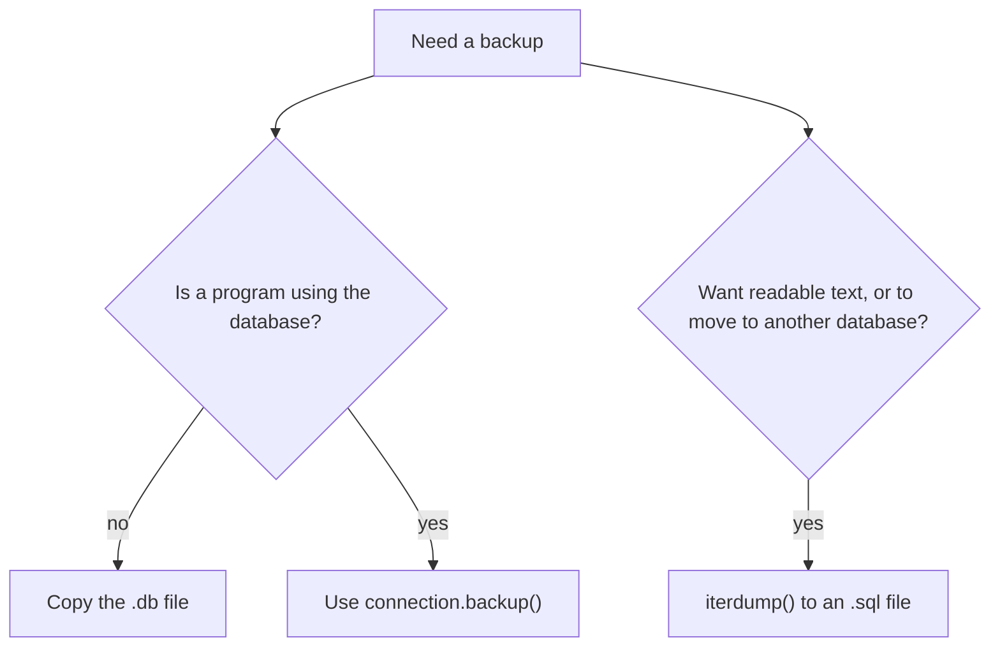

{:class="cover"}

---

By the end of this lesson you will be able to protect a SQLite file sensibly, and back it up with the `backup()` method and an SQL dump.

Module 10 focuses on securing SQLite databases and implementing backup strategies to protect data integrity and ensure business continuity.

### Securing SQLite Databases

Securing a SQLite database involves implementing measures to protect data confidentiality, integrity, and availability.

#### Encryption

The SQLite that comes with Python **doesn't** encrypt databases, and it has no password protection. Anyone who can read the `.db` file can read your data. (You may see `PRAGMA key = '...'` in tutorials: that only works with special encrypted builds of SQLite, and does nothing in the standard version.)

If you need an encrypted database, use [SQLCipher](https://www.zetetic.net/sqlcipher/), an open source, encrypted version of SQLite with Python bindings such as `sqlcipher3`. Otherwise, keep sensitive data out of SQLite, or protect the file itself as described below.

#### File System Access Control

Ensure appropriate file system access controls are in place to restrict unauthorized access to the database file. Set proper file permissions and restrict file access to authorized users or processes.

#### Database Access Control

Implement access control mechanisms within your application or system to control user access to the SQLite database. Use authentication and authorization techniques to restrict database access to authorized users only.

### Backing Up SQLite Databases



Regularly backing up SQLite databases is crucial to protect against data loss and ensure business continuity.

#### Database File Copy

The simplest method of backing up an SQLite database is by making a copy of the database file itself. Only do this when no program is using the database, otherwise you might copy it halfway through a change.

#### The backup API

Python's `sqlite3` module can make a safe copy of a database even while it's being used:

```python
import sqlite3

source = sqlite3.connect('mydatabase.db')
backup = sqlite3.connect('mydatabase_backup.db')

with backup:
    source.backup(backup)

backup.close()
source.close()
```

This is the method to use for scheduled backups.

#### SQL Dump

You can create an SQL dump of the database using the `.dump` command in the SQLite shell or programmatically using Python. The SQL dump contains the SQL statements necessary to recreate the database schema and insert data.

```python
# Creating an SQL dump
with open('backup.sql', 'w') as dump_file:
    for line in connection.iterdump():
        dump_file.write(f'{line}\n')
```

A dump is plain text, so it's easy to read, store in version control, or load into a different database.

In this example, we iterate through the `connection.iterdump()` generator, which provides the SQL statements to recreate the database structure and data. We write these statements to a backup SQL file.

#### Database Snapshot

Some file systems support taking snapshots or point-in-time copies of a file. If your file system supports this feature, taking snapshots of the SQLite database file can provide an efficient and consistent backup solution.

### Testing and Restoring Backups

Regularly test your backups by restoring them to ensure that the backup files are valid and the restore process works as expected. Establish backup restoration procedures and document them for quick and efficient recovery in case of data loss.

### Off-Site and Redundant Backups

Consider storing backup copies in off-site or remote locations to protect against physical disasters or localized data loss. Redundant backups on different storage media or cloud storage services can provide additional data protection.

### Disaster Recovery Planning

Develop a comprehensive disaster recovery plan that outlines the steps to recover the database in case of catastrophic events. Include backup strategies, restoration procedures, and the roles and responsibilities of personnel involved in the recovery process.

By implementing security measures and implementing backup strategies, you can protect the confidentiality, integrity, and availability of your SQLite databases and ensure business continuity.

## Try it Yourself

1. Run the backup example on your `mydatabase.db`. Open `mydatabase_backup.db` and count the rows in `books` to prove the copy works.
2. Write the SQL dump to `backup.sql` and open it in a text editor. Can you spot the `CREATE TABLE` and `INSERT` statements?
3. Restore the dump into a brand new database:

```python
import sqlite3

restored = sqlite3.connect("restored.db")
with open("backup.sql") as dump_file:
    restored.executescript(dump_file.read())
print(restored.execute("SELECT COUNT(*) FROM books").fetchone())
restored.close()
```

4. Challenge: write a function `backup_with_date(path)` that names the copy with today's date, using `datetime.date.today()`.

## Common Issues

- **Problem**: A copied `.db` file is corrupt or missing recent changes.
- **Solution**: Use `connection.backup()` instead of copying the file while a program has it open.
- **Why**: A file copy can catch the database halfway through a write. `backup()` takes a consistent copy.

- **Problem**: Restoring a dump into a database that already has the tables gives `table books already exists`.
- **Solution**: Restore into a new, empty database file.
- **Why**: The dump contains plain `CREATE TABLE` statements.

> **Teachers**: An unencrypted SQLite file is readable by anyone who can open it, so don't have learners store real personal details (names with addresses, photos of people) in their practice databases. Use made-up data and keep backups on school-approved storage.

---

## Check your understanding


? Does the standard SQLite in Python encrypt your database with `PRAGMA key`?
- [ ] Yes
- [x] No, you need an encrypted build such as SQLCipher
> Standard SQLite ignores `PRAGMA key`. Protect the file, or use SQLCipher.

? What's the safest way to back up a database that a program is using?
- [ ] Copy the file in your file manager
- [x] Use the `backup()` method from Python's sqlite3 module
- [ ] Email the file to yourself
> `backup()` makes a consistent copy even while the database is in use.

? Which format is plain text, easy to read and good for version control?
- [ ] A copy of the `.db` file
- [x] An SQL dump from `iterdump()`
- [ ] The `backup()` copy
> A dump is just the SQL statements needed to rebuild the database.

? Why test a backup by restoring it?
- [x] A backup you have never restored might not work when you need it
- [ ] Restoring makes the backup smaller
- [ ] It's required by SQLite
> The lesson recommends regularly restoring backups to check they are valid.


---
