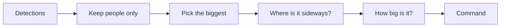

{:class="cover"}

---

Seeing is only half the job. This lesson is the project heart of the course: the brain that decides what the robot does about what it sees. We'll build a **person-following decision** in plain Python.

The code uses only the standard library and works on any computer, so you can test it at your desk. It takes a list of detections and returns a command: `forward`, `left`, `right`, `stop` or `search`. How the command reaches your motors depends on your robot, so we stop at the command.

## The shape of a detection

From lesson 6, each detection is a label, a confidence and a box. We'll store the box as fractions of the image, so `0.5` is the middle whatever the resolution. That is **invented stand-in data** with a shape you'll recognise in any detector's output.



## Step by step

1. **Keep people only**, and only if the model is confident.
2. **Pick the biggest box.** Bigger usually means closer, so that is the person to follow.
3. **Steer.** If the box centre is left of the middle, turn left. Use a **dead zone** so the robot doesn't wobble.
4. **Distance.** If the box is tall, the person is close, so stop. If it's short, drive forward.
5. **Lost them?** If no person is seen, `search`, but only after a few empty frames, so one missed frame doesn't spin the robot.

## The program

```python
from dataclasses import dataclass


@dataclass
class Detection:
    label: str
    confidence: float
    x: float       # left edge, 0 to 1
    y: float       # top edge, 0 to 1
    width: float   # 0 to 1
    height: float  # 0 to 1

    @property
    def centre_x(self):
        return self.x + self.width / 2


MIN_CONFIDENCE = 0.5   # ignore weak detections
DEAD_ZONE = 0.10       # how far off-centre before we steer
CLOSE_HEIGHT = 0.70    # a box this tall means "close enough"
LOST_FRAMES = 5        # empty frames before we start searching


class Follower:
    def __init__(self):
        self.empty_frames = 0

    def decide(self, detections):
        people = [
            d for d in detections
            if d.label == "person" and d.confidence >= MIN_CONFIDENCE
        ]
        if not people:
            self.empty_frames += 1
            if self.empty_frames >= LOST_FRAMES:
                return "search"
            return "stop"
        self.empty_frames = 0

        target = max(people, key=lambda d: d.width * d.height)
        offset = target.centre_x - 0.5      # negative: person is on the left
        if offset < -DEAD_ZONE:
            return "left"
        if offset > DEAD_ZONE:
            return "right"
        if target.height >= CLOSE_HEIGHT:
            return "stop"
        return "forward"


# Pretend frames, as if from a detector.
frames = [
    [Detection("person", 0.9, 0.40, 0.2, 0.20, 0.40)],   # centred, far
    [Detection("person", 0.9, 0.10, 0.2, 0.20, 0.40)],   # on the left
    [Detection("person", 0.8, 0.70, 0.2, 0.20, 0.40)],   # on the right
    [Detection("person", 0.9, 0.40, 0.1, 0.25, 0.80)],   # centred, close
    [Detection("cup", 0.9, 0.40, 0.4, 0.10, 0.10)],      # not a person
    [], [], [], [],                                        # person gone
]

follower = Follower()
for number, frame in enumerate(frames, start=1):
    print(f"frame {number}: {follower.decide(frame)}")
```

Save it as `follow_decision.py` and run it with `python3 follow_decision.py`. You should see `forward`, `left`, `right` and `stop` (close enough). The cup is not a person, so that frame and the next few empty ones give `stop`. After five frames in a row with no person, the last frame gives `search`.

## Why this works

Notice that `decide` knows nothing about the camera. It takes detections in and gives a command out. That makes it easy to test, as we just did, and it lets you swap in any detector. When you connect the real data from lesson 6, you only need to build `Detection` objects from it. The robot's behaviour stays the same.

**Common mistake: no dead zone.** Without it, a person standing roughly in the middle makes the robot flick between `left` and `right` every frame. The dead zone is what keeps it calm.

**Common mistake: reacting to one frame.** Detectors miss now and then. The `LOST_FRAMES` counter means a single dropped frame only makes the robot pause.

## Try it Yourself

1. Change `DEAD_ZONE` to `0.02` and add a frame just off-centre. What happens?
2. Change `CLOSE_HEIGHT` so the robot stops further away.
3. Challenge: add a `wave` command. If a pose lesson-5 style check says the wrist is above the shoulder, return `"stop"` whatever else is happening.

## Common Issues

**Problem**: The robot keeps choosing the wrong person.
**Solution**: Choose the target by a different rule, such as the one closest to the middle.
**Why**: "Biggest box" is only a guess at "closest".

**Problem**: The robot spins at the first dropped frame.
**Solution**: Raise `LOST_FRAMES`.
**Why**: It is how many empty frames you tolerate before you give up.
