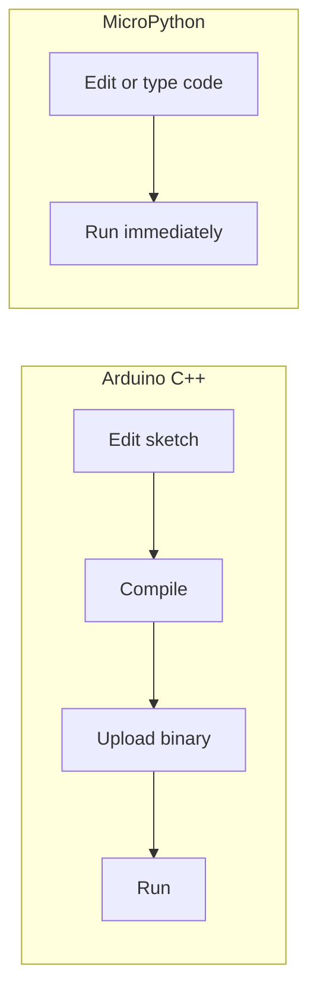

{:class="cover"}

---

By the end of this lesson you will be able to decide whether a project suits MicroPython or Arduino C++, and explain what the REPL is.

## It is about the right tool

If you are coming from Arduino's C++ world, you might wonder why you would switch. The answer is not "always use Python". It is about picking the right tool for the project in front of you.

MicroPython is a lean version of Python 3 that runs directly on a microcontroller such as the Raspberry Pi Pico W. You get quick experiments, readable code and an interactive prompt, in exchange for some raw speed and memory.

## The big difference: how you work

With Arduino C++ the loop is: write, compile on your computer, upload a binary, watch it run, repeat. With MicroPython you copy a text file to the board (or just type into it) and it runs straight away.



The star of the show is the **REPL** (Read-Eval-Print Loop). It is a Python prompt running on the board itself. Type `1 + 1` and the board answers `2`. Type a line that turns on an LED and the LED turns on. It is like having a conversation with your hardware, and we use it throughout the course.

## When MicroPython is a great fit

- Prototyping, where fast iteration matters
- Anything that needs WiFi and networking, such as a weather station or a web-controlled robot
- Data handling, such as logging sensor readings or formatting text
- Teaching and workshops, where readable code helps
- Projects where you want to test hardware interactively before committing to code

## When Arduino C++ still wins

- Tight timing, such as microsecond-precise protocols or fast motor control loops
- Very small memory budgets
- Battery projects where you must squeeze out every milliamp of sleep current
- Libraries that only exist for Arduino
- Existing C++ code you want to build on

## Is MicroPython slow?

Yes, it is slower than compiled C++. For most maker projects you will never notice, because a sensor read once a second spends almost all its time waiting. Blinking an LED, reading a temperature sensor and sending it over WiFi are all comfortable. You will feel the difference with tight loops, such as bit-banging a protocol or processing thousands of readings every second.

## Your first comparison

**Arduino C++:**
```cpp
void setup() {
  pinMode(LED_BUILTIN, OUTPUT);
}

void loop() {
  digitalWrite(LED_BUILTIN, HIGH);
  delay(1000);
  digitalWrite(LED_BUILTIN, LOW);
  delay(1000);
}
```

**MicroPython:**
```python
from machine import Pin
import time

led = Pin("LED", Pin.OUT)  # on-board LED on a Pico W or Pico 2 W

while True:
    led.on()
    time.sleep(1)
    led.off()
    time.sleep(1)
```

Notice there are no semicolons, no `setup()` and `loop()`, and the pin is an object with `.on()` and `.off()` methods instead of a number passed to a global function.

## What about CircuitPython?

CircuitPython is a friendly fork of MicroPython from Adafruit. The board appears as a USB drive, you edit `code.py` and it reruns every time you save. It has its own libraries (`board`, `digitalio`) instead of `machine`. The two are similar enough that what you learn transfers, but code is not always portable. This course teaches MicroPython, which is what Thonny and the Pico documentation use.

## Which board?

The examples target the Raspberry Pi Pico W and Pico 2 W, because they are cheap and well documented. Any board with MicroPython firmware works, but pin numbers and the on-board LED differ. The Arduino Nano ESP32 also runs MicroPython; look up its pin names in Arduino's documentation rather than assuming they match Arduino sketches.

## Try it Yourself

1. Pick a project you have built with Arduino. Write down whether it needs WiFi, microsecond timing or very low power. Which language would you choose, and why?
2. If you have a board with MicroPython installed, connect it in Thonny, and in the Shell type `print("Hello from MicroPython!")`, then `1 + 1`.
3. Challenge: in the Shell, type `from machine import Pin`, then `led = Pin("LED", Pin.OUT)`, then `led.on()`. You have just controlled hardware without any upload step.

## Common Issues

- **Problem**: Thonny shows no `>>>` prompt in the Shell.
- **Solution**: Choose the interpreter at the bottom right of Thonny (MicroPython (Raspberry Pi Pico)), press the Stop button once, or unplug and replug the board.
- **Why**: Thonny talks to the board over USB serial, and it needs to interrupt whatever program is running to reach the prompt.

- **Problem**: `ImportError: no module named 'machine'` appears.
- **Solution**: You are running the code on your computer's Python, not the board. Switch the interpreter to MicroPython.
- **Why**: The `machine` module only exists in MicroPython firmware.

## Check your understanding


? What does REPL stand for, and what is it?
- [ ] Run, Execute, Process, Load: a type of compiler
- [x] Read-Eval-Print Loop: an interactive prompt running on the board
- [ ] Remote Embedded Programming Link: a programming cable
> The REPL lets you type Python and see the board's answer instantly, with no compile or upload step.

? Which project is the best fit for MicroPython?
- [ ] A motor control loop that needs microsecond timing
- [x] A WiFi weather station that logs a reading every minute
- [ ] A battery device that must sleep for months
> Network-connected data projects with relaxed timing suit MicroPython, while tight timing and ultra-low power favour C++.

? What is the main trade-off of MicroPython compared with C++?
- [ ] It cannot control pins
- [x] It is slower and uses more memory
- [ ] It needs a compiler on your computer
> MicroPython trades some speed and memory for faster development and readable code.

