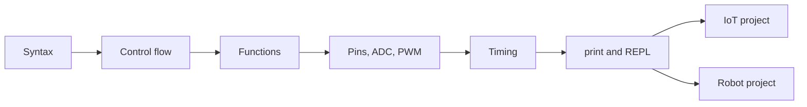

{:class="cover"}

---

By the end of this lesson you will be able to look up the MicroPython version of any common Arduino call, avoid the five classic pitfalls, and choose what to learn next.

## Congratulations!

Ahoy there makers! You have gone from Arduino sketches to MicroPython programs, and built a WiFi temperature monitor and an obstacle-avoiding robot on the way. Here is the whole journey on one page.



## Quick reference card

**Basic syntax:**

| Arduino C++ | MicroPython | Notes |
|-------------|-------------|-------|
| `int x = 10;` | `x = 10` | No type declaration, no semicolon |
| `String msg = "Hello";` | `msg = "Hello"` | Type inferred |
| `bool flag = true;` | `flag = True` | Capital T |
| `// comment` | `# comment` | Different comment symbol |
| `if (x > 10) { }` | `if x > 10:` | Colon and indentation |
| `else if` | `elif` | One word |
| `for (int i=0; i<10; i++)` | `for i in range(10):` | Use `range()` |
| `&&`, `||`, `!` | `and`, `or`, `not` | Words, not symbols |
| `void loop() { }` | `while True:` | Explicit infinite loop |
| `int add(int a, int b)` | `def add(a, b):` | No types |
{:class="table table-single"}

**Digital I/O:**

| Arduino C++ | MicroPython | Notes |
|-------------|-------------|-------|
| `pinMode(13, OUTPUT)` | `led = Pin(13, Pin.OUT)` | Create a Pin object |
| `pinMode(2, INPUT_PULLUP)` | `btn = Pin(2, Pin.IN, Pin.PULL_UP)` | Internal pull-up |
| `digitalWrite(13, HIGH)` | `led.on()` or `led.value(1)` | Method call |
| `digitalWrite(13, LOW)` | `led.off()` or `led.value(0)` | Method call |
| `digitalRead(2)` | `btn.value()` | Returns 0 or 1 |
{:class="table table-single"}

**Analogue I/O:**

| Arduino C++ | MicroPython | Notes |
|-------------|-------------|-------|
| `analogRead(A0)` | `ADC(Pin(26)).read_u16()` | 0 to 65535 |
| `analogWrite(9, 128)` | `PWM(Pin(9)).duty_u16(32768)` | 0 to 65535 |
| 10-bit ADC: 0 to 1023 | 16-bit: 0 to 65535 | Higher range |
| 8-bit PWM: 0 to 255 | 16-bit: 0 to 65535 | Higher range |
{:class="table table-single"}

**Timing and serial:**

| Arduino C++ | MicroPython | Notes |
|-------------|-------------|-------|
| `delay(1000)` | `time.sleep(1)` | Seconds, not milliseconds |
| `delayMicroseconds(10)` | `time.sleep_us(10)` | Microseconds |
| `millis()` | `time.ticks_ms()` | Milliseconds counter |
| `micros()` | `time.ticks_us()` | Microseconds counter |
| `now - previous` | `time.ticks_diff(now, previous)` | Handles the wrap-around |
| `Serial.begin(9600)` | Not needed | `print()` just works |
| `Serial.println(x)` | `print(x)` | Newline added |
| `Serial.print(x)` | `print(x, end="")` | No newline |
{:class="table table-single"}

**Pins and boards:**

| Arduino C++ | MicroPython on a Pico family board |
|-------------|------------------------------------|
| `LED_BUILTIN` | `Pin("LED", Pin.OUT)` on a Pico W or Pico 2 W |
| Pin `13` | `Pin(13)` means GP13, not header pin 13 |
| `A0` | `ADC(Pin(26))` (GP26, GP27 and GP28 only) |
{:class="table table-single"}

The Arduino Nano ESP32 numbers its pins differently, so check its MicroPython pinout rather than reusing Arduino numbers.

## The five classic pitfalls

1. **Seconds, not milliseconds.** `time.sleep(1000)` waits over 16 minutes. Use `time.sleep(1)` or `time.sleep_ms(1000)`.
2. **`True` and `False` are capitalised.** `true` raises a `NameError`.
3. **Indentation is syntax.** Four spaces, no tabs mixed in, and a colon to start each block.
4. **Different number ranges.** `read_u16()` gives 0 to 65535 and `duty_u16()` takes 0 to 65535. Do not reuse 0 to 1023 or 0 to 255 values.
5. **Compare ticks with `ticks_diff()`.** Never subtract `ticks_ms()` values directly.

## When to use each language

**Use MicroPython when** you are prototyping, need WiFi, want to debug in the REPL, process data, or teach.

**Use Arduino C++ when** you need tight timing, the smallest memory use, very low power, or an Arduino-only library.

**Both are great for** LEDs, sensors, motors and simple robots, and plenty of makers use each where it fits.

## Starter template

Save this as your starting point for new MicroPython projects:

```python
"""Project name: [your project]"""

from machine import Pin
import time

led = Pin("LED", Pin.OUT)
button = Pin(14, Pin.IN, Pin.PULL_UP)

def setup():
    for _ in range(3):          # startup blink
        led.toggle()
        time.sleep(0.2)
    led.off()
    print("Ready!")

def loop():
    while True:
        led.value(button.value() == 0)   # LED on while the button is pressed
        time.sleep(0.05)

try:
    setup()
    loop()
except KeyboardInterrupt:
    print("Stopped")
finally:
    led.off()
```

## What to learn next

The best next steps are the other MicroPython courses on the site:

- [Learn MicroPython - The basics](/learn/micropython/) fills in more of the language
- [Raspberry Pi Pico with MicroPython - GPIO Mastery](/learn/micropython_gpio/) goes deeper on pins
- [Intermediate level MicroPython](/learn/intermediate_micropython/) covers more advanced techniques
- [MicroPython Robotics Projects with the Raspberry Pi Pico](/learn/micropython_robotics/) builds more robots
- [Talking to the World - Working with I2C and SPI](/learn/i2c_spi/) connects real sensors and displays
- [Motors and motor drivers](/learn/motors_and_drivers/) explains how the driver in the robot project works
- [Using the Raspberry Pi Pico's Built-in Temperature Sensor](/learn/pico_temp_sensor/) goes deeper on the sensor we used for the IoT project
- [Getting Started with C on the Raspberry Pi Pico](/learn/c_pico/) shows the compiled side of the Pico



Useful links: [MicroPython documentation](https://docs.micropython.org/), [Arduino MicroPython documentation](https://docs.arduino.cc/micropython/) and [Thonny](https://thonny.org/).

## Project ideas

1. A plant monitor with a soil moisture sensor and a web page
2. A weather station that logs to a file
3. A line-following robot using two IR sensors
4. A WiFi-controlled LED strip
5. A temperature-controlled fan using PWM
6. A solar tracker with two light sensors and a servo

## Try it Yourself

1. Pick an old Arduino sketch of yours and convert it using the quick reference card. Run it on a Pico.
2. Start a new project from the starter template and change it to blink a pattern when the button is pressed.
3. Take the IoT monitor and add a second page that shows the last 10 readings.
4. Challenge: merge the two projects so the robot's web page shows the distance sensor reading.

## Common Issues

- **Problem**: A converted sketch does nothing, with no error.
- **Solution**: Check pin numbers against the Pico pinout, then use the REPL to test each part.
- **Why**: Arduino pin numbers and GP numbers are different systems.

- **Problem**: Sensor values look many times too big.
- **Solution**: Look for 10-bit or 8-bit numbers in the sketch, and scale to 16 bits.
- **Why**: The ADC and PWM use 16-bit values in MicroPython.

## Check your understanding


? Which is the correct conversion for `delay(250)`?
- [ ] `time.sleep(250)`
- [x] `time.sleep(0.25)`
- [ ] `time.sleep_us(250)`
> `sleep()` takes seconds, so 250 ms is 0.25.

? What is the MicroPython equivalent of `digitalRead(2)` for a pin object called `button`?
- [ ] `button.read(2)`
- [x] `button.value()`
- [ ] `Pin.read()`
> `value()` returns 0 or 1.

? Which language is the better choice for a project needing microsecond-precise timing?
- [ ] MicroPython
- [x] Arduino C++
- [ ] They are identical
> Compiled C++ gives you tighter and more predictable timing.

? What does an Arduino `analogRead` result of 512 correspond to in `read_u16()` terms?
- [ ] 512
- [x] About 32768
- [ ] About 5120
> 512 out of 1023 is about half, which is about half of 65535.

