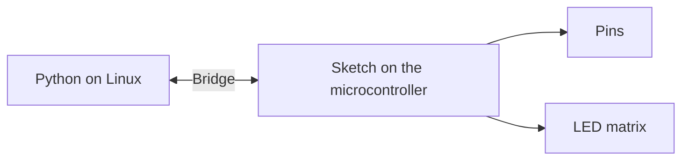

{:class="cover"}

---

The Uno Q is shaped like an Arduino Uno, but inside it is two computers. Before we write any code, let's understand why, because every choice you make in this course comes back to it.

Watch this video first. It compares the Uno Q with a Raspberry Pi, which is a good way to see where each brain fits.



---

## Brain one: Linux

The first brain is a **microprocessor** (the MPU). On the Uno Q it is a Qualcomm Dragonwing QRB2210 with four Arm Cortex-A53 cores at 2.0 GHz, and it runs Debian Linux.

Linux is good at the jobs a normal computer does:

- Networking, such as serving a web page or fetching data from the internet
- Files, such as saving a day of readings
- Python, with all its libraries
- Cameras and AI models
- Lots of memory: 2 GB or 4 GB, depending on your board

**Why this matters:** if your robot needs to see, think or talk to the internet, that work lives on this side.

## Brain two: the microcontroller

The second brain is a **microcontroller** (the MCU). On the Uno Q it is an STM32U585 with an Arm Cortex-M33 at up to 160 MHz, 2 MB of flash and 786 KB of RAM. It runs your Arduino sketches on top of Zephyr OS.

A microcontroller is good at the jobs where timing and pins matter:

- Exact timing, such as a steady servo pulse
- Direct control of pins
- Responding the instant something happens, such as a bumper switch
- Driving the LED matrix

**Why this matters:** a motor, a servo or a sensor wants a fast, predictable answer. That is what this side is for.

## Linux side vs microcontroller side

| | Linux side (MPU) | Microcontroller side (MCU) |
|---|---|---|
| Chip | Qualcomm Dragonwing QRB2210 | STM32U585 |
| Cores | 4 x Arm Cortex-A53, 2.0 GHz | Arm Cortex-M33, up to 160 MHz |
| Runs | Debian Linux | Arduino sketches on Zephyr OS |
| Memory | 2 GB or 4 GB RAM | 786 KB RAM, 2 MB flash |
| Storage | 16 GB or 32 GB eMMC | The 2 MB of flash |
| You write | Python | C++ sketches |
{:class="table table-single"}

Notice the Linux side has thousands of times more memory. The microcontroller makes up for it by being simple and predictable.

## Why both on one board?

You could wire a Raspberry Pi to an Arduino yourself. Plenty of robots do. You'd need a cable, a serial protocol, a way to power both, and code to agree on message formats.

The Uno Q does all of that for you. The two sides are already joined by an internal link, and a service called the **Bridge** sits on top of it. One side provides a named function, the other side calls it by name. We'll meet the Bridge properly in lesson 6.

In this course, the sketch owns the pins and the matrix. Python asks the sketch to act over the Bridge.

---

## A quick tour of the board

Here's what to look for when you pick the board up.

- **The LED matrix.** A grid of 8 x 13 blue LEDs (104 in all). The microcontroller drives it.
- **Four RGB LEDs.** LED 1 and LED 2 belong to Linux. LED 2 normally shows system status, such as Wi-Fi and Bluetooth. LED 3 and LED 4 belong to the microcontroller, so your sketches control them.
- **The headers.** The usual Uno-shaped pin rows. They run at **3.3 V**, not 5 V, so treat every pin as 3.3 V.
- **The Qwiic connector.** A small socket for plug-in I2C parts such as Modulino sensors. Also 3.3 V.
- **USB-C.** Power and data. You need a data cable, not a charge-only one.

Wi-Fi 5 (2.4 and 5 GHz) and Bluetooth 5.1 are built in, with built-in antennas.

---

## Which brain?

Now you try. Here are eight jobs. For each one, decide which side should own it, and you'll get the reason after each answer.


Read a wheel encoder thousands of times a second | right | Counting fast pulses needs exact timing, which is what the microcontroller is for.
Serve a web page to your phone | left | Networking and web servers are what Linux is for.
Run object detection on a webcam | left | Cameras and AI models need the Linux side and its large memory.
Keep a servo pulse steady | right | A servo needs a precisely timed pulse, and exact timing is the microcontroller's job.
Fetch the weather from the internet | left | Getting data from the internet is networking, which Linux handles.
Drive the LED matrix | right | The microcontroller drives the matrix, so a sketch draws on it.
Save a day of readings to a file | left | Linux has the storage and the file system for this.
Stop a motor the instant a bumper is pressed | right | Reacting at once through a pin is the microcontroller's strength.



Try the sorter, then notice which jobs felt obvious and which made you stop and think. The tricky ones are usually where the two sides meet.

---

## Try it Yourself

1. Think of a robot you have built or would like to build. Write two lists: what the **Linux side** would do, and what the **microcontroller side** would do.
2. Find a job on your lists that needs both sides. For example, a camera spots something and a motor reacts. Write down what message would need to pass between them.
3. Challenge: pick a job you couldn't decide on. Write one sentence arguing for each side, then decide which argument wins.

## Check your understanding


? Which side of the Uno Q runs Debian Linux?
- [ ] The STM32U585 microcontroller
- [x] The Qualcomm Dragonwing QRB2210 microprocessor
- [ ] The LED matrix driver
> The Linux side is the QRB2210. The microcontroller runs your Arduino sketches on Zephyr OS.

? What voltage do the Uno Q header pins use?
- [ ] 5 V, like a classic Arduino Uno
- [x] 3.3 V
- [ ] 12 V
> The headers are 3.3 V, so treat every pin as 3.3 V even though the board is shaped like an Uno.

? Why is having both processors on one board useful?
- [ ] The microcontroller can run Debian Linux faster
- [ ] You no longer need to write any code
- [x] They are already joined by a built-in link, so you don't have to wire and program one yourself
> The Bridge sits on top of the internal link, so one side can call functions on the other by name.

