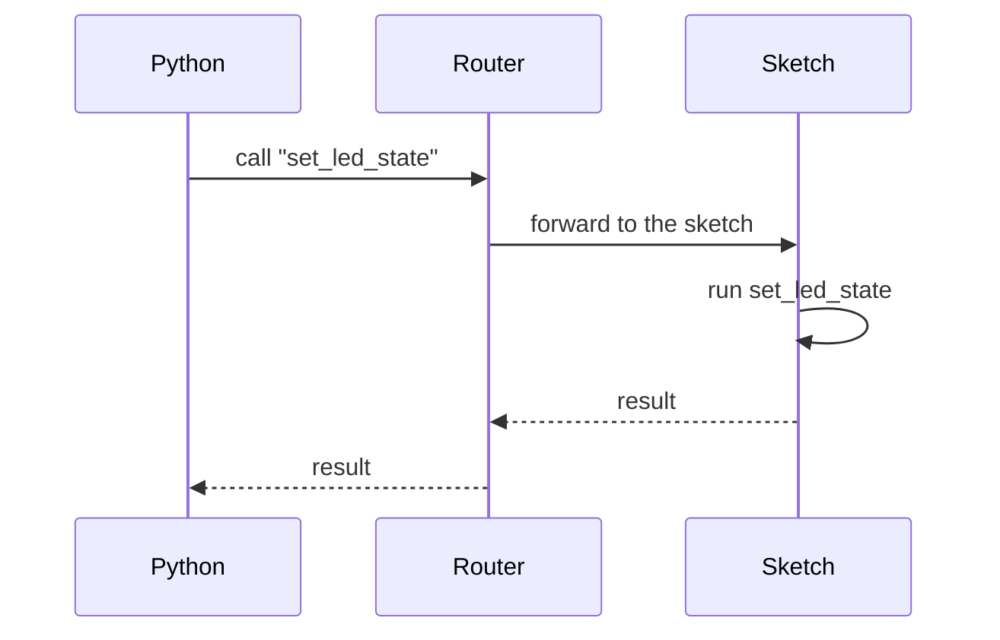

{:class="cover"}

---

So far the two brains have lived side by side without a word between them. This lesson gives them a way to talk. It is the most valuable idea in the whole course, so let's take it slowly.

Watch this video first, then come back and we will build on it.



---

## Two brains, no link

At the end of lesson 3 we had the Q Board blinking from the sketch while Python ran a loop of its own. Both sides worked, but neither knew the other existed. Python could not tell the sketch to blink, and the sketch could not tell Python what the sensor said.

The Bridge fixes that.

## RPC: ordering at the counter

The Bridge uses an idea called **RPC**, short for remote procedure call. Think of ordering at a café counter. You do not walk into the kitchen and start cooking. You ask for "a flat white" by name, and the kitchen does the work and hands it back.

RPC works the same way:

- One side **provides** a function under a name. That is the menu.
- The other side **calls** it by that name. That is the order.

Python never needs to know *how* the sketch turns an LED on. It only needs the name. And either side can be the kitchen: the sketch can provide functions for Python to call, and Python can provide functions for the sketch to call.

## The Arduino Router: the switchboard

Between the two sides sits a Linux background service called the **Arduino Router**. Think of it as a switchboard. The sketch connects to it, and every Python program connects to it. Nobody talks to anybody directly.

When Python calls a name, the router looks up who provides it, passes the message on and brings the answer back. Because everyone connects to the router, several Linux programs can talk to the sketch at the same time. Linux programs can also call each other through it.

Watch one message travel.



Press **Next** to step through one call from Python to the sketch, and watch the message on the wire at each step.

---

## The four verbs

Each side has four ways to take part:

| Verb | What it does | Use it when |
| --- | --- | --- |
| `provide` | Offers a named function to the other side | The function is short, such as storing a value. It runs in the Bridge's high-priority background thread |
| `provide_safe` | Offers a named function, run in the main `loop()` context | The function uses Arduino APIs such as `digitalWrite` or `Serial` |
| `call` | Calls a named function and waits for the answer | You need the result, or you need to know it finished |
| `notify` | Calls a named function and does not wait | You only want to send something and move on |
{:class="table table-single"}

In the sketch these are `Bridge.provide`, `Bridge.provide_safe`, `Bridge.call` and `Bridge.notify`. In Python you use `Bridge.call`, `Bridge.notify` and `Bridge.provide` after `from arduino.app_utils import App, Bridge`. Python's `call` blocks until the sketch answers and has a `timeout` (10 seconds by default).

A good rule of thumb: if your sketch function touches pins or Serial, use `provide_safe`. Lesson 9 shows what goes wrong otherwise.

## Anatomy of one call

Here is one call from start to finish:



Under the hood the messages are MessagePack-RPC. A request looks like `[0, id, "name", [args]]` and the response looks like `[1, id, error, result]`. You never write these by hand.

## Types that cross the Bridge

Values are converted automatically between the two languages:

| Python | Sketch (C++) |
| --- | --- |
| `bool` | `bool` |
| `int` | integer types |
| `float` | `float` / `double` |
| `str` | `String` |
| `list` | `std::vector` |
| `dict` | `std::map` |
| `bytes` | `std::vector<uint8_t>` |
| `None` | `void` |
{:class="table table-single"}

## Two limits to remember

1. **One message from the sketch is at most 256 bytes.** Send small values, not whole pictures.
2. **Never open `/dev/ttyHS1` or `Serial1` yourself.** That serial link is what the router uses to reach the microcontroller. If your own code opens it, you will break the Bridge.

---

## The smallest pair

Here is Arduino's own smallest example. Two files, one blinking LED, but this time **Python decides**.

**python/main.py**
```python
from arduino.app_utils import *
import time

led_state = False

def loop():
    global led_state
    time.sleep(1)
    led_state = not led_state
    Bridge.call("set_led_state", led_state)

App.run(user_loop=loop)
```

**sketch/sketch.ino**
```cpp
#include "Arduino_RouterBridge.h"

void setup() {
    pinMode(LED_BUILTIN, OUTPUT);

    Bridge.begin();
    Bridge.provide_safe("set_led_state", set_led_state);
}

void loop() {
}

void set_led_state(bool state) {
    // LOW state means LED is ON
    digitalWrite(LED_BUILTIN, state ? LOW : HIGH);
}
```

Walking through it:

- In the sketch, `Bridge.begin()` starts the Bridge. Without it nothing works.
- `Bridge.provide_safe("set_led_state", set_led_state)` puts `set_led_state` on the menu. We use `provide_safe` because the function calls `digitalWrite`.
- `set_led_state` flips the pin. The LED is active low, so `LOW` means on.
- In Python, `loop()` is called repeatedly by `App.run(user_loop=loop)`. Each time round it waits a second, flips `led_state` and calls `Bridge.call("set_led_state", led_state)`.

Run this on the board. LED 3 blinks red once a second, just like lesson 3, but now Python is deciding when. The sketch has no timing at all. Lessons 7 and 8 build the Q Board on this idea.

---

## Try it Yourself

1. Change `time.sleep(1)` to `time.sleep(0.2)` in Python only. Run it again. The blink speeds up and the sketch has not changed.
2. Rename the function on one side only, for example `"set_led_state"` to `"set_led"` in Python. Run it and see what happens. Lesson 9 explains the error. Then put it back.
3. Challenge: add `print(led_state)` inside Python's `loop()` and watch the **Python** console tab as the LED blinks.

## Common Issues

**Problem**: Python reports an error and the LED does not blink.
**Solution**: Check that the name in `Bridge.call("...")` matches the name in `Bridge.provide_safe("...")` exactly.
**Why**: The router finds the function by name, so a typo means nobody is providing it.

**Problem**: The sketch never answers.
**Solution**: Make sure `Bridge.begin()` is in `setup()`.
**Why**: Until the sketch calls `Bridge.begin()`, it is not connected to the router.

---

## Check your understanding


? What does the Arduino Router do?
- [ ] It compiles the sketch
- [x] It passes messages between the sketch and the Python programs
- [ ] It connects the board to Wi-Fi
> Everyone is a client of the router, and it forwards each call to whoever provides that name.

? Which verb should you use for a sketch function that calls digitalWrite?
- [ ] provide
- [x] provide_safe
- [ ] notify
> provide_safe runs the function in the main loop() context, where Arduino APIs are safe to use.

? Which of these should your own code never do?
- [ ] Call Bridge.call from Python
- [ ] Send a short message from the sketch
- [x] Open /dev/ttyHS1 or Serial1
> That serial link belongs to the router. Opening it yourself breaks the Bridge.

