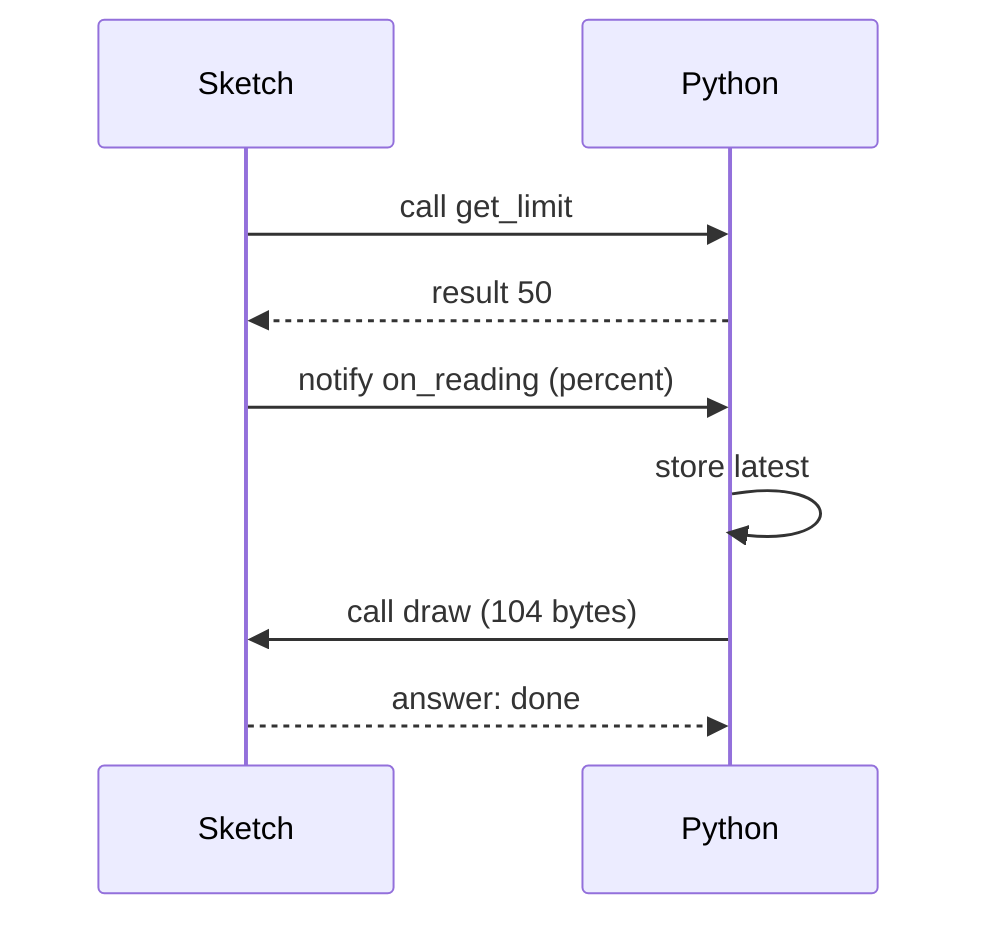

{:class="cover"}

---

In lesson 7 Python gave the orders and the sketch obeyed. Now we turn the Bridge around. The sketch reads a sensor and reports up to Python, and Python holds the settings.

This is **Q Board stage 5**.

---

## What you'll build

- The sketch reads the **potentiometer** from [lesson 5](/learn/arduino_uno_q/05_pins_sensors_and_servos.html) on A0, once a second, as a number from 0 to 99.
- It **sends each reading up to Python**, which prints it and draws it as big digits on the matrix.
- The sketch asks Python for an **alarm limit** when it starts. Above the limit, **LED 3 goes red** and LED 4 turns red too.

Wiring is the same as lesson 5: the outer legs of the potentiometer go to 3.3V and GND, and the middle leg goes to A0. Remember, analogue pins must never see more than 3.3 V.

No potentiometer? A Modulino Thermo works too. Use the fragment near the end of this lesson.

---

## The sketch

**sketch/sketch.ino**

```cpp
#include <Arduino_RouterBridge.h>
#include <Arduino_LED_Matrix.h>
#include <vector>

// Q Board, stage 5: the sketch sends readings up, and asks Python for its settings

const int sensorPin = A0;

Arduino_LED_Matrix matrix;
uint8_t frame[104] = {0};

unsigned long lastReading = 0;
int limit = 50;            // used until Python tells us otherwise
bool haveLimit = false;

void draw(std::vector<uint8_t> newFrame) {
  size_t len = min(newFrame.size(), (size_t)104);
  memcpy(frame, newFrame.data(), len);
}

void set_status(bool red, bool green, bool blue) {
  digitalWrite(LED4_R, red ? LOW : HIGH);
  digitalWrite(LED4_G, green ? LOW : HIGH);
  digitalWrite(LED4_B, blue ? LOW : HIGH);
}

void setup() {
  pinMode(LED3_R, OUTPUT);
  pinMode(LED4_R, OUTPUT);
  pinMode(LED4_G, OUTPUT);
  pinMode(LED4_B, OUTPUT);
  digitalWrite(LED3_R, HIGH);
  set_status(false, false, false);
  analogReadResolution(14);

  matrix.begin();
  matrix.setGrayscaleBits(3);
  matrix.clear();

  Bridge.begin();
  Bridge.provide("draw", draw);
  Bridge.provide_safe("set_status", set_status);
}

void loop() {
  matrix.draw(frame);

  // Once a second: take a reading and send it to Python
  if (millis() - lastReading >= 1000) {
    lastReading = millis();

    // call + result: ask Python a question and wait for the answer
    if (!haveLimit) {
      haveLimit = Bridge.call("get_limit").result(limit);
    }

    int percent = map(analogRead(sensorPin), 0, 16383, 0, 99);

    // notify: send the reading and carry on, no answer needed
    Bridge.notify("on_reading", percent);

    // The sketch can act on its own too: LED 3 goes red above the limit
    digitalWrite(LED3_R, percent > limit ? LOW : HIGH);
  }

  delay(10);
}
```

### Walking through the sketch

**The reading.** `analogReadResolution(14)` gives readings from 0 to 16383. `map(...)` squashes that to 0 to 99, so it fits on two digits.

**`Bridge.call("get_limit").result(limit)`.** This is the sketch asking Python a question. Read it in two parts:

- `Bridge.call("get_limit")` sends the request, and returns an object for the reply.
- `.result(limit)` waits for the answer and stores it in the variable `limit`. It returns **true** if that worked and **false** if it did not, and it only fills `limit` on success.

That is why the code is `haveLimit = ...result(limit)`. If Python is not ready yet, the sketch keeps its default of 50 and **tries again a second later**, because `haveLimit` is still false. Once it works, it never asks again.

**`Bridge.notify("on_reading", percent)`.** This sends the reading and carries on. A reading arrives every second, and a missed one is replaced by the next, so we do not need an answer. A notify is the right tool for a stream.

**The sketch acts on its own.** Look at the last line inside the `if`. LED 3 goes red when `percent > limit`, and the sketch decides that itself. It does not ask Python. So even if Linux is busy, slow, or restarting, the LED still reacts straight away. That is the whole point of having a microcontroller: **the fast, must-always-work jobs stay on the side that is never busy**.

**Limits on size.** One message from the sketch can be at most **256 bytes**. A single number is tiny, but if you ever send lists, keep this in mind.

---

## The Python

The drawing code is unchanged from lesson 7, so `FONT` and `number_frame()` are shown again in full to keep the file complete.

**python/main.py**

```python
import time

from arduino.app_utils import App, Bridge

LIMIT = 50        # the sketch asks for this when it starts
latest = None     # the newest reading from the sketch

FONT = {
    "0": ["01110", "10001", "10011", "10101", "11001", "10001", "01110"],
    "1": ["00100", "01100", "00100", "00100", "00100", "00100", "01110"],
    "2": ["01110", "10001", "00001", "00010", "00100", "01000", "11111"],
    "3": ["11110", "00001", "00001", "01110", "00001", "00001", "11110"],
    "4": ["00010", "00110", "01010", "10010", "11111", "00010", "00010"],
    "5": ["11111", "10000", "11110", "00001", "00001", "10001", "01110"],
    "6": ["00110", "01000", "10000", "11110", "10001", "10001", "01110"],
    "7": ["11111", "00001", "00010", "00100", "01000", "01000", "01000"],
    "8": ["01110", "10001", "10001", "01110", "10001", "10001", "01110"],
    "9": ["01110", "10001", "10001", "01111", "00001", "00010", "01100"],
}


def number_frame(number, level=7):
    """Return 104 brightness values that show a number from 0 to 99."""
    frame = [0] * 104
    text = f"{number:2d}"
    for position, digit in enumerate(text):
        if digit == " ":
            continue
        left = 1 + position * 6
        for row, line in enumerate(FONT[digit]):
            for col, pixel in enumerate(line):
                if pixel == "1":
                    frame[row * 13 + left + col] = level
    return frame


def get_limit():
    """The sketch calls this once to fetch its alarm limit."""
    return LIMIT


def on_reading(percent: int):
    """The sketch sends a reading here every second. Just remember it."""
    global latest
    latest = percent
    print(f"Reading: {percent}%")


Bridge.provide("get_limit", get_limit)
Bridge.provide("on_reading", on_reading)


def loop():
    if latest is not None:
        Bridge.call("draw", bytes(number_frame(latest)))
        over = latest > LIMIT
        Bridge.notify("set_status", over, not over, False)
    time.sleep(0.2)


App.run(user_loop=loop)
```

### Walking through the Python

**Python provides, the sketch calls.** `Bridge.provide("get_limit", ...)` and `Bridge.provide("on_reading", ...)` are the mirror image of lesson 7. Now Python offers functions and the sketch asks for them by name.

**The handler stores, the loop acts.** Look at `on_reading`. It only saves the number in `latest` and prints it. It does **not** call `Bridge.call("draw", ...)`. The drawing happens in `loop()`.

This is deliberate, and it is a rule: **a Python function provided to the Bridge must not use `Bridge.call()`**. It raises a `RuntimeError`. Starting a new conversation while answering one is not supported. `Bridge.notify()` is allowed inside a handler, but the safest habit is to keep handlers tiny: store a value, then let `loop()` do the work.

So the pattern is:

1. The handler **stores** the value in a global.
2. The loop **acts** on it when it is ready.

**Matching types.** `on_reading(percent: int)` takes an `int`, and the sketch sends an `int`. The two sides must agree:

| Python | Sketch (C++) |
| --- | --- |
| `bool` | `bool` |
| `int` | `int` types |
| `float` | `float` or `double` |
| `str` | `String` |
| `list` | `std::vector` |
| `bytes` | `std::vector<uint8_t>` |
| `None` | `void` |
{:class="table table-single"}

**Changing the limit.** The limit lives in Python (`LIMIT = 50`), and the sketch fetches it. To change the alarm level you only edit one number in Python, and the sketch never needs recompiling.

---

## Try it in the simulator

This box runs the `main.py` above. The stand-in sketch does what the real one does: it asks for `get_limit`, sends `on_reading` once a second and lights LED 3 red above the limit. The slider is the potentiometer on A0.



Press **Run** and move the slider past 50. LED 3 and LED 4 turn red. Now change `LIMIT` to 30 and run it again. For a useful mistake, add `Bridge.call("draw", bytes(104))` inside `on_reading` and read the `RuntimeError`.

As before, this is a stand-in. No C++ runs here, so finish by running the App on your board.

---

## Both directions at once





Step through it again and notice that this time the request starts on the other side.

---

## Using a Modulino Thermo instead

If you have a Modulino Thermo on the Qwiic connector, replace the `analogRead` line with this fragment. You also need `#include <Arduino_Modulino.h>`, the `Arduino_Modulino` library added with **Add sketch library**, `Modulino.begin(Wire1)` and `ModulinoThermo thermo; thermo.begin();` in the sketch's setup. The Qwiic connector is `Wire1`, which is 3.3 V only.

```cpp
int percent = (int)thermo.getTemperature();   // whole degrees C, shown as a number
```
{: .no-snakie }

The number is whole degrees Celsius, shown just like the potentiometer reading. Set `LIMIT` to a temperature that suits your room.

---

## Designing your own split

You now have all the tools. When you start a new project, ask these questions.

1. **Who owns the hardware?** If it is a pin, the matrix or an LED 3 or 4, the sketch does it. If it is the network, files, a camera or the clock, Python does it.
2. **Who makes the decision?** Put judgement and settings in Python, where they are easy to change. Keep fast safety reactions in the sketch.
3. **Call when you need the answer.** If the next step depends on a reply, use `call`.
4. **Notify for streams.** Readings, colours and anything refreshed again soon should be `notify`.
5. **Handlers store, loops act.** Keep provided functions short, and do the real work in `loop()`.

---

## Try it Yourself

1. **Change the limit from Python only.** Set `LIMIT = 30`, press **Stop** and **Run**, and turn the potentiometer. The sketch picks up the new limit by asking, with no change to the sketch.
2. **Add a warning.** Make Python print a warning when the reading has been over the limit for 5 readings in a row. You will need a counter that resets when a reading falls back under.
3. **Challenge: send two values in one notify.** Send the reading and the limit together, for example `Bridge.notify("on_values", percent, limit)`, and add a matching `on_values` in Python. Then show the two numbers on the matrix, alternately.

---

## Common Issues

**Problem**: The reading never changes.
**Solution**: Check the wiring. The middle leg goes to A0 and the outer legs to 3.3V and GND, with nothing over 3.3 V.
**Why**: If A0 is not connected, it floats and the number does not follow your hand.

**Problem**: `RuntimeError` about nested calls.
**Solution**: Look for `Bridge.call()` inside a function you gave to `Bridge.provide()`, and move it to `loop()`.
**Why**: A provided function is already answering a call, and starting another conversation from inside it is not supported.

**Problem**: The limit stays at 50.
**Solution**: Check that Python provides `get_limit`, and that the name is spelled the same in both files. Then **Stop** and **Run** again.
**Why**: If the call fails, `.result(limit)` returns false and the sketch keeps its default of 50.

**Problem**: Values arrive wrong or the call is refused.
**Solution**: Check the types in the table. For example, send an `int` where the sketch expects an `int`.
**Why**: Both sides must agree on the type, because the Bridge converts values by their type.

---

## Check your understanding


? Why does `on_reading` store the value and leave the drawing to `loop()`?
- [ ] Printing is faster than drawing
- [x] A function provided to the Bridge must not use `Bridge.call()`, so `loop()` makes the call
- [ ] The matrix can only be drawn in `setup()`
> Using `Bridge.call()` inside a provided Python function raises a `RuntimeError`. The pattern is that handlers store, and loops act.

? What happens if Python is not ready when the sketch asks for `get_limit`?
- [ ] The sketch crashes
- [x] `.result(limit)` returns false, the sketch keeps 50, and it asks again a second later
- [ ] The sketch waits forever before drawing anything
> `.result` returns true or false and only fills `limit` on success. Because `haveLimit` stays false, the sketch retries.

? Why does LED 3 turn red in the sketch, rather than Python telling it to?
- [ ] Python cannot control LEDs
- [ ] The Bridge is too slow for LEDs
- [x] The sketch reacts at once even if Linux is busy, which is what the microcontroller is for
> Fast, must-always-work reactions stay on the microcontroller. Python can still set the policy, such as the limit.

