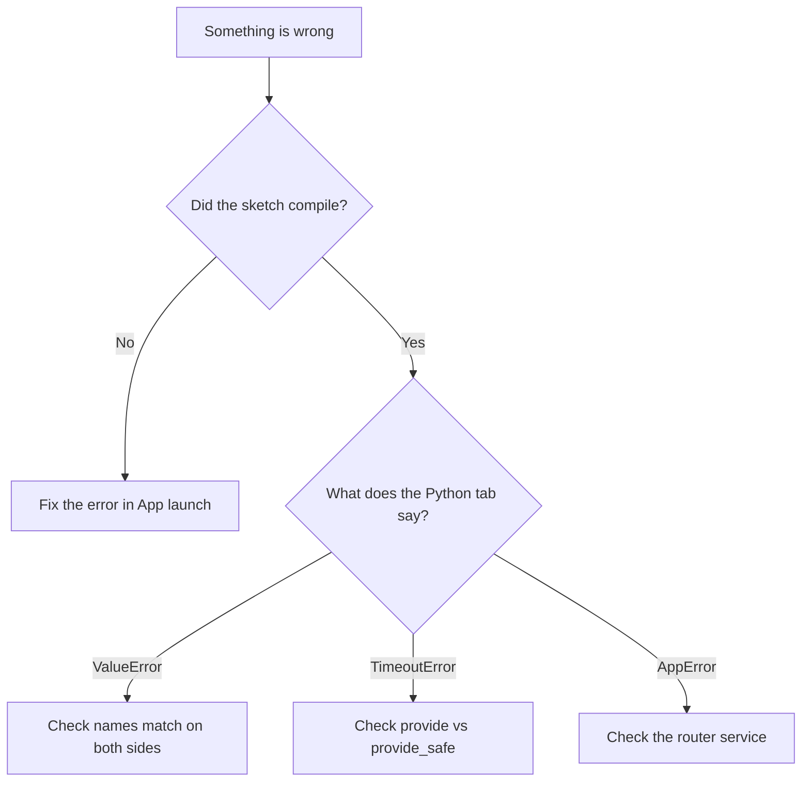

{:class="cover"}

---

Good news: Bridge problems are not a mystery. There are only a handful of mistakes, nearly everyone makes them, and each one has a clear sign. Once you know the signs, you can fix most problems in a minute.

Let's start with the nastiest one, and watch it happen before it happens to you.

---

## Watch a deadlock



Step through it with **Next**. You will see a `Serial.println()` inside a `Bridge.provide()` function, why that hangs the conversation, and how `provide_safe()` fixes it.

---

## The bug

Here is a small sketch with exactly that mistake in it. It is wrong on purpose.

**sketch/sketch.ino**

<!-- code-check: skip -->
```cpp
#include <Arduino_RouterBridge.h>

void set_led(bool on) {
  digitalWrite(LED3_G, on ? LOW : HIGH);
  Serial.println(on ? "LED on" : "LED off");   // printing inside a provide() callback
}

void setup() {
  pinMode(LED3_G, OUTPUT);
  Serial.begin(9600);
  Bridge.begin();
  Bridge.provide("set_led", set_led);
}

void loop() {
}
```

A function registered with `provide()` runs in the Bridge's own background thread, while the Bridge is busy answering. Printing, or starting another call, from there means starting a new conversation while still in the middle of one. Arduino's documentation puts it plainly: *do not use `Bridge.call()` or `Monitor.print()` inside functions registered with `Bridge.provide()`. Initiating a new communication while responding to one causes system deadlocks. Use `provide_safe()` instead.*

## The fix

The fix is one word.

**sketch/sketch.ino**

```cpp
#include <Arduino_RouterBridge.h>

void set_led(bool on) {
  digitalWrite(LED3_G, on ? LOW : HIGH);
  Serial.println(on ? "LED on" : "LED off");   // fine now: this runs inside loop()
}

void setup() {
  pinMode(LED3_G, OUTPUT);
  Serial.begin(9600);
  Bridge.begin();
  Bridge.provide_safe("set_led", set_led);
}

void loop() {
}
```

`provide_safe()` does not run the function in the background thread. It waits, and runs it in the main `loop()` context, where Arduino calls such as `digitalWrite` and `Serial.println` are fine.

**An honest note.** Some of Arduino's own example apps print inside `provide()`, and you may well get away with it. It can work for a long time and then hang on an unlucky moment, which is the worst kind of bug to track down. `provide_safe()` is the rule that always works.

### A simple rule of thumb

| What the function does | Register it with |
| --- | --- |
| Only stores a value (copies memory, sets a variable) | `provide` |
| Anything else (pins, `Serial`, `Monitor`, other Arduino APIs) | `provide_safe` |
{:class="table table-single"}

If in doubt, use `provide_safe`. In lesson 7, `draw` only copies memory, so it uses `provide`. `set_status` writes to pins, so it uses `provide_safe`.

---

## Python that survives a silent sketch

What if the sketch does not answer? A good Python program expects that and carries on. This `main.py` goes with the fixed sketch above.

**python/main.py**

```python
import time

from arduino.app_utils import App, Bridge

led_on = False


def loop():
    global led_on
    led_on = not led_on
    try:
        Bridge.call("set_led", led_on, timeout=2)
        print("LED is", "on" if led_on else "off")
    except TimeoutError:
        print("The sketch didn't answer within 2 seconds")
    except ValueError as error:
        print("The sketch refused the call:", error)
    time.sleep(1)


App.run(user_loop=loop)
```

Run it and the green LED 3 blinks once a second.

The key line is `Bridge.call("set_led", led_on, timeout=2)`. The `timeout` is how many seconds to wait for an answer, and the default is 10. Wrapping the call in `try` means one bad moment prints a message instead of stopping your program.

---

## Reading the errors

| Error | What it means |
| --- | --- |
| Python `ValueError` | The sketch answered with an error. Most often nothing provides that name: a typo, or the sketch was not flashed yet. The message tells you more. |
| Python `TimeoutError` | No answer arrived within `timeout` (10 seconds by default). |
| Python `ConnectionError` | The connection dropped while waiting. |
| Python `RuntimeError` | `Bridge.call()` was used inside a provided handler. Nested calls are not supported. |
| Python `AppError` at start | The router could not be reached within 5 seconds. Check the `arduino-router` service. |
| Sketch: `.result(x)` returns false | The call failed. The RpcCall object has `isError()`, `getErrorCode()` and `getErrorMessage()` for the detail. |
| Sketch: a message vanishes | A message over 256 bytes is dropped. |
{:class="table table-single"}

This table is this lesson's Common Issues. Come back to it whenever the Python tab shows something you do not recognise.

Also remember: never open `/dev/ttyHS1` on Linux or `Serial1` in the sketch. The router owns them, and your own code opening them will get in its way.

---

## Is the router healthy?

When names and code look right but nothing works, check the router. It is the Linux service that carries every Bridge message. These commands are typed **in a terminal on the board**. Lesson 10 covers how to get one, using an ADB shell or SSH, so for now just read them.

Is it running?

```bash
systemctl status arduino-router
```

Watch its log live while you run your App (press Ctrl+C to stop watching):

```bash
journalctl -u arduino-router -f
```

Restart it if it looks stuck:

```bash
sudo systemctl restart arduino-router
```

---

## Debugging checklist

Work down this list in order. It fixes most problems.

1. Open the **App launch** tab and check the sketch compiled without errors.
2. Read the **Serial Monitor** tab (sketch output) and the **Python** tab (Python output).
3. Check that every Bridge name and the number of arguments match on both sides.
4. Check `provide` versus `provide_safe` for each function.
5. **Stop** and **Run** the App again.
6. Restart the router with the command above.



---

## Try it Yourself

1. **Break it on purpose.** Using the fixed sketch and the Python above, misspell the name in Python (`"set_ledd"`). Run it and read the error. It is a `ValueError`, and now you know the sign.
2. **Remove the provider.** Comment out the `Bridge.provide_safe(...)` line in the sketch, press **Run**, and watch the Python tab. Which error do you get, and what does the table say it means? Put the line back afterwards.
3. **Challenge: write it down.** For every function in the Q Board (`draw`, `set_status`, `get_limit`, `on_reading`), write which side provides it, and whether the sketch ones should be `provide` or `provide_safe`, and why.

---

## Check your understanding


? Why can printing inside a `Bridge.provide()` function cause a deadlock?
- [ ] `Serial` cannot print numbers
- [x] It starts a new communication while the Bridge is still answering one
- [ ] The Serial Monitor tab is closed
> Arduino's documentation warns against `Bridge.call()`, `Monitor.print()` and `Serial.print()` inside `provide()` functions. `provide_safe()` runs the function in `loop()` instead.

? A function only stores a number in a variable. Which should you use?
- [x] `provide`, because it only stores a value
- [ ] `provide_safe`, because nothing else works
- [ ] Neither, functions cannot be provided
> A function that only stores a value is quick and safe in the background thread. If it did anything more, `provide_safe` is the rule that always works.

? Python raises `ValueError` when it calls `"set_led"`. What is the most likely cause?
- [ ] The router has run out of memory
- [x] Nothing provides that name, such as a typo or a sketch that was not flashed
- [ ] The call took longer than the timeout
> `ValueError` means the sketch answered with an error. A timeout would show as `TimeoutError` instead.

