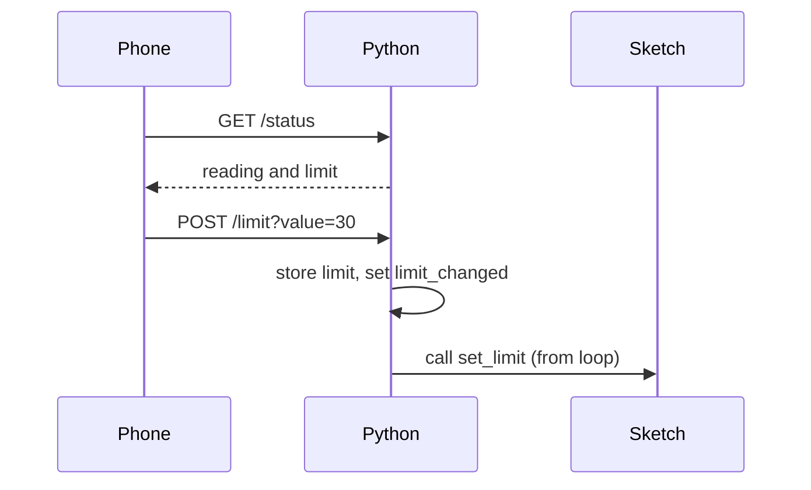

{:class="cover"}

---

So far you have needed App Lab on your computer to see what your Q Board is doing. In this lesson the board serves its own web page. Open it on your phone, watch the reading change, and drag a slider to move the alarm limit.

This is **Q Board stage 6**. The web page is a Linux job, so Python handles it. The sketch only gains one small function.

---

## What you'll build

- A **web page** served by the board, with the live reading in big digits and an alarm limit slider.
- The page **turns pink** when the reading goes over the limit.
- Moving the slider **changes the limit** in Python, and Python passes it down to the sketch, so LED 3 follows the new limit straight away.

You still need the potentiometer from [lesson 5](/learn/arduino_uno_q/05_pins_sensors_and_servos.html) on A0, wired as in [lesson 8](/learn/arduino_uno_q/08_the_sketch_calls_python.html). A phone or computer on the same network as the board is all the extra kit you need.

---

## The Web UI Brick

**Bricks** are ready-made building blocks for an App, such as web pages, databases and AI models. You add one with the **Add Brick** button at the top of the editor sidebar. Pick it from the catalogue and select **Add**. App Lab records it in `app.yaml` for you, so do not edit `app.yaml` by hand.

The Brick we want is **WebUI - HTML** (ID `arduino:web_ui`). Add it to your Q Board App now. It does three things for us:

- It serves the App's `assets/` folder as a web site on port **7000**.
- `assets/` must contain an `index.html`, which is the page people see.
- It lets Python add web addresses that run your own functions.

You never call a start method. `App.run()` starts the Brick along with everything else.

Once the App is running, open the page from a phone or computer on the same network at `http://<boardname>.local:7000`. If your network does not resolve `.local` names, use the board's IP address from [lesson 10](/learn/arduino_uno_q/10_linux_survival_kit.html) with `:7000` on the end.

The Brick can also push messages to the page over a WebSocket. This lesson uses the simpler approach instead: the page asks for the newest reading once a second, so the page needs no extra libraries.

---

## How the page and the board talk



Two web addresses do all the work. `GET /status` hands back the reading and the limit. `POST /limit?value=30` changes the limit. Notice that the web request does not call the sketch itself. We will come back to why.

---

## The sketch

This is the lesson 8 sketch with one new function. Replace your `sketch/sketch.ino` with it.

**sketch/sketch.ino**

```cpp
#include <Arduino_RouterBridge.h>
#include <Arduino_LED_Matrix.h>
#include <vector>

// Q Board, stage 6: as stage 5, and Python can change the limit while it runs

const int sensorPin = A0;

Arduino_LED_Matrix matrix;
uint8_t frame[104] = {0};

unsigned long lastReading = 0;
int limit = 50;            // used until Python tells us otherwise
bool haveLimit = false;

void draw(std::vector<uint8_t> newFrame) {
  size_t len = min(newFrame.size(), (size_t)104);
  memcpy(frame, newFrame.data(), len);
}

// Python calls this when the limit is changed from the web page
void set_limit(int newLimit) {
  limit = newLimit;
  haveLimit = true;
}

void set_status(bool red, bool green, bool blue) {
  digitalWrite(LED4_R, red ? LOW : HIGH);
  digitalWrite(LED4_G, green ? LOW : HIGH);
  digitalWrite(LED4_B, blue ? LOW : HIGH);
}

void setup() {
  pinMode(LED3_R, OUTPUT);
  pinMode(LED4_R, OUTPUT);
  pinMode(LED4_G, OUTPUT);
  pinMode(LED4_B, OUTPUT);
  digitalWrite(LED3_R, HIGH);
  set_status(false, false, false);
  analogReadResolution(14);

  matrix.begin();
  matrix.setGrayscaleBits(3);
  matrix.clear();

  Bridge.begin();
  Bridge.provide("draw", draw);
  Bridge.provide_safe("set_status", set_status);
  Bridge.provide("set_limit", set_limit);          // only stores a value
}

void loop() {
  matrix.draw(frame);

  // Once a second: take a reading and send it to Python
  if (millis() - lastReading >= 1000) {
    lastReading = millis();

    // call + result: ask Python a question and wait for the answer
    if (!haveLimit) {
      haveLimit = Bridge.call("get_limit").result(limit);
    }

    int percent = map(analogRead(sensorPin), 0, 16383, 0, 99);

    // notify: send the reading and carry on, no answer needed
    Bridge.notify("on_reading", percent);

    // The sketch can act on its own too: LED 3 goes red above the limit
    digitalWrite(LED3_R, percent > limit ? LOW : HIGH);
  }

  delay(10);
}
```

### What changed since lesson 8

Only `set_limit`. It takes the new limit, stores it in `limit`, and sets `haveLimit` to true so the sketch stops asking Python for the limit. Then `setup()` registers it with `Bridge.provide("set_limit", set_limit)`.

We used plain `provide` here rather than `provide_safe`, because `set_limit` only stores a value. It touches no pins and prints nothing. That is the rule from lesson 8: use `provide_safe` when the function uses Arduino APIs such as `digitalWrite`, and plain `provide` when it only stores data.

Everything else is exactly as before. The sketch still decides for itself when LED 3 goes red, using whatever `limit` currently holds.

---

## The Python

The drawing code is unchanged from lesson 7, so `FONT` and `number_frame()` are shown again only to keep the file complete.

**python/main.py**

```python
import time

from arduino.app_utils import App, Bridge
from arduino.app_bricks.web_ui import WebUI

limit = 50             # the alarm limit, now changeable from the web page
limit_changed = False  # set by the web page, acted on by loop()
latest = None          # the newest reading from the sketch

FONT = {
    "0": ["01110", "10001", "10011", "10101", "11001", "10001", "01110"],
    "1": ["00100", "01100", "00100", "00100", "00100", "00100", "01110"],
    "2": ["01110", "10001", "00001", "00010", "00100", "01000", "11111"],
    "3": ["11110", "00001", "00001", "01110", "00001", "00001", "11110"],
    "4": ["00010", "00110", "01010", "10010", "11111", "00010", "00010"],
    "5": ["11111", "10000", "11110", "00001", "00001", "10001", "01110"],
    "6": ["00110", "01000", "10000", "11110", "10001", "10001", "01110"],
    "7": ["11111", "00001", "00010", "00100", "01000", "01000", "01000"],
    "8": ["01110", "10001", "10001", "01110", "10001", "10001", "01110"],
    "9": ["01110", "10001", "10001", "01111", "00001", "00010", "01100"],
}


def number_frame(number, level=7):
    """Return 104 brightness values that show a number from 0 to 99."""
    frame = [0] * 104
    text = f"{number:2d}"
    for position, digit in enumerate(text):
        if digit == " ":
            continue
        left = 1 + position * 6
        for row, line in enumerate(FONT[digit]):
            for col, pixel in enumerate(line):
                if pixel == "1":
                    frame[row * 13 + left + col] = level
    return frame


def get_limit():
    """The sketch calls this once to fetch its alarm limit."""
    return limit


def on_reading(percent: int):
    """The sketch sends a reading here every second. Just remember it."""
    global latest
    latest = percent


Bridge.provide("get_limit", get_limit)
Bridge.provide("on_reading", on_reading)

ui = WebUI()


def api_status():
    """GET /status: the page asks for this once a second."""
    return {"reading": latest, "limit": limit}


def api_limit(value: int):
    """POST /limit?value=30: the page sends this when the slider moves."""
    global limit, limit_changed
    limit = max(0, min(99, value))
    limit_changed = True       # store it here, loop() tells the sketch
    return {"limit": limit}


ui.expose_api("GET", "/status", api_status)
ui.expose_api("POST", "/limit", api_limit)


def loop():
    global limit_changed
    if limit_changed:
        limit_changed = False
        Bridge.call("set_limit", limit)
    if latest is not None:
        Bridge.call("draw", bytes(number_frame(latest)))
        over = latest > limit
        Bridge.notify("set_status", over, not over, False)
    time.sleep(0.2)


App.run(user_loop=loop)
```

### Walking through the Python

`FONT` and `number_frame()` are unchanged from lesson 7, and `get_limit` and `on_reading` work as in lesson 8. The `limit` variable is now lower case, because it is no longer a fixed setting. It is a value that changes while the App runs.

**`ui = WebUI()`.** This creates the web server Brick. It starts when `App.run()` does.

**`ui.expose_api("GET", "/status", api_status)`.** This adds a web address. When a browser asks for `/status`, the Brick runs `api_status()` and sends back whatever it returns as JSON. Here that is the newest reading and the current limit.

**`ui.expose_api("POST", "/limit", api_limit)`.** Same idea for the slider. The function's parameters are filled in from the address, so `value: int` comes from `?value=30`. Reading the address `/limit?value=30` runs `api_limit(30)`.

Inside `api_limit`, `max(0, min(99, value))` keeps the limit between 0 and 99, whatever the page sends. Never trust a number that arrived from a web page.

**Handlers store, loops act.** Look at what `api_limit` does not do. It does not call `Bridge.call("set_limit", ...)`. It stores the new limit and sets `limit_changed = True`, and that is all. The next time round, `loop()` sees the flag, clears it, and makes the call to the sketch.

This is the same rule as lesson 8. A function that something else triggers (a Bridge message, or here a web request) should stay tiny. `loop()` is the one place that talks to the sketch, so you only have one place to look when the Bridge misbehaves.

The rest of `loop()` is stage 5 again: draw the reading, and set LED 4 red when it is over the limit and green when it is not.

---

## Try it in the simulator

This box runs the `main.py` above, with a pretend phone page beside the board. It shows the reading and has a limit slider.



Press **Run**, then move the limit slider on the pretend phone page. Now edit `api_limit` so it allows only limits from 10 to 90, and run it again.

As before, this is a stand-in. No C++ runs here, so finish by running the App on your board.

---

## The page

Now the other half. In App Lab, create a folder called `assets` in your App, then create a file called `index.html` inside it.

**assets/index.html**

```html
<!doctype html>
<html lang="en">
<head>
  <meta charset="utf-8">
  <meta name="viewport" content="width=device-width, initial-scale=1">
  <title>Q Board</title>
  <style>
    body { font-family: sans-serif; text-align: center; margin: 2rem; background: #f4f4f4; color: #222; }
    body.over { background: #ffd9d6; }
    #reading { font-size: 6rem; font-weight: bold; margin: 1rem 0; }
    input[type=range] { width: 100%; max-width: 20rem; }
  </style>
</head>
<body>
  <h1>Q Board</h1>
  <p id="reading">--</p>
  <p>Alarm limit: <span id="limitText">50</span></p>
  <input type="range" id="limit" min="0" max="99" value="50">
  <p id="state">Connecting...</p>

  <script>
    const reading = document.getElementById('reading');
    const slider = document.getElementById('limit');
    const limitText = document.getElementById('limitText');
    const state = document.getElementById('state');

    // Ask Python for the newest reading and show it
    async function refresh() {
      try {
        const response = await fetch('/status');
        const data = await response.json();
        reading.textContent = data.reading === null ? '--' : data.reading;
        document.body.classList.toggle('over', data.reading !== null && data.reading > data.limit);
        if (document.activeElement !== slider) {
          slider.value = data.limit;
          limitText.textContent = data.limit;
        }
        state.textContent = 'Connected';
      } catch (error) {
        state.textContent = 'Lost contact with the board';
      }
    }

    // Show the number while the slider moves, send it when it is let go
    slider.addEventListener('input', () => { limitText.textContent = slider.value; });
    slider.addEventListener('change', () => {
      fetch('/limit?value=' + slider.value, { method: 'POST' });
    });

    setInterval(refresh, 1000);
    refresh();
  </script>
</body>
</html>
```

### Walking through the page

**The layout.** A big number, the limit, a slider and a status line. The `viewport` line makes it fit a phone screen. When the reading is over the limit, the page gets the class `over`, and the CSS turns the background pink.

**`refresh()`.** This is the ask-every-second approach. `fetch('/status')` calls the address Python exposed, `response.json()` unpacks the answer, and the page updates the number. A reading of `null` means the sketch has not sent one yet, so the page shows `--`.

**The slider.** While you drag it, the `input` event only updates the number on screen. When you let go, the `change` event sends `POST /limit?value=...` to Python. That sends one request per drag, not hundreds.

**Not fighting your finger.** `refresh()` only copies the limit back into the slider when you are not holding it (`document.activeElement !== slider`). Without that check, the once-a-second refresh would snap the slider back while you were still dragging.

**`catch`.** If the board stops answering, `fetch` fails and the status line says "Lost contact with the board". That is your clue that the App has stopped.

Press **Run**, then open `http://<boardname>.local:7000` on your phone. Turn the potentiometer, then drag the slider. LED 3 should follow the new limit.

You have reached **Q Board stage 6**.

---

## Try it Yourself

1. **Change the starting limit.** Set `limit = 30` in `main.py` and `value="30"` in the page, then **Stop** and **Run**. Open the page and check the slider agrees.
2. **Show the limit on the page in colour.** In the CSS, add a different background for when the reading is within 10 of the limit. You will need a second class and a second `classList.toggle`.
3. **Challenge: add a /reset address.** Make `POST /reset` set the limit back to 50, following the same rule: the handler only stores, and `loop()` tells the sketch.

---

## Common Issues

**Problem**: The page will not load.
**Solution**: Check that you used port `:7000`, that your phone is on the same network as the board, and that the App is running. If `.local` does not work, use the IP address.
**Why**: The Brick only serves the page while the App is running, and only to machines that can reach the board.

**Problem**: The App fails to start and says `index.html` is required.
**Solution**: Check the `assets` folder holds a file named exactly `index.html`.
**Why**: The Web UI Brick serves the `assets/` folder, and it needs an `index.html` to show.

**Problem**: The page says "Lost contact with the board".
**Solution**: Check that the App is still running, and press **Run** if it has stopped.
**Why**: The page asks for `/status` every second. If nothing answers, the request fails and the page shows that message.

**Problem**: The slider moves but LED 3 does not react, and Python reports a `ValueError` naming `set_limit`.
**Solution**: Your sketch was not updated. Copy the stage 6 sketch above and **Run** again so it is flashed.
**Why**: Python calls `set_limit`, and the sketch has to provide a function with exactly that name.

---

## Check your understanding


? Why does `api_limit` set `limit_changed` instead of calling `Bridge.call("set_limit", ...)` itself?
- [ ] Web handlers are not allowed to change variables
- [x] Handlers store and loops act, so `loop()` is the one place that talks to the sketch
- [ ] The sketch can only be called once per minute
> The same rule as lesson 8 applies. Keep triggered functions tiny and let `loop()` do the Bridge calls.

? What does the Web UI Brick serve on port 7000?
- [ ] The sketch's `Serial.println` output
- [x] The App's `assets/` folder, which must contain an `index.html`
- [ ] Only the pages App Lab creates for itself
> It serves your `assets/` folder as a web site, so the folder needs an `index.html`.

? Why is `set_limit` registered with `provide` rather than `provide_safe`?
- [ ] `provide_safe` does not work with `int` values
- [ ] Because `set_limit` must run in the main `loop()` context
- [x] It only stores a value and uses no Arduino APIs such as `digitalWrite`
> `provide_safe` is for functions that touch pins or print. A function that only stores data can use plain `provide`.

