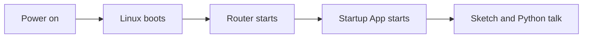

{:class="cover"}

---

A project is finished when it runs without you. Right now your Q Board only works while App Lab is open and you press **Run**. In this lesson we make it start by itself the moment the board gets power. This is stage 8 of the Q Board, and there is no new code, only a setting.

---

## Two ways to set it

Only one App can be the startup App. If you choose another, it replaces the first.

### In App Lab

1. Open your App.
2. Select the arrow next to the App name, near the top left.
3. Enable **Run at startup**.

You can also find it in the App's menu in the Apps list.

### From a terminal

You can do the same on the board, in an ADB shell or SSH session (see [lesson 10](/learn/arduino_uno_q/10_linux_survival_kit.html)). First find your App's ID. Your own Apps start with `user:`. Copy the ID of your Q Board from the list, because it is easy to mistype.

```bash
arduino-app-cli app list
```

Then set it as the default App, using the ID you copied.

```bash
arduino-app-cli properties set default <app ID>
```

And check what is set:

```bash
arduino-app-cli properties get default
```

---

## What happens at power-on

The board starts that App every time it gets power, with no computer attached. It is not instant, because Linux has to boot first.



The LED matrix shows the boot animation for about 20 to 30 seconds. Your App's output cannot appear before Python is up, because Python does the drawing in the Q Board. So a quiet matrix for half a minute is normal, not a fault.

### Power for a stand-alone board

With no computer to power the board, give it one of these:

- a USB-C 5 V 3 A supply or power bank
- 5 V on the 5V pin
- 7 to 24 V on VIN

---

## Design for the gap

There is a stretch where the microcontroller is awake and Python is not, and Python can also stop later. Decide what the sketch should do on its own in those moments.

You already did this in [lesson 8](/learn/arduino_uno_q/08_the_sketch_calls_python.html): the sketch kept a default limit, so LED 3 kept working while Python was away. Follow the same habit in your own projects. If you build a robot, its safety stop belongs in the sketch, not in Python.

---

## The headless checklist

A headless board has no screen and no App Lab open. Here is how to live with that.

| Question | Answer |
| --- | --- |
| How do I see it? | Open the web page from [lesson 11](/learn/arduino_uno_q/11_a_web_page_for_your_project.html) at `http://<boardname>.local:7000`. Or follow the Python output over SSH with `arduino-app-cli app logs <app ID> --follow`. Or connect App Lab over the network. |
| How do I stop it? | Use **Stop** in App Lab over the network, or `arduino-app-cli app stop <app ID>` over SSH. |
| How do I update it? | Edit it in App Lab over the network and press **Run**. |
{:class="table table-single"}

Before unplugging a board you care about, run `sudo halt` over SSH, wait, then unplug it. Lesson 10 explains why.

---

## Try it Yourself

1. **Turn it on.** Enable **Run at startup** for your Q Board in App Lab. Unplug the board and plug it back in. Count how long the matrix takes before your App appears.
2. **Check from the terminal.** Over SSH, run `arduino-app-cli properties get default`. Does it show the ID you expect from `arduino-app-cli app list`?
3. **Challenge: go headless.** Power the board from a USB-C power bank or wall supply, with no computer attached. Open the web page on your phone to prove the App is running, then stop it with the command from the checklist.

---

## Common Issues

**Problem**: The App does not start at power-on.
**Solution**: Run `arduino-app-cli properties get default` and check it is the App you want.
**Why**: Only one App can be the startup App. If you set another since, it replaced yours.

**Problem**: It works on USB from my computer but not from a power bank.
**Solution**: Use a supply or power bank that can give 5 V at 3 A.
**Why**: The board needs a USB-C 5 V 3 A supply, and a weaker one cannot run it reliably.

**Problem**: The web page cannot be reached after I moved to a new network.
**Solution**: Reconnect the board to the new Wi-Fi with App Lab over USB, or use the command-line route in the [Wi-Fi setup post](/blog/arduino-uno-q-wifi-setup.html).
**Why**: The board only knows the Wi-Fi it was set up with.

---

## Check your understanding


? You enable **Run at startup** for a second App. What happens to the first one?
- [ ] Both start at power-on
- [x] The second replaces it, because only one App can be the startup App
- [ ] The first is deleted from the board
> Only one App can be the startup App. Choosing another replaces it. The first App is not deleted.

? The board has just been powered on and the matrix is still showing the boot animation. Why does your App not show anything yet?
- [ ] The sketch has crashed
- [ ] Run at startup is switched off by default after every boot
- [x] Linux has to boot first, and Python does the drawing, so nothing appears until Python is up
> The boot animation lasts about 20 to 30 seconds. Your App starts after that.

? Where should a robot's safety stop live?
- [ ] In Python, because it has more memory
- [x] In the sketch, so it still works if Python is not there yet or has stopped
- [ ] In the web page
> The sketch keeps running when Python is away, as lesson 8 showed with the default limit.

