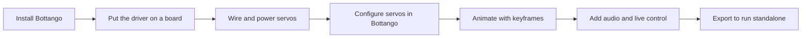

{:class="cover"}

---

Ahoy there makers! Have you ever wanted a puppet that nods, a prop that jumps out at trick-or-treaters, or a parrot that moves its head to a song? Let's build one, without writing a single line of code.

{:class="img-fluid w-100"}

---

## Overview

Bottango is free animation software for robots and animatronics. You build or import a character, attach servos to its joints, and animate it on a timeline with keyframes, much as you would in animation software. Bottango (<https://www.bottango.com>) can drive your hardware live over USB, or export your animations as Arduino-compatible code so the board can play them on its own.

Bottango runs on Windows, Mac and Linux, and the software is free to download. The Arduino-compatible driver that runs on your board is open source. Always check the official site for the current system requirements and licence terms.

Here is the journey we'll take:

## Course Content

- Installing Bottango and finding your way around
- Putting the Bottango driver on an Arduino or ESP32 board
- Wiring servos and powering them safely
- Setting up servos in a project
- Creating motion with keyframes and easing
- Making animations interactive
- Syncing movement to audio
- Exporting for standalone playback
- Controlling servos live with a gamepad

## Key Results

After completing this course, you will be able to:

- Set up Bottango with your Arduino or ESP32 board
- Wire servos with a separate power supply and a common ground
- Create smooth, lifelike motion without code
- Sync servo movements to music
- Control servos live with a gamepad
- Export an animation so it runs without your computer

## What you'll need

- A Windows, Mac or Linux computer
- An Arduino Uno R3 or an ESP32 board, with a data-capable USB cable
- One to three hobby servos, such as SG90 or MG90S
- A separate 5V power supply for the servos (a bench supply, battery pack or servo shield)
- Jumper wires, and a breadboard if you like
- Optional: a USB gamepad, and the Arduino IDE (free from arduino.cc)

## How the course works

**One idea per lesson.** Each lesson starts with what you will be able to do, teaches one step, and ends with exercises and a short quiz. Your quiz score is kept in your browser and shown in the sidebar.

**Hardware optional at first.** You can learn the timeline in lessons 5 to 7 with the on-screen simulation alone, though the real thing is more fun.

**Checked against the docs.** Bottango is updated often. We checked the course against the official documentation at [docs.bottango.com](https://docs.bottango.com), but button names and menus move between versions. If something looks a little different, trust the official docs.

**Mistakes are normal.** Look at the Common Issues list in each lesson before assuming something is broken.

## Prerequisites

You do not need to know how to code. A little electronics helps: [Electronics basics](/learn/electronics_basics/) covers power, ground and breadboards, and [Motors and motor drivers](/learn/motors_and_drivers/) explains why motors need their own power.

## What's Next

After this course, try the [Robot Eye Mechanism](/learn/eye_mechanism/) course, which is full of servo-driven movement, or [Robotics 101](/learn/robotics_101/) to see how robots are put together.

> **Teachers**: this course suits learners aged about 11 and up, working in pairs. Allow 30 to 45 minutes per lesson, and a double lesson for wiring and the board setup (lessons 2 to 4). Each pair needs one computer, one board, one to three servos and a separate 5V supply, so plan for shared kit. Teach the power rules before anyone plugs anything in. School computers often block software installs and USB access, so ask your IT team to install Bottango and the Arduino IDE beforehand. Lessons 1, 5, 6 and 7 can be done with no hardware using the on-screen simulation.

Ready? Let's install Bottango.
