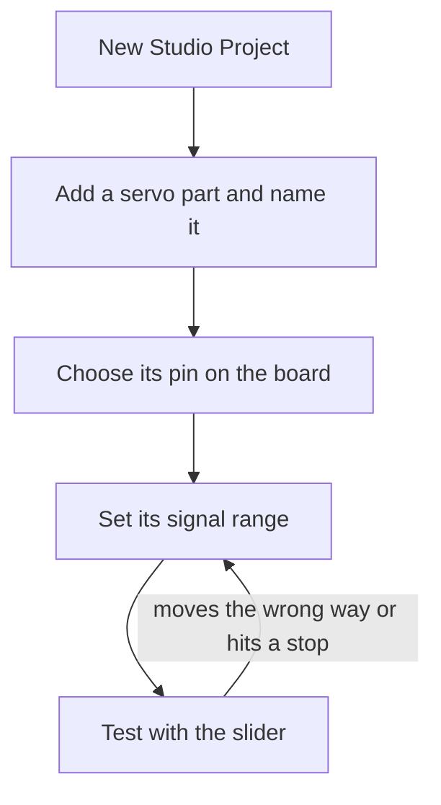

{:class="cover"}

---

By the end of this lesson you will be able to add a servo to a Bottango project, tell it which pin it is on, and test it with the slider.

Your servos are wired and your board is connected. Now we tell Bottango what is plugged in where. Think of it as introducing each servo by name: "this is the Head servo, and it lives on pin D3."

> **Note**: Bottango's docs organise a project into structures, joints and motors, and menu names change between versions. The steps below keep Kev's original wording. If a button has a different name on your screen, look for the closest match, and check the Motors and Hardware Drivers pages of the [Bottango docs](https://docs.bottango.com).

## Step 1: Create a new project

1. Open Bottango.
2. On the start screen, click **New Studio Project**.
3. Give your project a name, for example "Servo Test Rig".
4. Choose where to save it on your computer.

Save often, and keep your project in a folder with a simple path.

## Step 2: Add a servo

1. Add a servo to the scene. It appears in the **Parts** panel on the left.
2. Rename it to something meaningful, such as "Head", "Jaw" or "Wing". You will be much happier with names than numbers when you have five servos.

In the parrot project from lesson 1, the servos have names like `HeadRotationServo` and `HeadTiltServo`. Good names tell you what each servo does.

## Step 3: Assign a pin

Select the servo and open its setup. The part's setup includes a **Connection** section where you choose the **Pin** it is wired to, for example pin 3 for D3 on an Uno. The pin must match the real wiring. If you are using a PCA9685 servo board instead, you choose the I2C address and the channel on that board.

Next, set the servo's **signal range**. Bottango's default range is 1000 to 2000 microseconds, which is deliberately cautious. Many servos can do more, so the docs suggest trying 600 to 2400 if you are unsure and adjusting until it suits your servo. Go slowly and stop if the servo strains at either end.

## Step 4: Test

Turn on **Master Live** and drag the servo's slider. It should move in real time. If it hums or grinds at the end, you have set the range too wide, so narrow it.

## Step 5: Add more servos

Repeat for each servo. Give each a unique pin. If you assign two servos to the same pin, they will both receive the same signal and move together.

## How many servos?

An Uno R3 is limited to 8 servos directly (or 5 with a PCA9685), while an ESP32 board handles 16, according to the Bottango docs. Older versions of this lesson said six, so go by the current docs.

## Common Issues

- **Problem**: The slider moves but the servo does not.
- **Solution**: Check that Master Live is on, the board is connected in the **Hardware** window, the servo supply is on and the pin number matches your wiring.
- **Why**: The slider only sends motion to the real servo when the whole chain from app to board to servo is working.

- **Problem**: The servo does not reach its full range of movement.
- **Solution**: Widen the signal range a little at a time, for example from 1000 to 2000 towards 600 to 2400.
- **Why**: Each servo model has its own range, and Bottango's default is deliberately conservative.

- **Problem**: The servo moves the wrong way.
- **Solution**: Look for a reverse or invert option in the servo's setup, or swap the minimum and maximum if your version allows it.
- **Why**: Servos are mounted in different directions, so the direction depends on your build.

- **Problem**: Two servos move together.
- **Solution**: Give each servo its own pin.
- **Why**: They are listening to the same signal.

> **Teachers**: save projects to a named folder on the shared drive or a USB stick, as lab computers are often wiped between classes. Set range limits before anyone fixes a horn to a servo, to protect the gears from pupils who drag the slider to the extremes.

## Try it Yourself

1. Create a project called "Servo Test Rig" and add one servo named after its job.
2. Move the slider slowly from one end to the other. Where does it start to strain?
3. Narrow the signal range so the servo never strains, and note your values.
4. Challenge: add a second servo on a different pin and make them move in opposite directions.

## Check your understanding


? What must the pin in Bottango match?
- [ ] The name of the project
- [x] The pin you wired the servo's signal wire to
- [ ] The USB port number
> The pin setting tells Bottango which output to send the servo signal to.

? What is Bottango's default signal range?
- [ ] 0 to 180 degrees
- [x] 1000 to 2000 microseconds, which is deliberately conservative
- [ ] 2500 to 5000 microseconds
> The lesson says the default is conservative and you can widen it, for example to 600 to 2400, while watching for strain.

? Two servos move together. What is the likely mistake?
- [ ] The servos are too small
- [x] They are assigned to the same pin
- [ ] Master Live is off
> Two servos on one pin receive the same signal.

