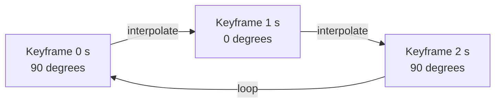

{:class="cover"}

---

By the end of this lesson you will be able to create a looping animation with keyframes and smooth it with easing.

Now for the fun part. Instead of telling a servo "go to 90 degrees", we tell it "be at 90 degrees at second 0, and at 0 degrees at second 1", and Bottango works out everything in between. That is the idea behind **keyframes**.

{:class="img-fluid w-100"}

> **Note**: button names and shortcut keys differ between versions of Bottango. Kev's original steps are kept here, and the official [Starting Animating](https://docs.bottango.com) pages in the docs are the final word.

## Step 1: The timeline

The Bottango timeline works like animation software:

- Time runs from left to right.
- Each servo gets its own track.
- A **keyframe** says where a servo should be at a particular moment.

Start in the **Animate** view and create a new animation from the **Animations** panel. You can use **New Empty Animation**, or **New Example Animation** to see how a finished one is built. An animation's duration is set from its settings button, and the docs say you enter it as minutes, seconds and frames.

## Step 2: Add your first keyframes

1. Select a servo.
2. Move the timeline cursor to a time.
3. Set the servo position with the slider.
4. Add a keyframe at that point.

Then repeat at other times. For a simple back-and-forth movement:

| Time | Position |
|------|----------|
| 0 s | 90 degrees |
| 1 s | 0 degrees |
| 2 s | 90 degrees |
{:class="table table-single"}

Press play and the servo sweeps out and back. Bottango fills in the movement between your keyframes, which is called **interpolation**.

## Step 3: Make it feel alive with easing

If a servo moves at a constant speed it looks like a machine. Real things speed up and slow down. Bottango lets you change the **curve** between keyframes, and has a graph view for editing the curves by hand. The docs list **Graph View** and **Editing Keyframes** as the places to look.

- Drag keyframes to change their timing.
- Use ease-in and ease-out style curves so the movement starts and stops gently.
- Close keyframes make fast movement, and wide gaps make slow movement.

## Good habits

- Start with slow, wide movements, then refine.
- Make the last keyframe the same as the first, so a loop does not jump.
- Keep your servo inside its safe range. Pushing a servo to its mechanical limits makes it strain.
- Save often, and use undo when you slip.

## Common Issues

- **Problem**: I added keyframes but the servo does not move.
- **Solution**: Check the keyframes have different positions, and that Master Live is on and the board is connected.
- **Why**: Identical keyframes mean there is nothing to interpolate, and Master Live must be on for the real servo to follow.

- **Problem**: The animation is jerky or robotic.
- **Solution**: Use easing curves on your keyframes, and avoid very large jumps over very short times.
- **Why**: A constant speed looks mechanical, and a big jump asks the servo to move faster than it can.

- **Problem**: The loop jumps at the end.
- **Solution**: Make the last keyframe match the first.
- **Why**: Otherwise the servo snaps back when the animation restarts.

- **Problem**: The animation stops partway through.
- **Solution**: Check the animation's duration in its settings and extend it.
- **Why**: Playback stops at the end of the animation, however many keyframes you placed.

## Try it Yourself

1. **Wave**: make a 3-second animation that moves a servo from 0 to 180 degrees and back. Check the servo stays inside a safe range first.
2. **Easing experiment**: copy the same motion and give it different curves. How do they look and feel different?
3. **Two servos**: make one servo move up while the other moves down, and swap at the 2-second mark.
4. **Breathing**: make a loop that moves slowly from 90 to 95 degrees and back over about four seconds, with smooth easing.

> **Teachers**: set a safe servo range before pupils animate, so keyframes at 0 or 180 cannot drive a horn into a stop. Pupils often fix a horn, set a keyframe and are surprised by sudden movement, so keep hands clear and ask them to announce "going live" before turning on Master Live.

## Check your understanding


? What does a keyframe describe?
- [ ] The colour of a servo wire
- [x] Where a servo should be at a specific moment
- [ ] The USB port speed
> Keyframes mark positions at times, and Bottango fills in the rest.

? Why use easing curves?
- [ ] They make servos draw less power
- [x] They make movement speed up and slow down, so it looks more natural
- [ ] They are needed to save the project
> Constant speed movement looks mechanical.

? An animation loops with a jump at the end. What should you check?
- [ ] That the servo has a separate power supply
- [ ] That the first keyframe is deleted
- [x] That the last keyframe matches the first
> The servo snaps back to the start position if the end does not match.

