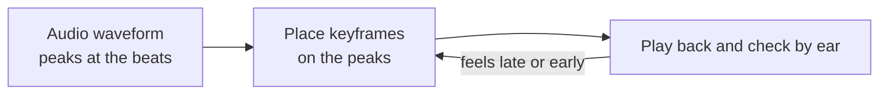

{:class="cover"}

---

By the end of this lesson you will be able to add an audio track to an animation and place keyframes against its waveform.

A puppet that moves in time with a voice or a song feels alive. Bottango lets you load audio onto the timeline, see its waveform, and place keyframes exactly where the beat or the syllable lands.

> **Note**: the Bottango docs cover this under **Audio and Video**, with pages on importing audio and video and on audio on hardware. Button names may have moved in newer versions, so check there if yours looks different.

## Step 1: Add an audio track

1. Open your project and the animation you want to score.
2. Use the add audio option in the animation to import a sound file. Bottango's docs list audio and video import as supported, and the Crash Course includes an "Add Audio" step. Check the docs for the file types your version accepts.
3. The audio waveform appears alongside your servo tracks.

Short, clean clips work best. A 10 to 30 second clip is plenty for a first try.

## Step 2: Line up keyframes with the waveform

1. Play the audio with the timeline preview.
2. Use the waveform as a guide: loud peaks usually mean a beat, and gaps mean silence.
3. Zoom in on the timeline to place keyframes precisely.

## Step 3: Simple lip-sync

To make a jaw talk:

1. Assign a servo to the jaw or mouth.
2. Add a keyframe with the jaw open at each strong syllable, and one with it closed in between.
3. Use easing so it opens and closes naturally.

A tip from animators: you do not need to match every sound. Open the jaw on the strong, loud parts of words, and the brain fills in the rest.

## Where does the sound play?

By default, Bottango plays audio on your computer's speakers, while the servos move through the board. The docs also have an **Audio on Hardware** page for playing sound from the hardware itself. Because audio and servo commands travel separately, timing can drift if you use Bluetooth speakers, which add a delay. Use wired speakers for tight sync.

## Example: a dancing robot

1. Load a short music clip.
2. Add a nod on each beat of the first verse.
3. Add bigger movements for the chorus.
4. Loop the playback and refine until it feels right.

## Common Issues

- **Problem**: The movement seems late compared to the sound.
- **Solution**: Move your keyframes a little earlier, and use wired speakers.
- **Why**: Servos take time to move and wireless speakers add delay, so the movement needs to start before the sound.

- **Problem**: I cannot place a keyframe exactly on the beat.
- **Solution**: Zoom in on the timeline.
- **Why**: At a wide zoom each pixel covers a lot of time.

- **Problem**: The audio file will not load.
- **Solution**: Check the file type against the docs, or export your clip as a common type such as WAV or MP3 and try again.
- **Why**: Not every audio format is supported.

> **Teachers**: only use audio you have the right to use. Pupils love to import chart songs, but these are protected by copyright, and recordings of themselves speaking are a better choice. If you use voice recordings of pupils, get permission and tell them where the files will be stored.

## Try it Yourself

1. **Beat matching**: load a 5 to 10 second clip with a clear beat and make a servo nod on each beat.
2. **Lip-sync**: record yourself saying "Hello, I am a robot!" and make a jaw open on each strong syllable.
3. **Two-servo dance**: make one servo move left and right with the melody, and another bob with the drums.
4. Challenge: add a "wake up" movement at the start of the clip and a "sleep" pose at the end.

## Check your understanding


? How can you place keyframes precisely against audio?
- [ ] Turn off the waveform
- [x] Use the waveform as a guide and zoom in on the timeline
- [ ] Always use the slowest easing
> The waveform shows beats and zooming in gives fine control.

? Why might movement look late compared to the sound?
- [x] Servos need time to move, and wireless speakers add delay
- [ ] The animation has too many keyframes
- [ ] The servo is wired backwards
> Start the movement earlier, and use wired speakers for tight timing.

? What is a good first lip-sync approach?
- [ ] Match every single sound
- [x] Open the jaw on the strong syllables and close it in between
- [ ] Keep the jaw still
> You do not need to match every sound.

