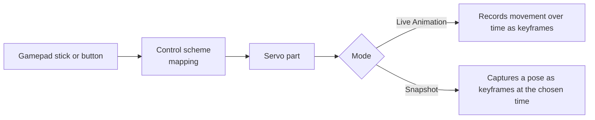

{:class="cover"}

---

By the end of this lesson you will be able to map a gamepad to servos with a control scheme and use it to puppeteer or record an animation.

Want to perform your robot like a puppeteer? Bottango can take live input, such as a gamepad, and use it to move servos in real time. You can perform it live, or record your performance as keyframes and tidy them afterwards.

> **Note**: this lesson follows the **Recording and Puppeteering** pages of the [Bottango docs](https://docs.bottango.com). Older versions of this lesson listed menu names such as Devices and Gamepad Settings, which we could not confirm. The names for control scheme settings may differ in your version.

## What is a control scheme?

The docs define a control scheme as "a set of mappings between parts and inputs", along with its settings. A project can have as many as you like, for example one for the head and one for the arms.

## Two types of scheme

The **Control Scheme Type** setting has two choices:

- **Live Animation** (the default): records the live input over time.
- **Snapshot**: lets you set a pose with live input, and then capture it as keyframes at the selected time. Snapshot schemes replace the record button with a camera icon.

Live Animation suits a performance, such as a talking beak. Snapshot suits poses, such as a set of facial expressions that you place carefully on the timeline.

## Step 1: Plug in your gamepad

The docs list a gamepad as a supported recording input. Connect it to your computer by USB, and if it is not recognised, restart Bottango with the gamepad already plugged in.

## Step 2: Make a control scheme

1. Open the control scheme editor in the Animate view and choose to create or edit a scheme.
2. Map a stick or button to a servo part.
3. Set the range so the input travels across the servo's safe movement, not beyond it.

## Step 3: Perform and record

1. In the Animate view, pick the active scheme from the dropdown. Choose none to switch recording off.
2. Make sure Master Live is on so the real servos follow.
3. Record, move the stick, and stop.
4. Play back what you recorded and tidy the keyframes by hand as in lesson 5.

## Tips for smooth control

- Keep the servo's safe range tight, so a hard push on a stick cannot overdrive it.
- Use one axis per servo until you are confident.
- Tidy recorded movement afterwards. Raw hand movement has small wobbles you can smooth.

## Common Issues

- **Problem**: Bottango does not see my gamepad.
- **Solution**: Plug it in before starting Bottango, then restart Bottango and check again.
- **Why**: Programs commonly look for controllers when they start.

- **Problem**: The servo moves the wrong way when I push the stick.
- **Solution**: Look for an invert option in the scheme mapping, or swap the range ends.
- **Why**: Different controllers and servos point in different directions.

- **Problem**: The servo jitters.
- **Solution**: Look for smoothing or dead-zone settings in the control scheme, and tidy the recorded keyframes afterwards.
- **Why**: Analogue sticks never sit perfectly still, so small noise reaches the servo.

- **Problem**: I recorded but nothing happens when I play back.
- **Solution**: Check that an active scheme is selected before recording, and that the animation has keyframes after the recording.
- **Why**: Selecting none disables recording.

> **Teachers**: gamepads are good for sharing, but one performer at a time means others wait. Plan for pairs, with one performer and one "safety" person who watches the servo supply and can switch it off. Check USB gamepads work on your lab computers before the lesson, as some managed machines block them.

## Try it Yourself

1. Map one stick axis to one servo and move it live. How smooth can you make it?
2. Record a 10 second performance and play it back. Tidy it up using keyframes.
3. Make a Snapshot scheme with three poses (neutral, look left, look right) and capture each on the timeline.
4. Challenge: map two axes to a head with two servos, and perform a short "looking around" animation.

## Check your understanding


? Which Control Scheme Type records live input over time?
- [x] Live Animation
- [ ] Snapshot
- [ ] None
> Live Animation is the default and records over time. Snapshot captures one pose.

? What does a Snapshot scheme give you instead of the record button?
- [ ] A speaker icon
- [x] A camera icon
- [ ] A save icon
> The lesson says Snapshot schemes replace the record button with a camera icon.

? How do you switch recording off in the Animate view?
- [ ] Unplug the gamepad
- [x] Select none as the active scheme
- [ ] Delete the animation
> Choosing none from the active scheme dropdown disables recording.

