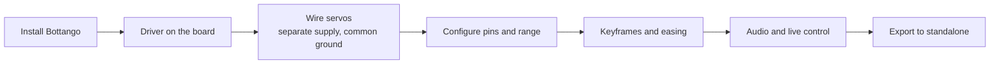

{:class="cover"}

---

By the end of this lesson you will be able to describe the whole Bottango workflow from install to standalone prop, and choose a project to build next.

Congratulations, you have finished **Bottango Basics**! You can now take an idea for a moving character and turn it into servo movement without writing code. Let's recap, then plan what to build.

## What you have learned

| Lesson | What you can now do |
|--------|---------------------|
| Install | Download Bottango and find the Parts, Animations and Hardware controls |
| Board | Put the open-source driver on a board and connect the app |
| Wiring | Power servos from a separate supply with a common ground |
| Configure | Assign a servo to a pin and set its signal range |
| Motion | Build keyframe animations with easing |
| Interactivity | Choose between control schemes, external control and playback logic |
| Music | Time movement to an audio waveform |
| Export | Export animations so a board can play them alone |
| Gamepad | Perform and record live with a control scheme |
{:class="table table-single"}

## Project ideas

- A talking robot head that lip-syncs to a recording
- A Halloween prop that plays an animation when someone walks past, using custom playback logic
- A puppet with a gamepad control scheme
- A cosplay or theatre prop with an exported, standalone animation
- A servo drummer that plays along with a track

Pick one and plan it first. Which servos does it need? What supply will power them? Which animations will it play, and how will it react to people?

## Where to go next

- Explore the [Bottango documentation](https://docs.bottango.com) for features we did not cover, such as 3D models, inverse kinematics, Dynamixel and stepper motors
- Join the Bottango community through the links on [bottango.com](https://www.bottango.com)
- Learn how motors and servos are driven in [Motors and motor drivers](/learn/motors_and_drivers/)
- Build servo-driven movement with the [Robot Eye Mechanism](/learn/eye_mechanism/) course
- See the bigger picture of how robots are put together in [Robotics 101](/learn/robotics_101/)
- If you want to move from Arduino code to MicroPython, try [Arduino to MicroPython](/learn/arduino_to_python/)
- Control many servos from code with a PCA9685 in [Building a Robot Arm with Raspberry Pi and PCA9685](/learn/pca9685/)

## Common Issues

- **Problem**: My project worked last week and now nothing moves.
- **Solution**: Check in order: servo supply on, grounds joined, USB cable and port, driver on the board, Hardware connection, Master Live on, pins match.
- **Why**: A servo setup is a chain, and a fault anywhere along it stops the movement.

- **Problem**: I am not sure if the fault is in Bottango or my wiring.
- **Solution**: Test the servo and board with a plain Arduino example first, then add Bottango.
- **Why**: The Bottango docs advise confirming the hardware works without Bottango before troubleshooting the software.

> **Teachers**: this makes a good end-of-term project. Ask pairs to plan, build and demonstrate a character in two or three lessons, with a power and safety check from you before power goes on. Assess the plan, the wiring diagram and a short reflection as well as the finished prop, since hardware failures are common and not the learner's fault.

## Try it Yourself

1. Write a one-page plan for your own character: its servos, supply, animations and how it reacts.
2. Build the plan with one servo, and show it working.
3. Add a second animation and switch between them.
4. Challenge: export it so it runs without your computer.

## Check your understanding


? What is the right order when something stops moving?
- [ ] Rewrite the animation
- [x] Check the servo supply, grounds, USB, driver, Hardware connection, Master Live and pins
- [ ] Reinstall your operating system
> A servo setup is a chain, so check each link in turn.

? How can a board play an animation with no computer?
- [ ] By using Master Live
- [x] By exporting the animation as code and uploading it
- [ ] By using a gamepad
> Exported code runs on the board by itself.

? What is the safest way to power several servos?
- [ ] From the board's 5V pin
- [x] From a separate supply with its ground joined to the board's ground
- [ ] From the computer's USB port
> Servos can draw more current than the board can supply, and the grounds must be shared.


Thanks for taking this course. Now get out there and make something that moves!
