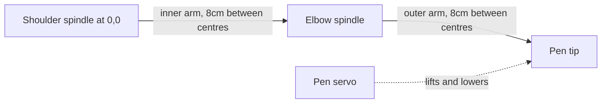
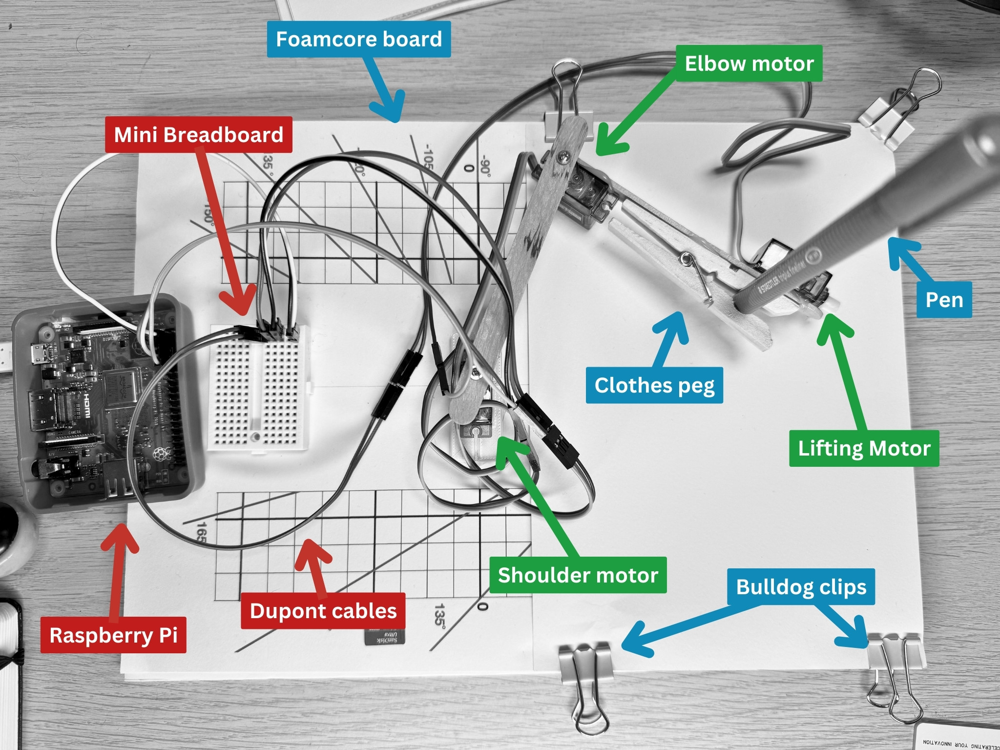
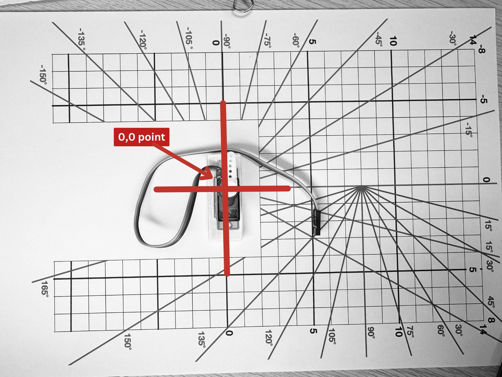
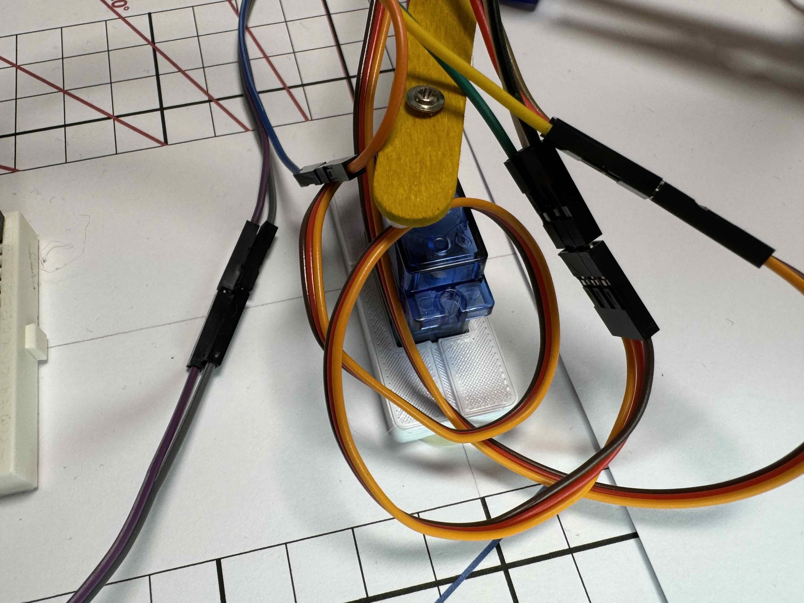
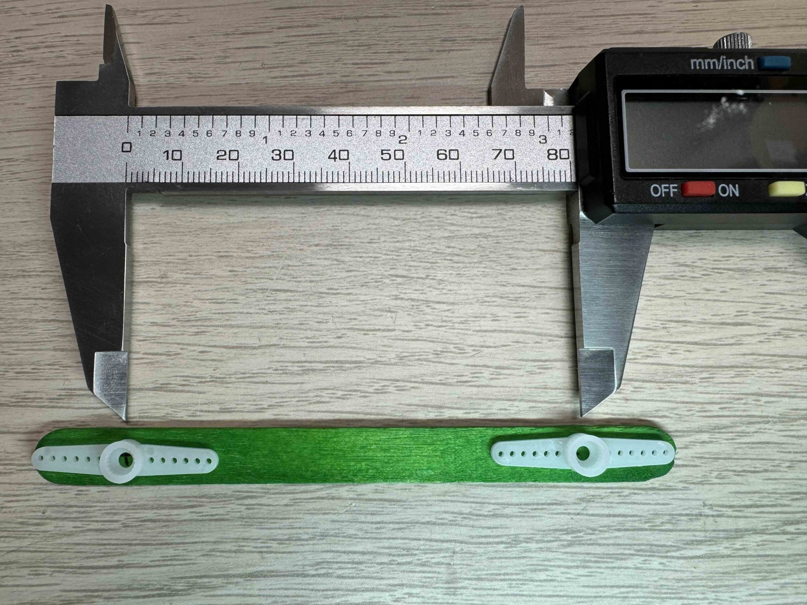
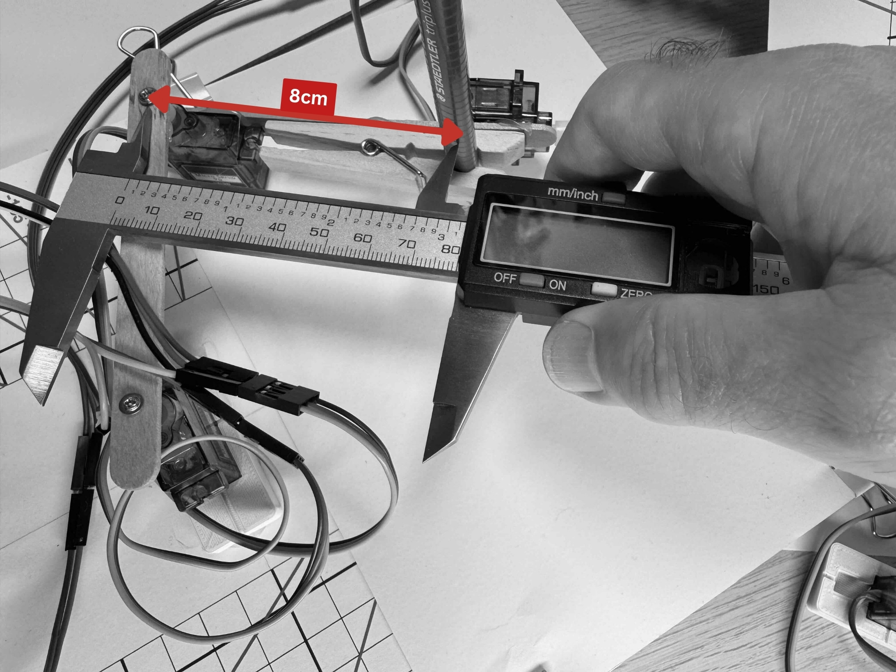
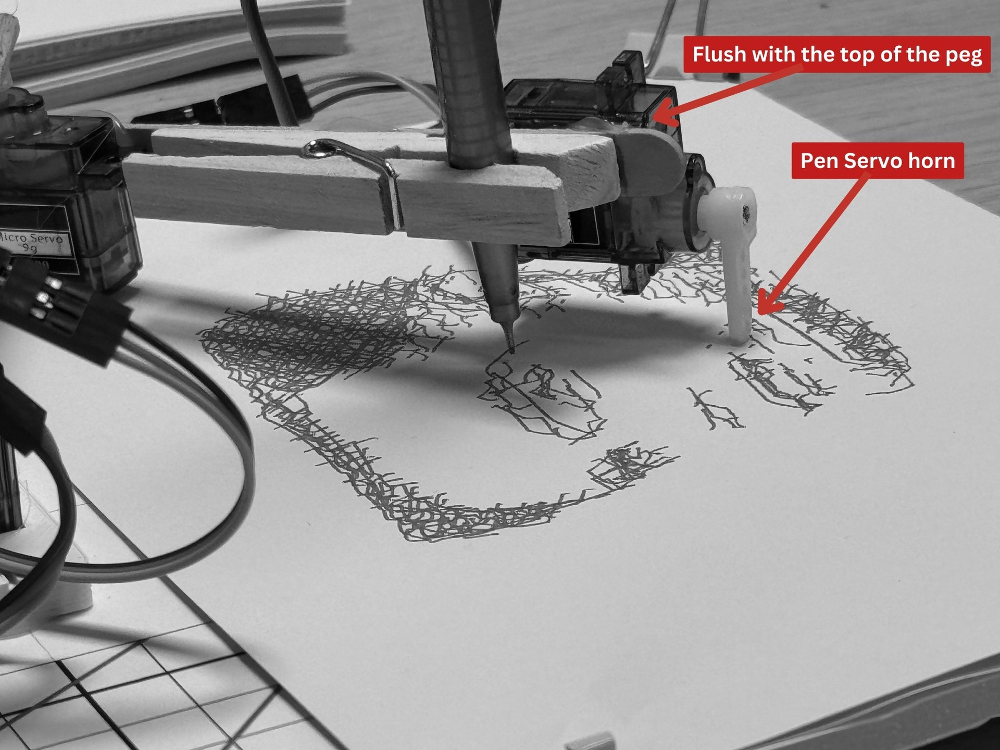

{:class="cover"}

---

By the end of this lesson you will be able to build the base, inner arm, outer arm and pen lift, with the two arm lengths set correctly at 8cm between centres.

## Why the measurements matter

The BrachioGraph library does geometry. Given an x, y position on the paper it works out the two servo angles that put the pen there, and to do that it has to know how long the arms are. The default is 8cm for each arm, measured between rotation centres (the middle of one servo spindle to the middle of the next joint, and from the elbow to the pen). If your arms are not 8cm, every line you draw will be slightly out. The official build guide says the same: both distances should be exactly 8cm.

{:class="w-100 card-hover card-shadow rounded-3"}

> **Teachers**: Hot glue guns burn skin and glue strings stick to everything, so set up a glue station with a heat-proof mat and have one adult or confident student in charge of it per table. Pilot holes in sticks are best made with a bradawl or a hand drill with a 1 to 2mm bit, never with a craft knife. Cutting foam board needs a craft knife, so pre-cut the bases if you are short on supervision. Glue needs a minute or two to set, so plan a break in the lesson.

---

## Step 1: Build the base

1. Cut the foam core board or card to roughly A4 size. The paper we draw on will be A5 (an A4 sheet cut in half).
2. Print the [base template](assets/template-grid.pdf) [^1] and stick it to the board with a glue stick. The grid has the 0,0 point marked on it, and the plotter's coordinates are measured from there.
3. Lift the shoulder servo 4 to 6mm above the board so the arm can swing freely. A few layers of card work well, or you can 3D print a [small spacer](assets/base.stl).
4. Hot glue the shoulder servo down, with the centre of its spindle exactly over the 0,0 point on the grid.

{:class="w-100 card-hover card-shadow rounded-3"}

{:class="w-100 card-hover card-shadow rounded-3"}

---

## Step 2: Build the inner arm

1. Draw a line along the middle of a lolly stick.
2. Glue the two servo horns to the stick so that their rotation centres are exactly 8cm apart. One horn will go on the shoulder servo, the other on the elbow servo.
3. If you like, drill a small pilot hole (1 to 2mm) either side and screw the horns on as well as gluing. This makes the joint less floppy.

{:class="w-100 card-hover card-shadow rounded-3"}

---

## Step 3: Build the outer arm

1. Glue the elbow servo to the second stick, with the servo's spindle in the right place for the 8cm distance.
2. Glue the clothes peg to the far end of the outer arm. The centre of the pen, once it is in the peg, should be exactly 8cm from the elbow spindle.
3. Glue the pen servo near the end of the outer arm. Its horn must be able to lift the pen clear of the paper and let it come back down.

{:class="w-100 card-hover card-shadow rounded-3"}

{:class="w-100 card-hover card-shadow rounded-3"}

Don't attach the arms to the servo spindles yet. That happens in lesson 4, after the servos have been moved to a known position by the code.

---

## Try it Yourself

1. Measure both arms from centre to centre with a ruler marked in millimetres. Write the lengths down. Are they within 1mm of 8cm?
2. Press the clothes peg onto a pen and check the pen tip sits where you measured 8cm. Adjust if not.
3. Challenge: the arm's reach decides the drawing area. Sketch the area two 8cm arms can reach from the 0,0 point. Then work out roughly why the official docs describe the drawing area as about 14cm wide and 9cm high.

---

## Common Issues

- **Problem**: Hot glue doesn't hold a servo in place.
- **Solution**: Roughen the surfaces with sandpaper, glue both sides, and hold the part for about 30 seconds.
- **Why**: Smooth plastic does not bond well with hot glue until it has been keyed.

- **Problem**: The arm lengths are not 8cm.
- **Solution**: Re-measure from centre to centre, not edge to edge, and reposition the part while the glue is warm.
- **Why**: The library assumes 8cm arms, and different lengths distort every drawing.

- **Problem**: A servo horn comes loose from the stick.
- **Solution**: Add small screws through pilot holes as well as glue.
- **Why**: The servo pushes with real torque on the horn, and glue alone can peel away.

- **Problem**: The foam board bends.
- **Solution**: Use thicker board or glue a second layer underneath, and keep it flat while it sets.
- **Why**: A warped base moves the servos and ruins the drawing geometry.

- **Problem**: The clothes peg won't hold the pen firmly.
- **Solution**: Wrap a little tape around the pen, or use a spring peg.
- **Why**: A pen that wiggles draws wiggly lines.

[^1]: Provided by <https://brachiograph.art>

---

## Check your understanding


? How far apart should the rotation centres be on each BrachioGraph arm?
- [ ] 4cm
- [x] 8cm
- [ ] 14cm
> Both arms are 8cm between centres, which is what the library assumes by default.

? Where should the shoulder servo's spindle sit on the template?
- [ ] At the bottom left corner of the paper
- [x] At the 0,0 point on the grid
- [ ] At the centre of the pen servo
> The plotter's coordinates are measured from the shoulder spindle at 0,0.

? Why is the shoulder servo raised 4 to 6mm above the base?
- [ ] To make it easier to reach the wires
- [x] So the arm can swing freely over the board
- [ ] To keep the servo cool
> Lifting the servo stops the arm from rubbing on the board as it moves.

