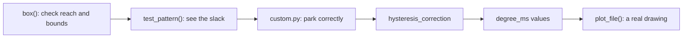

{:class="cover"}

---

By the end of this lesson you will be able to draw a box, a test pattern and a demo file, and improve the results by calibrating the parked pulse-widths, hysteresis correction and angle scaling in a `custom.py` file.

## Your first box

The drawing area is measured in centimetres, from the shoulder spindle at 0,0. The `bounds` for a box are `[left, bottom, right, top]`, which are the bottom-left and top-right corners. Put a sheet of A5 paper on the grid, tape it down, put a pen in the peg, and try:

```python
bg.box(bounds=[-2, 7, 2, 11])
```

That box spans x from -2 to 2 and y from 7 to 11, so it should be about 4cm by 4cm. Called with no bounds, `bg.box()` draws around the whole default drawing area, which is a great way to see how far your plotter reaches. Your lines will be a little wobbly. That is normal for this machine, and the rest of the lesson is about making them better.



---

## Test patterns and a demo drawing

```python
bg.test_pattern()
bg.test_pattern(reverse=True)
```

The pattern is a set of lines. Drawing it forwards and in reverse shows how far apart the lines land, because the arm's slack and friction make it stop short in one direction. Then try the demo file, which is a list of lines in a JSON file:

```python
bg.plot_file("images/demo.json")
```

> **Teachers**: Pens, paper and tape are cheap, but a plot can take several minutes, so give each group a timer and a small test pattern to run first. Plan for a spare pen per group, because a pen left down on the paper while the plotter pauses leaves a blot.

---

## Calibrating with custom.py

Instead of retyping settings each session, put them in a file. Inside the `BrachioGraph` folder, create `custom.py`:

```python
from brachiograph import BrachioGraph

bg = BrachioGraph(
    servo_1_parked_pw=1570,
    servo_2_parked_pw=1450,
)
```

The values 1570 and 1450 are the official docs' example for their own build. Yours will be different: the right numbers depend on how your horns happen to be fitted. To find your own, use `bg.set_pulse_widths(shoulder, elbow)` and nudge each value in steps of no more than 100 until the arms sit perpendicular to each other and to the drawing area, then write those values into `custom.py`.

Load it with:

```python
from custom import bg
```

---

## Correcting hysteresis

The motors are weak and the arms flex, so when you approach a position from one direction, the arm stops a little short, and from the other direction it stops short on the other side. That error is called hysteresis. Counter it by asking for a small overshoot:

```python
from brachiograph import BrachioGraph

bg = BrachioGraph(
    servo_1_parked_pw=1570,
    servo_2_parked_pw=1450,
    hysteresis_correction_1=10,
    hysteresis_correction_2=10,
)
```

Restart Python, import the plotter again, and compare:

```python
bg.test_pattern(both=True)
```

The official docs suggest trying correction values between 7 and 20.

---

## Fine-tuning the angle calculation

By default the library assumes that a change of 10 in pulse-width means a change of 1 degree. Your servos may disagree. To measure it:

1. Park the plotter and check that the inner arm is at -90 degrees.
2. Run `bg.set_angles(angle_1=0)`. Is the inner arm at 0 degrees? If not, adjust the pulse-width until it is.
3. Take the difference between that pulse-width and the -90 degree one, then divide by 90. That is your pulse-width change per degree.
4. Repeat for the outer arm.

Put your numbers in as `servo_1_degree_ms` and `servo_2_degree_ms`. The docs' example values are -9.8 and 10.1. Servo 1's value is negative because that servo is mounted so it turns the other way. If you get the sign wrong the arm moves the wrong way, so just flip it.

If you want to go further, the docs have a [more sophisticated calibration](https://www.brachiograph.art/tutorial/sophisticated-calibration/) using `bg.capture_pws()`, which records pulse-widths for each angle in both directions.

---

## No hardware? Use the virtual plotter

You can run the whole thing without servos. Create the plotter in virtual mode and add the on-screen turtle preview:

```python
from brachiograph import BrachioGraph

bg = BrachioGraph(virtual=True, turtle=True)
bg.box(bounds=[-2, 7, 2, 11])
bg.test_pattern()
```

The turtle window draws what the plotter would have drawn. You need tkinter available (we installed `python3-tk` in lesson 3).

---

## Try it Yourself

1. Draw a box in a different place using `bounds`. Check it fits within the default drawing area.
2. Run `bg.test_pattern()` with hysteresis correction at 0, 10 and 15. Which looks best?
3. Create a `custom.py` with your own parked pulse-widths and import it.
4. Challenge: calibrate `servo_1_degree_ms` and `servo_2_degree_ms` for your plotter and compare a before and after test pattern.

---

## Common Issues

- **Problem**: The box is squashed or skewed.
- **Solution**: Check the arm lengths are 8cm and calibrate the degree values.
- **Why**: The library's geometry assumes accurate arms and accurate angles.

- **Problem**: The pattern is wobbly or doubled.
- **Solution**: Add hysteresis correction and tighten the joints. The advanced calibration page suggests screwing the horns to the arms for less flex.
- **Why**: Slack in the joints means the arm lands on different points depending on direction.

- **Problem**: The arm moves in the wrong direction when I set degree values.
- **Solution**: Flip the sign of the `servo_*_degree_ms` value.
- **Why**: Servos can be mounted facing opposite ways.

- **Problem**: My changes in `custom.py` have no effect.
- **Solution**: Restart Python and import `custom` again.
- **Why**: Python only reads the file when you import it.

---

## Check your understanding


? What order are the four numbers in `bounds=[-2, 7, 2, 11]`?
- [ ] x1, x2, y1, y2
- [x] left, bottom, right, top
- [ ] top, right, bottom, left
> The bounds are the bottom-left and top-right corners, so left, bottom, right, top.

? What is hysteresis in this plotter?
- [ ] The pen running out of ink
- [x] The arm stopping short of its target, on a different side depending on direction
- [ ] The Pi overheating
> Slack and flex mean the arm falls short, and the error flips sign when approached from the opposite direction.

? Where should you get your parked pulse-width values from?
- [ ] Copy 1570 and 1450 from the lesson
- [x] Measure them on your own plotter
- [ ] Ask the Pi
> The numbers are per-build, so the lesson shows the method with the docs' example values.

