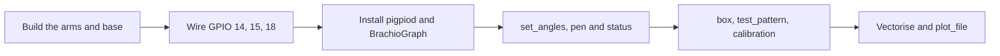

{:class="cover"}

---

By the end of this lesson you will be able to describe each stage of the BrachioGraph project, from build to plotted image, and choose what to try next.

## The whole journey

You went from a pile of lolly sticks to a robot that follows lines from a Python program. Here is the path you took:

---

## What each lesson taught

1. **Build**: two arms with 8cm between centres, a shoulder servo at 0,0 raised 4 to 6mm, and a pen lift.
2. **Wire**: shoulder on GPIO 14, elbow on GPIO 15, pen on GPIO 18, with power and ground shared.
3. **Setup**: the `pigpiod` service, a virtual environment, the BrachioGraph repository and its requirements.
4. **Code**: `BrachioGraph()`, `set_angles()`, `park()`, `pen.up()`, `pen.down()` and `status()`.
5. **Draw**: `box()`, `test_pattern()`, `plot_file()`, parked pulse-widths, hysteresis correction and degrees-per-pulse-width values in `custom.py`.
6. **Vectorise**: `image_to_json()`, `vectorise()`, `draw()` and `repeat_contours`.

The big idea is that no calibration number is universal. Every plotter is a little different, so you learned the method for finding your own numbers.

> **Teachers**: A good assessment is a calibration log. Ask each group to record their parked pulse-widths, hysteresis value and a photo or drawing of a test pattern before and after. It shows the learning and gives you something to mark. Allow 30 minutes for a final showcase where groups plot their favourite vectorised image.

---

## Try it Yourself

1. Redraw the same test pattern with your final calibration, and label what changed from your first attempt.
2. Choose a simple picture (a logo, a face outline) and vectorise it for a clean plot.
3. Challenge: read the [sophisticated calibration](https://www.brachiograph.art/tutorial/sophisticated-calibration/) page and decide whether it would improve your plotter.

---

## Common Issues

- **Problem**: My plots got worse after I changed settings.
- **Solution**: Go back to one change at a time, and keep a note of each value.
- **Why**: Several calibration settings interact, so changing them all at once hides which one helped.

- **Problem**: The plotter stopped moving after a reboot.
- **Solution**: Run `sudo pigpiod` again, reactivate the virtual environment and run Python from the `BrachioGraph` folder.
- **Why**: The official start-up steps do these things every session.

---

## Where next

- [Wall Drawing Robot Tutorial](/learn/scrawly_wally/) shows a very different way to draw with a robot.
- [Building a Robot Arm with Raspberry Pi and PCA9685](/learn/pca9685/) uses a servo controller board for a bigger arm.
- [Robotics 101](/learn/robotics_101/) puts servos and sensors in a wider context.
- [Python for beginners](/learn/python/) builds the language skills behind the code.

Resources: the [BrachioGraph documentation](https://www.brachiograph.art/) and the [BrachioGraph repository](https://github.com/evildmp/BrachioGraph). Credit goes to Daniele Procida and the BrachioGraph community for the design and the template grid.

---

## Check your understanding


? Why does every plotter need its own calibration numbers?
- [ ] The library has a different version each time
- [x] Servo horns and joints are never fitted identically
- [ ] The Pi changes the numbers on boot
> Each build is slightly different, so you measure your own pulse-widths and angle scaling.

? Which command must be running before you start the plotter in Python?
- [ ] `pip install`
- [x] `sudo pigpiod`
- [ ] `git clone`
> The pigpio daemon produces the servo pulses, and the official start-up steps run it each session.

? What does a `custom.py` file save you from doing?
- [ ] Wiring the servos
- [x] Retyping your calibration values every session
- [ ] Installing OpenCV
> `custom.py` holds your own BrachioGraph settings, so you import them rather than retype them.

